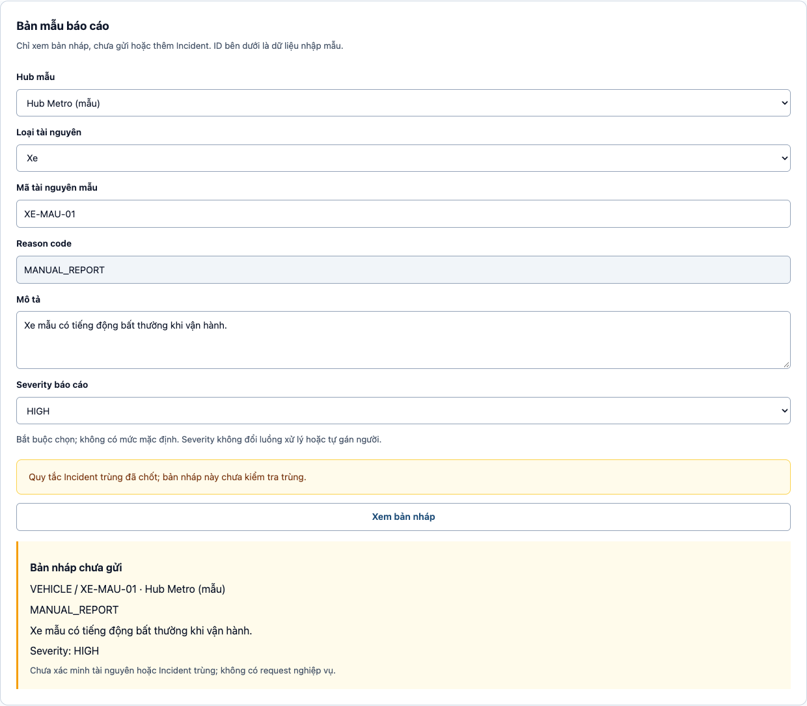

# Báo cáo module M6

**Bộ giả lập IoT, sự kiện và xử lý sự cố**

*Smart E-Mobility Hub — Công nghệ Phần mềm HK261*

| Người phụ trách | Phạm vi |
|---|---|
| Nguyễn Trần Hoàng Hiếu (TV6) | M6, DevOps và tích hợp |
| Module M6 | Mô phỏng dữ liệu thiết bị, cập nhật trạng thái tài nguyên, phát sự kiện và thiết kế quy trình quản lý sự cố. |

> **Phạm vi đã triển khai.** Simulator, API và màn hình điều khiển Simulator đã kết nối với backend. Luồng thiết bị cập nhật snapshot trong bộ nhớ và phát sự kiện qua Spring. Vòng đời Incident đã có ở tầng domain và được minh họa bằng giao diện dữ liệu mẫu. API quản lý Incident, lưu trữ M6 trong cơ sở dữ liệu và phát sự kiện sau commit thuộc thiết kế mục tiêu. Mục 7.4 đối chiếu hai phạm vi.

# 1. Functional requirements (§2.2)

Các yêu cầu mô tả hành vi của hệ thống. Cột **Phạm vi hiện tại** cho biết phần đã thực hiện và phần còn thuộc thiết kế.

| Mã | Tên FR | Mô tả yêu cầu | MoSCoW | Loại | Tác nhân kích hoạt | Phạm vi hiện tại |
|---|---|---|---|---|---|---|
| FR-M6-01 | Báo cáo sự cố thiết bị | Hệ thống phải cho phép Operator đã đăng nhập báo cáo xe hoặc cổng sạc bị lỗi. Báo cáo xác định Hub, loại và ID tài nguyên, lý do và mức độ; khi chọn `MANUAL_REPORT`, Operator phải nhập mô tả. Nếu dữ liệu hợp lệ và tài nguyên chưa có sự cố đang hoạt động, hệ thống tạo Incident ở `Reported` và trả ID, trạng thái. Nếu đã có sự cố đang hoạt động, hệ thống từ chối tạo trùng và trả ID, trạng thái của sự cố đó. | Must | Interactive | Operator | Form mẫu chỉ xem trước. Chưa có API tạo Incident hoặc kiểm tra trùng tại backend. |
| FR-M6-02 | Quản lý vòng đời sự cố | Hệ thống phải cho phép Operator xem danh sách và chi tiết Incident, lọc theo trạng thái, loại tài nguyên hoặc mức độ, phân công người xử lý và thực hiện Assign, Start, Resolve, Reopen, Close theo BR-M6-04/06. Khi cập nhật, hệ thống phải kiểm tra phiên bản mà Operator đã đọc. Yêu cầu dùng phiên bản cũ hoặc chuyển trạng thái không hợp lệ bị từ chối và không làm thay đổi bản ghi. | Must | Interactive | Operator | Đã có đồ thị chuyển trạng thái ở domain và giao diện mẫu. Chưa có API Incident, lưu trữ hoặc kiểm soát phiên bản. |
| FR-M6-03 | Tiếp nhận và xử lý dữ liệu thiết bị | Hệ thống phải tiếp nhận bản tin cho xe, chỗ đỗ và cổng sạc, gồm mã bản tin (`eventId`), Hub, loại và ID tài nguyên, trạng thái và thời điểm quan sát. Giá trị pin chỉ áp dụng cho xe, trong khoảng 0–100%. Hệ thống phải từ chối dữ liệu sai hoặc Hub/tài nguyên không khớp. Bản tin thường hợp lệ và chưa xử lý cập nhật snapshot theo loại và ID tài nguyên rồi phát `ResourceStateUpdated` với Hub, loại, ID và trạng thái. Gửi lại cùng mã đã xử lý thành công không làm lặp cập nhật hay sự kiện. | Must | Non-interactive | Sensor/Simulator | Đã xử lý bản tin Simulator theo danh mục mẫu và lưu snapshot trong bộ nhớ. Chống trùng áp dụng với mã đã hoàn tất còn trong bộ nhớ của tiến trình, tối đa 10.000 mã. Chưa kết nối cảm biến thật hoặc lưu snapshot vào DB. |
| FR-M6-04 | Mô phỏng định kỳ | Khi chế độ tự động được bật, hệ thống phải chạy `NORMAL_TICK` với seed đã cấu hình để sinh dữ liệu xe và pin, chỗ đỗ, cổng sạc. Mỗi bản tin đi qua cùng luồng xác thực, cập nhật và phát sự kiện như khi chạy thủ công. Khoảng chờ cấu hình cho demo là 5 giây sau lượt trước; nếu đến lượt định kỳ mà Simulator đang bận, bỏ qua lượt đó. | Must | Non-interactive | Bộ lập lịch | Đã có scheduler dùng chung luồng xử lý với chế độ thủ công. Scheduler mặc định tắt. |
| FR-M6-05 | Ghi nhận lỗi và thông báo để khóa tài nguyên | Khi nhận bản tin lỗi hợp lệ, hệ thống phải cập nhật snapshot và phát thông báo theo loại tài nguyên: xe phát `VehicleFailed`; cổng sạc phát `ResourceStateUpdated` với trạng thái `FAULTY`, rồi phát `ChargerFailed`. Thông báo lỗi phải xác định tài nguyên, Hub và lý do để module quản lý tài nguyên áp dụng biện pháp khóa hoặc xử lý tương ứng theo hợp đồng sự kiện. Trong thiết kế mục tiêu, hệ thống tạo Incident `Reported` với mức độ theo BR-M6-10 nếu đủ điều kiện BR-M6-06. Khi đã có sự cố đang hoạt động, bản tin lỗi mới không tạo thêm Incident hoặc phát lại sự kiện lỗi. | Must | Non-interactive | Dữ liệu lỗi thiết bị | Đã có snapshot trong bộ nhớ và phát sự kiện. Đã kiểm chứng M3 nhận `VehicleFailed` và chuyển xe mẫu sang `MAINTENANCE`. Phản ứng của M2/M4/M5 thuộc phạm vi tích hợp tương ứng. Chưa có tự tạo Incident, gán mức độ tự động hoặc chống trùng Incident tại backend. |
| FR-M6-06 | Chạy và theo dõi Simulator | Hệ thống phải cho phép Operator xem trạng thái Simulator, chế độ tự động và chu kỳ khi bật, rồi chọn `NORMAL_TICK`, `VEHICLE_FAILURE` hoặc `CHARGER_FAILURE` và nhập seed là số nguyên 64 bit có dấu. Kết quả lượt chạy hiển thị mã lượt, thời điểm, số bản tin đã xử lý, trùng, bị từ chối và danh sách sự kiện ghi nhận trong lượt chạy. Hệ thống phải báo lỗi nếu đầu vào không hợp lệ hoặc đã có lượt chạy đang thực hiện. | Must | Interactive | Operator | API và giao diện Simulator đã hoạt động. Giao diện kiểm tra seed là số nguyên 64 bit có dấu. Giới hạn kiểm tra kiểu JSON ở backend và tổng kết khi phát sự kiện lỗi được nêu tại §7.1. Điều khiển chế độ tự động chỉ đọc. |

# 2. Business rules and constraints (§2.4)

Các luật dưới đây mô tả điều kiện vận hành và kết quả cần bảo đảm. Những ràng buộc của Simulator được nêu riêng trong cùng bảng. Mục 7.4 ghi phạm vi hệ thống hiện thực thi được.

| Mã | Luật hoặc ràng buộc | Áp dụng khi | Liên quan FR |
|---|---|---|---|
| BR-M6-01 | Chỉ Operator được báo cáo thủ công, phân công và xử lý sự cố. Sự cố cũng có thể được ghi nhận tự động từ dữ liệu thiết bị. | Quản lý sự cố | FR-M6-01, FR-M6-02, FR-M6-05 |
| BR-M6-02 | Simulator chỉ chạy một kịch bản tại một thời điểm. Cùng một kịch bản và cùng tham số khởi tạo phải tái tạo được nội dung dữ liệu mô phỏng. | Chạy Simulator thủ công hoặc tự động | FR-M6-04, FR-M6-06 |
| BR-M6-03 | Chỉ xe và cổng sạc thuộc phạm vi ghi nhận sự cố thiết bị. Pin thấp tự nó không được xem là xe hỏng. Lý do báo cáo thủ công chỉ được dùng khi Operator lập báo cáo. | Phân loại lỗi thiết bị | FR-M6-01, FR-M6-03, FR-M6-05 |
| BR-M6-04 | Sự cố mới bắt đầu ở Reported. Các bước hợp lệ là Reported → Assigned → InProgress → Resolved → Closed. Chỉ sự cố đã giải quyết mới được mở lại từ Resolved về InProgress, theo BR-M6-06. Closed là trạng thái cuối. | Thay đổi trạng thái sự cố | FR-M6-01, FR-M6-02, FR-M6-05 |
| BR-M6-05 | Tình trạng kỹ thuật của cổng sạc được theo dõi riêng với việc cổng đang được sử dụng hay cấp cho một phiên sạc. Một cổng báo hỏng không được coi là sẵn sàng về kỹ thuật chỉ vì chưa có phiên sạc. | Đánh giá tình trạng cổng sạc | FR-M6-03, FR-M6-05 |
| BR-M6-06 | Mỗi tài nguyên chỉ có tối đa một sự cố đang hoạt động, bất kể lý do báo cáo. Reported, Assigned và InProgress là các trạng thái hoạt động. Báo cáo trùng không tạo sự cố mới hoặc sửa sự cố đang có. Khi sự cố cũ đã Resolved hoặc Closed và không còn sự cố hoạt động khác, một báo cáo mới có thể tạo sự cố mới. Không mở lại một sự cố nếu tài nguyên đã có sự cố hoạt động khác. | Tạo hoặc mở lại sự cố | FR-M6-01, FR-M6-02, FR-M6-05 |
| BR-M6-07 | Gửi lại một bản tin thiết bị với mã còn được ghi nhận là đã xử lý thành công không được làm lặp cập nhật hoặc phát lại thông báo. | Nhận lại dữ liệu thiết bị | FR-M6-03, FR-M6-05 |
| BR-M6-08 | Ghi nhận thiết bị hỏng và xử lý đặt chỗ hoặc phiên sạc là các trách nhiệm riêng. Bộ phận quản lý xe, đặt chỗ hoặc sạc tự xử lý dữ liệu thuộc phạm vi của mình khi nhận thông báo lỗi. | Sự cố liên quan đến tài nguyên đang được quản lý ở module khác | FR-M6-05 |
| BR-M6-09 | Báo cáo không hợp lệ hoặc tham chiếu tài nguyên không tồn tại không được tạo sự cố hay làm đổi trạng thái tài nguyên. Trong thiết kế lưu trữ, một thay đổi thất bại phải giữ nguyên dữ liệu liên quan và không phát thông báo thành công. | Từ chối dữ liệu hoặc thao tác thất bại | FR-M6-01, FR-M6-02, FR-M6-03, FR-M6-05 |
| BR-M6-10 | Có bốn mức độ sự cố: LOW, MEDIUM, HIGH và CRITICAL. Khi báo cáo thủ công, Operator phải chọn một mức, không có mức mặc định. Sự cố tự động lấy mức độ theo loại thiết bị và lý do lỗi. Mức độ dùng để hiển thị, lọc và ưu tiên xử lý. Mức độ không tự phân công người xử lý hoặc thay đổi vòng đời sự cố. Thiết kế hiện tại không có thao tác sửa mức độ sau khi tạo. | Xác định mức độ sự cố | FR-M6-01, FR-M6-05 |

**Phân loại mức độ cho sự cố tự động trong thiết kế mục tiêu**

| Thiết bị | Lý do lỗi | Mức độ |
|---|---|---|
| Xe | Lỗi cơ khí (`MECHANICAL`) | HIGH |
| Xe | Mất kết nối cảm biến (`SENSOR_OFFLINE`) | MEDIUM |
| Cổng sạc | Mất kết nối (`OFFLINE`) | MEDIUM |
| Cổng sạc | Lỗi nguồn (`POWER_FAULT`) | HIGH |
| Cổng sạc | Quá nhiệt (`OVERHEAT`) | CRITICAL |

Các mã lý do trên là những mã mà luồng dữ liệu thiết bị hiện chấp nhận theo từng loại. `MANUAL_REPORT` và lý do ngoài danh sách bị từ chối ở đầu vào thiết bị. Việc tự gán mức độ và tạo bản ghi Incident chưa được nối vào luồng này.

# 3. Use-case (§2.5)

## 3.1 Sơ đồ use case

File nguồn: [Sơ đồ use case M6](../../docs/architecture/m6_use_case.drawio).

Operator chạy Simulator và theo dõi kết quả qua UC-M6-06. Bộ lập lịch gọi cùng luồng xử lý dữ liệu qua UC-M6-04. Simulator nội bộ là nguồn dữ liệu hiện tại. Cảm biến thật là tác nhân trong mô hình mục tiêu. UC-M6-01 và UC-M6-02 mô tả quy trình Incident mục tiêu. UC-M6-05 mở rộng luồng dữ liệu khi phát hiện lỗi. Bản hiện tại phát sự kiện lỗi theo loại tài nguyên, còn bước tạo bản ghi Incident thuộc thiết kế mục tiêu.

## 3.2 Đặc tả use case

### UC-M6-01 — Báo cáo sự cố thiết bị

**Phạm vi mục tiêu.** Giao diện hiện có chỉ xem trước báo cáo mẫu.

| Trường | Đặc tả |
|---|---|
| Tác nhân chính | Operator. |
| Bên liên quan | Operator cần ghi nhận đúng xe hoặc cổng sạc. Các bộ phận quản lý tài nguyên cần nhận thông báo lỗi đúng đối tượng. |
| Tiền điều kiện | Operator đã đăng nhập với quyền vận hành. |
| Kích hoạt | Operator chọn lập báo cáo sự cố. |
| Hậu điều kiện thành công | Sự cố mới ở Reported được lưu và thông tin sự cố được trả về. |
| Hậu điều kiện thất bại | Giữ dữ liệu hiện có và không phát thông báo thành công. |
| Luồng chính | 1. Operator xác định Hub, tài nguyên, lý do và mức độ. 2. Hệ thống kiểm tra quyền, dữ liệu và tài nguyên. 3. Hệ thống kiểm tra tài nguyên có sự cố hoạt động chưa. 4. Nếu đủ điều kiện, ghi sự cố Reported và thông báo lỗi sau khi lưu thành công. |
| Luồng thay thế | 1a. Với lý do báo cáo thủ công, Operator nhập mô tả. 4a. Nếu tài nguyên đang được đặt hoặc dùng trong phiên sạc, module phụ trách nhận thông báo và tự xử lý. |
| Ngoại lệ | 2a. Dữ liệu sai hoặc tài nguyên không tồn tại: từ chối. 3a. Đã có Incident active: báo xung đột và chỉ ra sự cố hiện có. 4b. Lưu thất bại: báo lỗi. |
| Truy vết | FR-M6-01/05, BR-M6-01/03/04/06/08/09/10 |

### UC-M6-02 — Xử lý vòng đời Incident

**Phạm vi mục tiêu.** Domain hiện kiểm tra các cạnh chuyển trạng thái. Giao diện thực hiện các thao tác trên dữ liệu mẫu.

| Trường | Đặc tả |
|---|---|
| Tác nhân chính | Operator. |
| Bên liên quan | Operator cần biết trạng thái hiện tại, người xử lý và các thao tác có thể thực hiện. |
| Tiền điều kiện | Operator đã đăng nhập với quyền vận hành. |
| Kích hoạt | Operator mở chi tiết sự cố và chọn một thao tác. |
| Hậu điều kiện thành công | Trạng thái mới, người xử lý và thời điểm tương ứng được lưu theo thiết kế. Cách xử lý thời điểm Resolve khi Reopen thành công chưa được xác định. |
| Hậu điều kiện thất bại | Giữ nguyên dữ liệu trước yêu cầu. |
| Luồng chính | 1. Hệ thống tải sự cố và các thao tác hợp lệ. 2. Operator chọn Assign và người xử lý. 3. Operator chọn Start. 4. Operator chọn Resolve. 5. Operator chọn Close. Mỗi thao tác hợp lệ cập nhật trạng thái tương ứng theo BR-M6-04. |
| Luồng thay thế | 4a. Operator có thể Reopen một sự cố Resolved khi tài nguyên chưa có sự cố active khác. |
| Ngoại lệ | 1a. Không tìm thấy sự cố: báo lỗi. 2a–5a. Sai trạng thái, phiên bản đã đổi hoặc xung đột khi mở lại: từ chối. |
| Truy vết | FR-M6-02, BR-M6-01/04/06/09 |

### UC-M6-03 — Tiếp nhận dữ liệu thiết bị

**Phạm vi đã triển khai.** Simulator dùng danh mục tài nguyên mẫu, cập nhật snapshot trong bộ nhớ và phát sự kiện đồng bộ.

| Trường | Đặc tả |
|---|---|
| Tác nhân chính | Simulator trong bản hiện tại. |
| Bên liên quan | Các module nhận cần trạng thái và thông báo lỗi đúng tài nguyên. |
| Tiền điều kiện | Luồng nhận dữ liệu nội bộ sẵn sàng. |
| Kích hoạt | Luồng nội bộ chuyển một bản tin gồm mã bản tin, Hub, định danh tài nguyên, trạng thái và thời điểm quan sát. Lý do lỗi là trường tùy chọn. |
| Hậu điều kiện thành công | Snapshot đã cập nhật và bản tin được đánh dấu hoàn tất sau các lệnh phát sự kiện. |
| Hậu điều kiện thất bại | Bản tin bị từ chối không thay đổi dữ liệu. Nếu lỗi phát xảy ra sau khi ghi snapshot, luồng hiện tại giữ cập nhật đã thực hiện. |
| Luồng chính | 1. Kiểm tra dữ liệu và đối chiếu Hub/tài nguyên với danh mục mẫu. 2. Bỏ qua mã bản tin đã xử lý. 3. Ghi đè snapshot của cùng loại và ID tài nguyên trong bộ nhớ. 4. Phát sự kiện tương ứng. 5. Đánh dấu bản tin hoàn tất sau khi các lệnh phát thành công. |
| Luồng thay thế | 4a. Không có lý do lỗi: phát thông báo trạng thái. 4b. Có lý do lỗi hợp lệ của xe: phát `VehicleFailed`. 4c. Có lý do lỗi hợp lệ của cổng sạc: phát cập nhật trạng thái `FAULTY`, rồi phát `ChargerFailed`. |
| Ngoại lệ | 1a. Dữ liệu sai hoặc Hub/tài nguyên không khớp: trả kết quả từ chối. 2a. Cùng mã đã hoàn tất: trả `DUPLICATE`. 4d. Lỗi phát sự kiện làm lượt chạy thất bại. Luồng hiện tại không hoàn tác sự kiện đã phát. |
| Truy vết | FR-M6-03/05, BR-M6-03/07/08/09 |

### UC-M6-04, UC-M6-05 và UC-M6-06

| Use case | Kích hoạt và kết quả | Phạm vi |
|---|---|---|
| UC-M6-04 — Mô phỏng định kỳ | Khi bật chế độ tự động, bộ lập lịch chạy kịch bản thông thường với tham số khởi tạo đã cấu hình. Nếu Simulator đang bận, bỏ qua lượt định kỳ đó. | Đã triển khai. FR-M6-04 và BR-M6-02. |
| UC-M6-05 — Ghi nhận lỗi thiết bị | Dữ liệu lỗi hợp lệ của xe hoặc cổng sạc dẫn tới thông báo lỗi. Thiết kế mục tiêu bổ sung ghi nhận Incident mới khi đủ điều kiện, hoặc giữ Incident hiện có và không phát lại sự kiện lỗi nếu tài nguyên đã có Incident active. | Đã phát sự kiện từ dữ liệu thiết bị. Chưa áp dụng chính sách Incident active hoặc tự gán mức độ. FR-M6-05 và BR-M6-03/06/10. |
| UC-M6-06 — Điều khiển Simulator | Operator xem trạng thái, chọn một trong ba kịch bản, nhập tham số khởi tạo và xem bản tổng kết. Yêu cầu sai bị từ chối. Lượt chạy mới bị từ chối khi đang có lượt khác. | Đã triển khai. FR-M6-06 và BR-M6-02. |

# 4. Thiết kế hành vi (§3.3)

## 4.1 Vòng đời Incident và tình trạng cổng sạc

File nguồn: [Sơ đồ trạng thái](../../docs/architecture/m6_state_machines.drawio).

`IncidentLifecycle.reported()` khởi tạo một giá trị domain ở Reported. `IncidentStatus.transition(action)` áp dụng đúng năm cạnh bên dưới. Các cặp khác bị từ chối với `INVALID_STATE_TRANSITION`. Lệnh chuyển trạng thái tạo giá trị mới và không sửa đối tượng cũ.

| Từ | Thao tác | Đến |
|---|---|---|
| Reported | Assign | Assigned |
| Assigned | Start | InProgress |
| InProgress | Resolve | Resolved |
| Resolved | Reopen | InProgress |
| Resolved | Close | Closed |

Kiểm tra quyền, phiên bản và sự cố active khi Reopen là trách nhiệm của luồng ứng dụng mục tiêu. Domain hiện chỉ kiểm tra cặp trạng thái và thao tác. Domain cũng không đổi người xử lý, thời điểm, mức độ hay tình trạng thiết bị.

Phần cổng sạc trong hình là **mô hình khái niệm**. M6 phụ trách tình trạng kỹ thuật. M5 phụ trách trạng thái sử dụng, gồm `InUse`, và phiên sạc. Mũi tên nét đứt sau sửa chữa chỉ minh họa khả năng phục hồi về kỹ thuật. Quyết định cấp phát lại thuộc luồng sử dụng của M5. Bản hiện tại chỉ mô phỏng `AVAILABLE` và `FAULTY` cho cổng sạc trong bản tin và snapshot. Chưa có state machine cổng sạc thực thi các cạnh trong hình.

## 4.2 Activity diagram — Xử lý sự cố mục tiêu

File nguồn: [Sơ đồ hoạt động](../../docs/architecture/m6_incident_activity.drawio).

Nhánh Operator từ chối báo cáo trùng và cung cấp thông tin sự cố active hiện có. Với dữ liệu thiết bị, mã bản tin đã xử lý trả `DUPLICATE`. Một bản tin lỗi có mã mới khi đã có Incident active được ghi nhận là đã xử lý, giữ nguyên Incident và không phát lại sự kiện lỗi. Khi snapshot không đổi, luồng mục tiêu cũng không phát thêm `ResourceStateUpdated`. Sơ đồ chưa đặc tả cách xử lý snapshot thay đổi trong nhánh đã có Incident active.

Nhánh tạo sự cố mô tả một lần lưu nhất quán cho dữ liệu liên quan, sau đó mới thông báo lỗi. Các ô kiểm tra chuyển trạng thái trong hình xét tình trạng kỹ thuật của thiết bị khi có áp dụng. Vòng đời Incident đã tồn tại được mô tả riêng ở §4.1. Điều kiện xử lý trùng và kết quả nghiệp vụ được xác định ở BR-M6-06/07, còn cách khóa đồng thời và bảo đảm commit chưa được triển khai.

## 4.3 Sequence diagram — Luồng thiết bị đang chạy

File nguồn: [Sơ đồ tuần tự](../../docs/architecture/m6_device_event_sequence.drawio).

Yêu cầu chạy từ màn hình hoặc từ bộ lập lịch vào cùng `DeviceSimulatorService.runScenario(...)`. Sau khi giữ quyền chạy, service sinh dữ liệu mẫu và chuyển từng bản tin cho `DeviceEventService`. Service kiểm tra dữ liệu và danh mục trước khi tra mã bản tin đã hoàn tất. Bản tin hợp lệ, chưa xử lý sẽ ghi snapshot, phát sự kiện đồng bộ và sau đó mới đánh dấu hoàn tất. Service tổng hợp số bản tin đã xử lý, bị trùng hoặc bị từ chối cùng các sự kiện đã trả về.

Ranh giới này nằm trong tiến trình ứng dụng. Nếu listener ném lỗi, lượt chạy có thể được ghi là thất bại sau khi snapshot đã đổi. Bản tin lỗi tại bước phát chưa được đánh dấu hoàn tất, nên không có bảo đảm chống phát lại một phần khi thử lại.

# 5. Giao diện (§3.4)

| Màn hình | Nội dung và thao tác hiện có | Giới hạn |
|---|---|---|
| Simulator | Operator xem trạng thái, chế độ tự động, chu kỳ khi chế độ này bật và kết quả lần chạy gần nhất. Có thể chọn kịch bản và nhập tham số khởi tạo để chạy. Kết quả gồm thời gian, số lượng bản tin và danh sách sự kiện. | Điều khiển chế độ tự động chỉ đọc. Màn hình hiển thị lỗi dữ liệu, đăng nhập, phân quyền và xung đột lượt chạy. |
| Incident | Dữ liệu mẫu hỗ trợ lọc theo trạng thái, loại tài nguyên và mức độ, tìm theo mã/tài nguyên/Hub, xem chi tiết, thử chuyển trạng thái và xem trước báo cáo. | Thao tác chỉ thay đổi dữ liệu mẫu trong trang. Không có ghi DB, kiểm tra Incident trùng, phân quyền thao tác ở API Incident hoặc phát sự kiện. |

# 6. Thiết kế cấu trúc (§3.2)

File nguồn: [Class diagram M6](../../docs/architecture/m6_class_design.drawio).

Vùng đã triển khai gồm controller Simulator, scheduler, service chạy kịch bản, bộ sinh dữ liệu, service xử lý thiết bị, danh mục mẫu, hai store trong bộ nhớ và lớp phát sự kiện. Ba kiểu `IncidentLifecycle`, `IncidentStatus` và `IncidentAction` thuộc domain. Vùng thiết kế mục tiêu mô tả controller, service, repository, dữ liệu Incident có lưu trữ và bảng latest-state thiết bị. Kiểu trả về `Page<Incident>` là đề xuất ở mức thiết kế. Hợp đồng phân trang chưa được đặc tả.

## 6.1 Dữ liệu hiện có và thiết kế lưu trữ

| Thành phần | Dữ liệu và ràng buộc | Phạm vi |
|---|---|---|
| Snapshot thiết bị | Một snapshot theo cặp loại/ID tài nguyên. Có Hub, trạng thái quan sát, pin hoặc lý do lỗi khi phù hợp, và thời điểm quan sát. | Store trong bộ nhớ. Bản tin xử lý sau ghi đè bản trước theo khóa, chưa sắp thứ tự theo thời điểm quan sát. |
| Bản tin đã hoàn tất | Mã bản tin và kết quả xử lý. Bộ nhớ giữ tối đa 10.000 mã theo thứ tự thêm. | Store trong tiến trình. Tách khỏi cơ chế chống trùng ở consumer. |
| Incident | ID, loại/ID tài nguyên, Hub, lý do, mô tả nếu có, mức độ, trạng thái, nguồn báo cáo, người báo cáo/người xử lý khi có, các mốc thời gian và phiên bản. | Thiết kế lưu trữ. Tài nguyên được tham chiếu theo loại/ID. Chưa có entity, repository hoặc migration M6. |
| Tình trạng kỹ thuật cổng sạc | Cổng có ID, mã, Hub, tình trạng kỹ thuật, thời điểm cập nhật và phiên bản trong thiết kế. Thông tin cấp phát và phiên sạc thuộc mô hình sử dụng. | Thiết kế mục tiêu. Simulator chỉ ghi snapshot tổng quát và phát sự kiện. |
| Latest-state trong DB | Một dòng theo loại/ID tài nguyên, lưu snapshot hiện tại. Phạm vi thiết kế không lưu toàn bộ lịch sử bản tin. | Thiết kế mục tiêu. Chưa có bảng hoặc upsert PostgreSQL của M6. |

## 6.2 Các phương thức nghiệp vụ đã triển khai

| Phương thức | Vai trò và điều kiện | Kết quả và ngoại lệ |
|---|---|---|
| `DeviceSimulatorService.runScenario(scenario: SimulatorScenario, seed: long): SimulationRunView` | Nhận kịch bản và tham số khởi tạo. Tạo bản tin mẫu và gọi luồng xử lý cho từng bản tin. | Trả bản tổng kết. Lượt chạy chồng bị từ chối. Khi có lỗi, lưu kết quả thất bại và giải phóng quyền chạy. |
| `DeviceEventService.processReading(reading: DeviceReading, runId: UUID): ProcessingResult` | Kiểm tra dữ liệu, Hub/tài nguyên và trùng mã bản tin. Có overload không nhận `runId`. | Với bản tin mới hợp lệ, ghi snapshot và phát sự kiện. Dữ liệu sai trả `REJECTED`, bản tin đã hoàn tất trả `DUPLICATE`. Lỗi phát sự kiện có thể thoát ra ngoài sau cập nhật snapshot. |
| `IncidentStatus.transition(action: IncidentAction): IncidentStatus` | Kiểm tra một cặp trạng thái và thao tác theo bảng §4.1. | Trả trạng thái đích hợp lệ. Cặp sai ném lỗi nghiệp vụ `INVALID_STATE_TRANSITION`. |
| `IncidentLifecycle.transition(action: IncidentAction): IncidentLifecycle` | Gọi bảng chuyển trạng thái của `IncidentStatus` trên giá trị hiện tại. | Trả giá trị lifecycle mới khi hợp lệ. Lỗi không thay đổi giá trị hiện tại. |

Thiết kế Incident còn mô tả `reportIncident(command: ReportIncidentCommand): Incident` và `transitionIncident(id: Long, command: TransitionIncidentCommand): Incident`. Lệnh chuyển trạng thái dự kiến có thao tác, phiên bản đang đọc và thông tin người xử lý hoặc ghi chú khi áp dụng. Đây là chữ ký thiết kế, chưa phải API hoặc method đã được cài đặt.

# 7. Cài đặt (§4.2, §4.3, §4.4)

## 7.1 API và chế độ chạy Simulator

`GET /api/m6/simulator/status` đọc trạng thái và lượt chạy gần nhất. `POST /api/m6/simulator/scenarios/{scenario}` chạy `NORMAL_TICK`, `VEHICLE_FAILURE` hoặc `CHARGER_FAILURE` với `seed` có kiểu `Long` ở backend. Hai route yêu cầu Operator. Thiếu đăng nhập trả 401, sai quyền trả 403 và lượt chạy chồng trả 409. Các trường hợp kịch bản không hợp lệ, JSON hỏng, thiếu body hoặc seed thiếu/null trả 400. Bộ lọc quyền bao phủ cả đường dẫn dành cho Incident. Controller Incident thuộc thiết kế mục tiêu.

Giao diện chỉ gửi seed là số nguyên 64 bit có dấu. Khi gọi API trực tiếp, bộ đọc JSON hiện có thể chuyển một số giá trị về `Long`, ví dụ `1.5` thành `1` và chuỗi `"42"` thành `42`. Tổng kết nhận danh sách sự kiện từ các bản tin đã trả về kết quả xử lý. Nếu một bản tin phát thành công sự kiện đầu rồi lỗi khi phát sự kiện kế tiếp, sự kiện đầu có thể đã đến listener nhưng vắng trong tổng kết.

Scheduler dùng khoảng chờ cố định **sau khi lượt trước kết thúc**, được đặt ở 5.000 ms cho demo. Scheduler mặc định tắt. Khi bật, cần cấu hình tham số khởi tạo và khoảng chờ dương. Cả hai chế độ dùng chung một cơ chế chống chạy chồng trong tiến trình. Cùng kịch bản và tham số tái tạo nội dung mô phỏng, trong khi mã bản tin, mã lượt chạy và mã sự kiện được tạo riêng. Thời điểm quan sát được ghi lúc sinh dữ liệu.

## 7.2 Sự kiện của module

M6 phát các sự kiện dưới đây. Module hiện không đăng ký bộ xử lý sự kiện nghiệp vụ đến. Mỗi sự kiện phát đi có `eventId` và `occurredAt` riêng, tách khỏi mã bản tin đến. Trong thiết kế tích hợp, việc tự khóa tài nguyên dựa trên hợp đồng sự kiện. M6 thông báo lỗi, còn module quản lý tài nguyên hoặc phiên sử dụng áp dụng biện pháp tương ứng.

| Dữ liệu đầu vào | Sự kiện đã phát | Nội dung chính | Phạm vi tích hợp |
|---|---|---|---|
| Bản tin thông thường hợp lệ và chưa xử lý | `ResourceStateUpdated` | Hub, loại tài nguyên, ID tài nguyên và trạng thái quan sát. | M1/M8 là consumer theo hợp đồng. |
| Xe có lý do lỗi hợp lệ | `VehicleFailed` | ID xe, Hub và lý do lỗi. | H2 integration test và smoke PostgreSQL chứng minh M3 chuyển xe mẫu sang `MAINTENANCE`. Xử lý đặt chỗ thuộc M2 và chưa được kiểm chứng bởi các lượt này. |
| Cổng sạc có lý do lỗi hợp lệ | `ResourceStateUpdated` với `FAULTY`, tiếp theo là `ChargerFailed` | Cập nhật trạng thái cổng và thông báo ID cổng, Hub, lý do lỗi. | Đã kiểm chứng phía phát. Phản ứng thực tế của M4/M5 chưa được kiểm chứng trong bản này. |

Trong `NORMAL_TICK`, xe mẫu có trạng thái `AVAILABLE` và giá trị pin từ 0 đến 100, chỗ đỗ là `FREE`, cổng sạc là `AVAILABLE`. Hai kịch bản lỗi dùng `MECHANICAL` và `OFFLINE`. Danh mục kiểm tra ID và Hub theo dữ liệu mẫu. Service kiểm tra trạng thái quan sát có nội dung. Với bản tin lỗi cổng sạc, snapshot giữ `observedState` đầu vào, còn `ResourceStateUpdated` phát giá trị `FAULTY`. Kịch bản `CHARGER_FAILURE` tự sinh `observedState = FAULTY`, nên hai giá trị trùng nhau trong demo.

## 7.3 Quyết định cài đặt quan trọng

M6 dùng Spring event bus trong tiến trình để phân tách bên phát sự kiện và bên phản ứng. Các module dùng hợp đồng trong `shared/events`. M6 không gọi trực tiếp service hoặc ghi dữ liệu của các module nhận. Cách này đủ cho pipeline demo và cho phép kiểm thử hợp đồng phát sự kiện trong cùng ứng dụng.

Snapshot và mã bản tin đã hoàn tất nằm trong bộ nhớ. Service ghi snapshot rồi phát đồng bộ. Một bản tin thường mới có thể phát `ResourceStateUpdated` ngay cả khi giá trị trạng thái giống snapshot cũ. Bản tin hợp lệ có cùng mã đã hoàn tất bị bỏ qua khi mã còn trong bộ nhớ. Store giữ tối đa 10.000 mã và loại mã cũ nhất theo thứ tự thêm khi vượt giới hạn. Cơ chế này không bảo đảm giao sự kiện bền vững, chống trùng qua restart, rollback cho cả batch hoặc phát đúng một lần khi listener thất bại.

## 7.4 Sai lệch và giới hạn

| Hạng mục | Phạm vi đã thực hiện | Giới hạn so với thiết kế |
|---|---|---|
| Báo cáo và xử lý Incident | Có graph domain và giao diện dữ liệu mẫu. | Chưa có API hoặc lưu trữ Incident, kiểm soát phiên bản, xử lý trùng active hay tự gán mức độ. |
| Latest-state | Một snapshot theo loại/ID trong bộ nhớ. | Chưa có PostgreSQL upsert hoặc tồn tại qua restart. |
| Ghi nhận và phát sự kiện | Phát đồng bộ sau cập nhật bộ nhớ. | Chưa có transaction M6 cho Incident/snapshot và phát sau commit. Consumer lỗi có thể làm lượt chạy thất bại sau khi dữ liệu trong bộ nhớ đã đổi. |
| Cổng sạc | Giả lập bản tin trạng thái hoặc lỗi, phát thông báo tương ứng. | Chưa có quản lý vòng đời kỹ thuật của cổng sạc hoặc xác nhận cấp phát lại sau sửa chữa. |
| Tích hợp consumer | Có bằng chứng M3 nhận `VehicleFailed`. | Bằng chứng phía phát không xác nhận phản ứng thực tế của các module còn lại. |
| Giao diện | Simulator nối backend. Incident minh họa lọc, chuyển trạng thái và xem trước báo cáo. | Form Incident chưa gửi yêu cầu nghiệp vụ. Các kiểm tra lỗi UI dùng phản hồi giả lập không đại diện kiểm thử đồng thời với backend. |

# 8. Kiểm thử (§5.3 và §5.4)

## 8.1 Test case đã có kết quả

`P` ghi kết quả của từng lượt kiểm thử đã thực hiện. Mục 8.2 chỉ rõ case nào kiểm tra bản thử nghiệm tích hợp hoặc hành vi đã thay đổi. Mục 8.5 ghi riêng 39 case thiết kế mục tiêu chưa chạy.

| **Mã** | **Tên / mục tiêu** | **Truy vết** | **Kỹ thuật** | **Dữ liệu vào** | **Kết quả mong đợi** | **Kết quả thực tế** | **P/F** |
|---|---|---|---|---|---|---|---|
| TC-M6-01 | Cùng seed giữ nguyên business payload; UUID mới, timestamp không null | FR-M6-03/04 | So sánh theo trường nghiệp vụ | `NORMAL_TICK`, seed 42 hai lần | Business payload giống nhau; inbound IDs khác; cả hai `observedAt` không null, không yêu cầu khác nhau | Pass, focused Maven run 21 test; UUID khác nhau, observedAt không null | P |
| TC-M6-02 | `NORMAL_TICK` có vehicle+battery, parking space, charging point | FR-M6-03/04 | Equivalence / structural | seed 42 | Đúng ba resource type, chỉ vehicle có battery trong `0..100` | Pass, focused Maven run 21 test | P |
| TC-M6-03 | Reading thường phát `ResourceStateUpdatedEvent` đúng payload | FR-M6-03 | Event contract | parking space 1, state `OCCUPIED` | Hub/type/ID/state khớp reading | Pass, focused Maven run 21 test | P |
| TC-M6-04 | Vehicle failure đến M3 và chuyển fixture sang `MAINTENANCE` | FR-M6-05 | Spring event + H2 integration + Compose/PostgreSQL smoke | vehicle ID 1, `MECHANICAL` | M3 listener nhận event và state thành `MAINTENANCE` | Pass, `mvn -B verify` và isolated Compose/PostgreSQL smoke; M3 trả vehicle ID 1 `MAINTENANCE` | P |
| TC-M6-05 | Charger failure phát state `FAULTY` và `ChargerFailedEvent` | FR-M6-05 | Event contract | charging point 1, `OFFLINE` | Có đủ hai event với payload tương ứng | Pass, focused Maven run 21 test và smoke `CHARGER_FAILURE` có đủ hai event | P |
| TC-M6-06 | Gửi lại đúng cùng inbound `eventId` | FR-M6-03 | Idempotency / negative | Cùng một `DeviceReading` hai lần | Lần hai `DUPLICATE`, không phát event thêm | Pass, focused Maven run 21 test | P |
| TC-M6-07 | Battery sai hoặc resource vắng trong catalog | FR-M6-03 | Equivalence partitions | battery 101; parking ID 9 | `REJECTED`, không đổi state và không publish | Pass, focused Maven run 21 test | P |
| TC-M6-08 | Gọi status chưa đăng nhập | FR-M6-06 | Security boundary | GET `/api/m6/simulator/status` | HTTP 401 | Pass, `mvn -B verify` (MockMvc) và isolated HTTP smoke: 401 | P |
| TC-M6-09 | Student gọi status simulator | FR-M6-06 | Security boundary | role `STUDENT` | HTTP 403 | Pass, `mvn -B verify` (MockMvc) và isolated HTTP smoke: 403 | P |
| TC-M6-10 | Operator đọc status và chạy scenario | FR-M6-06; UC-M6-06 | Security boundary / happy path | role `OPERATOR`, seed 42 | HTTP 200 cho GET/POST | Pass, `mvn -B verify` (MockMvc) và isolated HTTP smoke: 200 | P |
| TC-M6-11 | Scheduler property tắt | FR-M6-04 | Configuration boundary | `scheduler-enabled=false` | Scheduler bean không được tạo | Pass, `mvn -B verify` (Spring context test) | P |
| TC-M6-12 | Scheduler bật với cấu hình tường minh | FR-M6-04 | Adapter delegation | interval/seed khai báo trong test | Scheduler gọi pipeline dùng chung với `NORMAL_TICK` | Pass, `mvn -B verify` (Spring context test) | P |
| TC-M6-13 | `NORMAL_TICK` phát đúng contract state của ba tài nguyên | FR-M6-03/04 | Pipeline integration + structural | seed 42 | Vehicle `AVAILABLE`, ParkingSpace `FREE`, ChargingPoint `AVAILABLE`; phát ba state event tương ứng | Pass, focused Maven run 21 test xác nhận đúng ba state/event, gồm ParkingSpace `FREE` | P |
| TC-M6-14 | Factory ném exception rồi simulator phục hồi | FR-M6-04 | Failure injection / recovery | Factory ném ở lần đầu, thành công lần sau | Lần đầu run `FAILED`, completedAt có, readingCount=0; lần sau chạy thành công | Pass, focused Maven run 21 test; factory exception ghi FAILED và run sau thành công | P |
| TC-M6-15 | Hai scenario không chạy chồng nhau | FR-M6-04/06; BR-M6-02 | Concurrency / negative | Run thứ nhất giữ bằng latch; request thứ hai trong lúc chạy | Service từ chối; API trả 409 `SIMULATOR_ALREADY_RUNNING`; sau run đầu guard được giải phóng | Pass, focused Maven run 21 test; latch concurrency và MockMvc 409 `SIMULATOR_ALREADY_RUNNING` | P |
| TC-M6-16 | Scenario/body sai hoặc thiếu seed | FR-M6-06 | API validation / negative | Unknown scenario, malformed/empty JSON, `{}`, seed `null` | HTTP 400 `VALIDATION_FAILED`; details chỉ rõ scenario hợp lệ hoặc request/seed | Pass, `mvn -B verify` (MockMvc) và isolated HTTP smoke: unknown/malformed/empty/missing/null đều 400 | P |
| TC-M6-17 | Lỗi ở giữa batch vẫn giữ counters của reading đã xử lý | FR-M6-04 | Failure injection | Reading đầu thành công, reading tiếp theo ném lỗi | Run `FAILED`, readingCount giữ batch size và processedCount giữ giá trị đã xong | Pass, focused Maven run 21 test; failure giữa batch giữ reading/processed counters | P |
| TC-M6-18 | Consumer dedupe theo stable key | FR-M6-05; BR-M6-08 | Dedupe pair / negative | Cùng outbound `eventId`, cùng consumer key rồi key khác | Cùng key no-op; key khác vẫn được xử lý | Pass, `ProcessedEventStoreTest` trong focused 14-test run và `mvn -B verify` integration | P |
| TC-M6-19 | Lặp lại `VehicleFailed` không đổi M3 lần hai | FR-M6-05; BR-M6-08 | H2 event integration / idempotency | Cùng `VehicleFailedEvent` được publish hai lần | Xe vào `MAINTENANCE`; version không tăng ở lần nhận trùng | Pass, `DeviceEventM3IntegrationTest` trong focused 14-test run và `mvn -B verify` integration | P |
| TC-M6-20 | M3 consumer lỗi không thoát ra publisher | FR-M6-05; BR-M6-08/09 | Failure injection | Processor ném exception trong handler | Listener bắt/log lỗi và lời gọi handler không ném exception | Pass, `VehicleEventHandlerTest` trong focused 14-test run và `mvn -B verify` integration | P |
| TC-M6-21 | Threshold `VehicleLowBattery` do M3 sở hữu | FR-M6-05; BR-M6-03 | Boundary values | Trả xe ở 19% và đúng 20%; threshold cấu hình 20% | 19% phát `VehicleLowBattery`; 20% chỉ phát `VehicleReturned` | Pass, `VehicleServiceTest` trong focused 14-test run và `mvn -B verify` integration | P |
| TC-M6-22 | Reason code uppercase hợp lệ theo resource; code sai loại hoặc lowercase bị từ chối | FR-M6-03; BR-M6-03 | Equivalence partitions / negative | Vehicle `MECHANICAL`, `SENSOR_OFFLINE`, `MANUAL_REPORT`; Charger `OFFLINE`, `OVERHEAT`, `POWER_FAULT`, `MANUAL_REPORT`; lowercase và code sai loại | Code hợp lệ được xử lý; code sai bị `REJECTED`, không lưu state/publish | Pass, `DeviceEventServiceTest`; `mvn -B verify` ngày 21/10/2026: 41 tests, 0 failures/errors | P |
| TC-M6-23 | Cập nhật latest snapshot cùng resource không giữ history trong walking skeleton | FR-M6-03 | State upsert | Hai reading cùng `VEHICLE/1`, state/pin khác nhau | Một snapshot trong memory store với state/pin của reading mới nhất | Pass, `DeviceEventServiceTest`; `mvn -B verify` ngày 21/10/2026: 41 tests, 0 failures/errors. Chưa chứng minh persistence DB | P |
| TC-M6-24 | Kiểm tra phân quyền toàn namespace trên bản tích hợp lịch sử | FR-M6-01/02/06; BR-M6-01 | Security boundary / negative | Route chưa map `/api/m6/unmapped-access-check`; unauthenticated, STUDENT, OPERATOR | 401, 403; Operator đi qua authorization và nhận 404 do route chưa tồn tại | Pass, `SimulatorControllerSecurityTest`; `mvn -B verify` ngày 21/10/2026: 41 tests, 0 failures/errors | P |

Lượt smoke trên Compose/PostgreSQL xác nhận ba kịch bản chạy, phân quyền Simulator và M3 đổi trạng thái xe mẫu sang `MAINTENANCE`. TC-M6-18–21 và TC-M6-24 là bằng chứng từ cấu hình hoặc mã trên bản tích hợp thử nghiệm. Các case này không đại diện cho code nhánh M6 hiện tại. TC-M6-22 ghi allowlist lịch sử. Regression ở §8.10 ghi hành vi hiện tại của adapter đối với `MANUAL_REPORT`.

## 8.2 Phạm vi bằng chứng của TC-M6-01–24

Đường dẫn source test tính từ `backend/src/test/java/com/hcmut/emobility/`. Số JUnit test và số case trong report là hai cách đếm khác nhau.

| Case | Source test đối chiếu | Bằng chứng thực sự phủ và giới hạn |
|---|---|---|
| TC-M6-01 | `m6simulator/service/SyntheticReadingFactoryTest#sameSeedProducesSameScenarioContentButFreshIds` | So sánh business payload; kiểm UUID và timestamp của reading đầu. Không chứng minh mọi UUID giữa mọi batch đều khác hoặc timestamp tăng. |
| TC-M6-02 | `SyntheticReadingFactoryTest#normalTickContainsAllThreeResourceTypesAndVehicleBattery` | Ba loại resource, vocabulary state, pin vehicle trong 0–100 và đúng một reading có pin. Fixture demo, không kiểm dữ liệu database. |
| TC-M6-03 | `m6simulator/service/DeviceEventServiceTest#normalReadingPublishesResourceStateUpdatedAndStoresLatestState` | Assert đầy đủ hub/type/id/state của một event qua mock publisher; latest state trong memory. Không có consumer runtime. |
| TC-M6-04 | `m3vehicle/DeviceEventM3IntegrationTest#m6VehicleFailedEventReachesM3AndMovesVehicleToMaintenance` | Spring bus + H2 chứng minh M3 vào MAINTENANCE; PostgreSQL smoke là bằng chứng lịch sử riêng. Không chứng minh Incident, M2 hoặc publication sau commit. |
| TC-M6-05 | `DeviceEventServiceTest#chargerFailurePublishesFaultyStateAndChargerFailed` | Assert loại/thứ tự hai event, state FAULTY và reason OFFLINE. Chưa assert toàn bộ chargingPointId/hubId của failure event; chưa có M4/M5 runtime. |
| TC-M6-06 | `DeviceEventServiceTest#duplicateInboundIdIsNoOpAndDoesNotPublishAgain` | Hai lần gọi tuần tự cùng object trong một process; không chứng minh concurrent delivery hoặc dedupe qua restart. |
| TC-M6-07 | `DeviceEventServiceTest#malformedBatteryAndUnknownResourceAreRejectedWithoutPublishing` | Pin 101, resource vắng trong demo catalog; state memory không đổi và không publish. Không phải HTTP 404 từ Incident API. |
| TC-M6-08 | `m6simulator/controller/SimulatorControllerSecurityTest#simulatorApiRequiresAuthentication` | MockMvc status route trả 401; HTTP smoke trước đây là bằng chứng riêng. |
| TC-M6-09 | `SimulatorControllerSecurityTest#studentCannotReadSimulatorStatus` | MockMvc status route trả 403. Không thay thế test từng endpoint Incident. |
| TC-M6-10 | `SimulatorControllerSecurityTest#operatorCanReadStatusAndRunScenario` | Controller/security với service mock cho GET/POST; không chứng minh persistence của service. |
| TC-M6-11 | `m6simulator/service/SimulatorSchedulerTest#schedulerBeanDoesNotExistWhenDisabled` | Spring context không có scheduler bean khi property false. |
| TC-M6-12 | `SimulatorSchedulerTest#enabledSchedulerUsesTheSharedNormalTickPipeline` | Bằng chứng ban đầu gọi trực tiếp `scheduledTick()`. Từ `7ebe5dd`, test đợi tối đa 5 giây để Spring tự gọi pipeline với `NORMAL_TICK` và seed `17`; CI xác nhận Pass tại §8.11. Đây là thời gian chờ assertion, chưa đo cadence demo hoặc NFR. |
| TC-M6-13 | `DeviceEventServiceTest#normalTickPipelinePublishesThreeContractStatesIncludingFreeParkingSpace` | Pipeline trong memory + mock publisher, đúng ba state/type. Không chứng minh state trong bảng của các module khác. |
| TC-M6-14 | `m6simulator/service/DeviceSimulatorServiceTest#factoryFailureRecordsFailedRunAndReleasesGuardForNextRun` | Inject factory exception, FAILED summary và run sau thành công. Không chứng minh DB rollback. |
| TC-M6-15 | `DeviceSimulatorServiceTest#concurrentRunIsRejectedAndGuardIsReleasedAfterFirstRunCompletes`; `SimulatorControllerSecurityTest#concurrentScenarioRequestReturnsConflictCode` | Latch ở service và HTTP 409 qua service mock. Chưa chứng minh hai HTTP request thật chạy đồng thời. |
| TC-M6-16 | Ba method `SimulatorControllerSecurityTest#unknownScenarioReturnsValidationErrorWithAllowedValues`, `#malformedAndEmptyRequestBodiesReturnValidationError`, `#missingOrNullSeedReturnsValidationError` | Validation của simulator API; không kiểm payload Incident. |
| TC-M6-17 | `DeviceSimulatorServiceTest#processingFailureKeepsCountsFromEarlierReadings` | Summary giữ counters khi processing mock ném lỗi; không chứng minh rollback toàn batch. |
| TC-M6-18 | `shared/events/ProcessedEventStoreTest#deduplicatesPerConsumerAndEventIdPair` | Cùng key no-op, key khác được nhận; store memory. Chỉ ở tích hợp, chưa chứng minh hai consumer thật cùng commit thành công. |
| TC-M6-19 | `DeviceEventM3IntegrationTest#repeatedVehicleFailedEventForSameConsumerDoesNotApplyTransitionTwice` | H2, cùng outbound event nhận tuần tự, M3 version không tăng lần hai. Chỉ ở tích hợp; khác inbound reading dedupe. |
| TC-M6-20 | `m3vehicle/events/VehicleEventHandlerTest#logsAndSwallowsVehicleFailedProcessorFailure`, `#eachM3ProcessorRunsInAnIndependentTransaction` | Assert listener không ném khi processor mock lỗi và kiểm annotation REQUIRES_NEW. Không capture/assert log, không chứng minh publisher transaction thật đã commit và không rollback. |
| TC-M6-21 | Hai method trong `m3vehicle/service/VehicleServiceTest`: `returnBelowConfiguredThresholdPublishesVehicleLowBattery`, `returnAtConfiguredThresholdDoesNotPublishVehicleLowBattery` | Unit test M3 ở 19/20, mock repository/publisher. Không chứng minh M6 phát VehicleLowBattery; M6 không sở hữu event đó. Chỉ ở tích hợp. |
| TC-M6-22 | `DeviceEventServiceTest#acceptsOnlyTheSelectedUppercaseReasonCodesForEachResourceType`, `#rejectsLowercaseAndWrongResourceReasonCodes` | Allowlist lịch sử từng nhận MANUAL_REPORT. Đối với code hiện tại, adapter từ chối mã này. Xem regression ở §8.10. |
| TC-M6-23 | `DeviceEventServiceTest#latestStateUpsertReplacesSnapshotWithoutKeepingHistory` | Một entry trong memory sau hai reading; không có DB upsert, Flyway hoặc restart proof. |
| TC-M6-24 | `SimulatorControllerSecurityTest#operatorRuleCoversTheEntireM6Namespace` | 401/403 trên route chưa map, Operator nhận 404. Chỉ ở tích hợp; 404 này không phải INCIDENT_NOT_FOUND hay bằng chứng Incident API tồn tại. |

TC-M6-01–17 và 22–23 có source tương ứng ở feature; TC-M6-18–21 và 24
phụ thuộc phần shared/M3/security chỉ có trên checkout tích hợp. Việc giữ P ở
bảng cũ không mở rộng phạm vi các assertion nêu trên. Khi thay implementation
memory bằng persistence phải chạy regression và ghi build/worktree mới.

## 8.3 Dữ liệu và phương pháp cho các case mục tiêu

F0 là một PostgreSQL 16 riêng, khởi tạo từ migration của phiên bản cần kiểm thử. Tắt scheduler và chuẩn bị Hub H1/H2, xe V1/V2, cổng C1/C2, chỗ đỗ P1, hai Operator O1/O2 và một Student S1. S_VALID là một trong bốn mức tại BR-M6-10. I_R/I_A/I_P/I_S/I_C lần lượt là Incident Reported/Assigned/InProgress/Resolved/Closed, với phiên bản hiện tại v. Chuẩn bị dữ liệu mới cho mỗi case.

Trong bảng test, FR-01, UC-01 và BR-01 lần lượt viết tắt cho FR-M6-01, UC-M6-01 và BR-M6-01. EP là phân lớp tương đương, BVA là giá trị biên, ST là chuyển trạng thái, DT là bảng quyết định và IT là kiểm thử tích hợp. Case API/DB đối chiếu response, dữ liệu đọc bằng kết nối mới và số lượng/nội dung sự kiện. Case cập nhật đồng thời dùng hai transaction riêng và điểm đồng bộ. Kết quả nghiệp vụ được kiểm tra độc lập với việc cơ chế khóa được hiện thực theo cách nào.

Các case Incident cần endpoint và lưu trữ thực tế. Các case về commit cần transaction DB và bộ ghi nhận sự kiện. Chi tiết thời điểm Reopen và hành vi phục hồi cổng sạc chưa có expected result đầy đủ. Không suy ra kết quả cho các chi tiết đó từ fixture hoặc test domain.

## 8.4 Ma trận truy vết yêu cầu

| FR | Use case | Bằng chứng hiện có | Case mục tiêu chưa chạy |
|---|---|---|---|
| FR-M6-01 | UC-M6-01 | Form xem trước và kiểm tra mức độ trên fixture | TC-M6-25–31, 49, 51, 57, 59–60, 62 |
| FR-M6-02 | UC-M6-02 | 35 unit test domain và thao tác trên fixture | TC-M6-30–44, 49, 63 |
| FR-M6-03 | UC-M6-03 | TC-M6-01–03, 06–07, 13, 22–23, với phạm vi ở §8.2 | TC-M6-28, 45–53, 55–56, 58, 61 |
| FR-M6-04 | UC-M6-04 | TC-M6-11–14, 17. TC-M6-12 có bằng chứng scheduler thực sự gọi service trong CI | TC-M6-45–50, 52–53, 55–56 đối với lưu trữ và phát sau commit |
| FR-M6-05 | UC-M6-03, UC-M6-05 | TC-M6-04–05 kiểm chứng một phần luồng thông báo lỗi | TC-M6-25–26, 51–59, 61–63 |
| FR-M6-06 | UC-M6-06 | TC-M6-08–10, 15–16 và kiểm thử UI ở §8.8 | — |

## 8.5 Thiết kế TC-M6-25–63 — 39 ca ở trạng thái Not run

`Not run` ghi trạng thái thực thi của cả ca. Unit test, kiểm tra adapter và giao diện mẫu đã cung cấp bằng chứng cho một số bước. Các ca dưới đây vẫn cần API, dữ liệu lưu trữ, transaction hoặc phép kiểm tra tích hợp tương ứng. Kết quả mong đợi còn thiếu được ghi tại từng ca.

### A. Báo cáo sự cố, validation, resource và quyền

| Mã / mục tiêu | FR / UC / BR | Kỹ thuật | Tiền điều kiện & dữ liệu | Các bước | Kết quả mong đợi | Kết quả thực tế | P/F |
|---|---|---|---|---|---|---|---|
| TC-M6-25 — Operator báo xe hỏng | FR-01/05; UC-01; BR-01/03/08/09 | EP + API/DB IT | F0; O1; V1/H1; S_VALID; MECHANICAL; mô tả hợp lệ; không active Incident | 1. POST báo cáo. 2. GET theo ID. 3. Đọc DB và event probe sau commit. | 2xx, một Incident Reported gắn đúng resource/reporter/severity, reportedAt có; VehicleFailed đúng ID/hub/reason + metadata chỉ xuất hiện sau commit. M6 không ghi vehicle/reservation của consumer. không suy ra M3/M2 đã xử lý. | Not run | — |
| TC-M6-26 — Operator báo cổng sạc hỏng | FR-01/05; UC-01; BR-01/03/05/09 | EP + API/DB IT | F0; O1; C1/H1; S_VALID; OFFLINE; tình trạng kỹ thuật ban đầu hợp lệ | 1. POST báo cáo. 2. Đọc Incident/health. 3. Bắt event sau commit. | Một Incident Reported; thông báo lỗi cổng sạc có ID, Hub, lý do và metadata. Chi tiết thay đổi health và điều kiện phát thêm cập nhật trạng thái chưa có expected result đầy đủ. Không tự đổi phiên sạc hay đặt chỗ. | Not run | — |
| TC-M6-27 — Payload thiếu hoặc sai cấu trúc | FR-01; UC-01; BR-09 | EP | F0; O1; resource tồn tại; lần lượt JSON hỏng/rỗng, thiếu hubId/resourceType/resourceId/reason | 1. Gửi từng biến thể riêng. 2. Kiểm HTTP, row count và events. | 400; không thêm Incident/đổi health/latest state/phát event. Field bắt buộc theo FR-01/target DTO; severity thiếu/sai tách sang TC-60 theo BR-M6-10, không có mặc định. | Not run | — |
| TC-M6-28 — Resource type/reason không hợp lệ | FR-01/03; UC-01/03; BR-03/09 | EP | F0; O1; VEHICLE với OFFLINE hoặc mechanical; CHARGING_POINT với MECHANICAL; resourceType không thuộc danh mục | 1. POST từng payload sai. 2. So DB/event baseline. | API 400; không ghi/publish. Phạm vi Incident chỉ gồm xe và cổng sạc. | Not run | — |
| TC-M6-29 — Resource không tồn tại | FR-01; UC-01; BR-09 | EP | F0; O1; Hub hợp lệ, severity/reason hợp lệ; ID absent được xác nhận bằng query | 1. POST báo cáo ID absent. 2. Đọc DB và probe. | 404; không tự tạo resource, không Incident/state/event. Khác 404 route chưa map ở TC-24. | Not run | — |
| TC-M6-30 — Chưa đăng nhập vào Incident API | FR-01/02; UC-01/02; BR-01 | DT + API | F0; request hợp lệ nhưng không session | 1. POST create. 2. GET list/detail. 3. PATCH transition. 4. So DB/probe. | Mỗi route trả 401; không mutation/event. khi route chưa implement không coi response security hiện có là Incident feature pass. | Not run | — |
| TC-M6-31 — Student bị chặn Incident API | FR-01/02; UC-01/02; BR-01 | DT + API | F0; S1 đăng nhập; Incident tồn tại cho detail/transition | 1. POST/GET list/GET detail/PATCH như TC-30 với session S1. 2. So DB/probe. | Mỗi route trả 403; không mutation/event; Student không có quyền với các route Incident trong phạm vi này. | Not run | — |
| TC-M6-32 — List/detail/filter Incident | FR-02; UC-02; BR-01 | EP + API/DB IT | F0; O1; nhiều Incident khác status/resource; mức độ hợp lệ theo BR-M6-10 | 1. GET list không filter. 2. Filter từng status/severity/resource rồi tổ hợp. 3. GET một ID và query rỗng. | Chỉ trả bản ghi đúng bộ lọc, detail khớp DB; tập rỗng không giả thành lỗi; không thay state/version/publish. Phạm vi phân trang/sort không tự bổ sung. | Not run | — |
| TC-M6-33 — Incident ID absent | FR-02; UC-02; BR-09 | EP | F0; O1; ID được kiểm tra không tồn tại; PATCH body còn lại hợp lệ | 1. GET ID absent. 2. PATCH ID absent. 3. So state/event baseline. | 404 cho cả hai; không ghi/publish. không dùng route-404 ở TC-24 làm proof. | Not run | — |

### B. Lifecycle Incident và validation transition

Các case vòng đời kiểm tra Incident. Quy tắc gắn vòng đời Incident với việc sửa chữa hoặc cấp phát lại cổng sạc chưa có expected result đầy đủ.

| Mã / mục tiêu | FR / UC / BR | Kỹ thuật | Tiền điều kiện & dữ liệu | Các bước | Kết quả mong đợi | Kết quả thực tế | P/F |
|---|---|---|---|---|---|---|---|
| TC-M6-34 — Assign | FR-02; UC-02; BR-04/09 | ST | F0; O1; I_R version v; assignee O2 tồn tại | 1. PATCH ASSIGN, expectedVersion=v, assigneeUserId=O2. 2. GET/đọc DB mới. | Assigned, assignee O2, assignedAt có; version mới khác v; không tự sửa state consumer. | Not run | — |
| TC-M6-35 — Start | FR-02; UC-02; BR-04/05/09 | ST | F0; I_A version v; Operator hợp lệ | 1. PATCH START với v. 2. GET/DB. | InProgress, startedAt có, assignee giữ đúng, version đổi. Không kiểm chuyển trạng thái cổng sạc trong case vòng đời Incident. | Not run | — |
| TC-M6-36 — Resolve | FR-02; UC-02; BR-04/05/09 | ST | F0; I_P version v; note sửa xong hợp lệ | 1. PATCH RESOLVE với v và note. 2. GET/DB. | Resolved, resolvedAt có, version đổi; không tự quyết cổng có thể cấp phát lại. | Not run | — |
| TC-M6-37 — Close | FR-02; UC-02; BR-04/09 | ST | F0; I_S version v, không có Incident khác cần xử lý trên resource | 1. PATCH CLOSE với v. 2. Đọc lại. | Closed, closedAt có, version đổi; bản ghi không bị xóa. Closed là trạng thái cuối. | Not run | — |
| TC-M6-38 — Reopen từ Resolved | FR-02; UC-02; BR-04/09 | ST | F0; I_S version v; note tái diễn; không có Incident active khác của resource | 1. PATCH REOPEN với v/note. 2. GET/DB. | InProgress, version đổi. Cách xử lý từng timestamp khi Reopen thành công chưa được xác định. Case không xác nhận phục hồi cổng sạc. | Not run | — |
| TC-M6-39 — Closed không reopen | FR-02; UC-02; BR-04/09 | ST negative | F0; I_C; đúng current version để không lẫn lỗi stale | 1. PATCH REOPEN. 2. Đọc lại và so event baseline. | 409 transition sai; status/version/assignee/timestamps giữ nguyên; không phát event từ thao tác bị từ chối. | Not run | — |
| TC-M6-40 — Phủ toàn bộ action/state sai | FR-02; UC-02; BR-04/09 | ST + DT | F0; mỗi source state là fixture độc lập; version hiện tại, assignee/note hợp lệ | 1. Chạy 25 tổ hợp state × action theo ma trận dưới. 2. Reset fixture từng tổ hợp. 3. Kiểm DB và probe. | 5 tổ hợp hợp lệ đúng state đích; 20 tổ hợp còn lại 409 và không đổi state/version/timestamps/events. Assignee lại/self-transition không được ngầm xem là workflow mới. | Not run | — |
| TC-M6-41 — Assign thiếu assignee | FR-02; UC-02; BR-09 | EP | F0; I_R, current version; thiếu/null assigneeUserId | 1. PATCH ASSIGN từng biến thể. 2. Đọc lại. | 400 theo thiết kế lệnh chuyển trạng thái ở §6.2; không gán người/chuyển state/publish. Case chỉ kiểm thiếu người xử lý. | Not run | — |
| TC-M6-42 — Action/version thiếu hoặc không hợp lệ | FR-02; UC-02; BR-09 | EP | F0; Incident tồn tại; JSON hỏng, action lạ/thiếu, expectedVersion thiếu/sai kiểu | 1. PATCH từng biến thể. 2. Đọc DB và probe. | 400 payload sai; không mutate/publish. Không tự áp thêm version range hoặc note length. | Not run | — |

**Bảng quyết định vòng đời (case TC-M6-40):** `409` là transition bị từ chối, không
phải lỗi concurrency. Các fixture hợp lệ đều không có active-conflict khác.

| Source state | ASSIGN | START | RESOLVE | REOPEN | CLOSE |
|---|---|---|---|---|---|
| Reported | Assigned | 409 | 409 | 409 | 409 |
| Assigned | 409 | InProgress | 409 | 409 | 409 |
| InProgress | 409 | 409 | Resolved | 409 | 409 |
| Resolved | 409 | 409 | 409 | InProgress | Closed |
| Closed | 409 | 409 | 409 | 409 | 409 |

### C. Hai yêu cầu cập nhật cùng version

| Mã / mục tiêu | FR / UC / BR | Kỹ thuật | Tiền điều kiện & dữ liệu | Các bước | Kết quả mong đợi | Kết quả thực tế | P/F |
|---|---|---|---|---|---|---|---|
| TC-M6-43 — Hai Operator cùng version | FR-02; UC-02; BR-09 | Concurrency + DB IT | F0; I_R version v; O1/O2 cùng đọc v, hai assignee hợp lệ khác nhau | 1. Barrier giữ hai transaction sau khi đọc v. 2. Cả hai ASSIGN và commit. 3. GET bằng transaction mới. | Chính xác một mutation commit; request còn lại HTTP 409. DB chứa assignee của bên thắng, version mới; không lost update hoặc side effect từ transaction thua. Không chọn trước ai thắng. | Not run | — |
| TC-M6-44 — Client dùng version cũ | FR-02; UC-02; BR-09 | ST + API/DB IT | F0; I_A hiện version v1 sau ASSIGN; client còn v0 | 1. PATCH START với v0. 2. So DB/probe. 3. Tải lại rồi START với v1. | Lượt stale trả 409, không đổi Assigned hoặc phát event; lượt dùng version mới chuyển InProgress. | Not run | — |

### D. Latest-state trong PostgreSQL, không dùng memory làm oracle

| Mã / mục tiêu | FR / UC / BR | Kỹ thuật | Tiền điều kiện & dữ liệu | Các bước | Kết quả mong đợi | Kết quả thực tế | P/F |
|---|---|---|---|---|---|---|---|
| TC-M6-45 — Insert snapshot đầu | FR-03/04; UC-03/04; BR-07 | DB IT | F0; chưa có row V1; reading normal ID e1, H1, AVAILABLE, pin 75, T0 | 1. Gọi pipeline nội bộ và commit. 2. Đọc bảng bằng connection mới. | Một row key (VEHICLE,V1), hub/state/battery/time khớp; không raw tick history. không yêu cầu tạo Incident cho normal reading. | Not run | — |
| TC-M6-46 — Upsert cùng resource | FR-03/04; UC-03/04; BR-07 | ST + DB IT | F0; row V1 tại T0; reading e2 mới, cùng key, AVAILABLE, pin 60, T1 lớn hơn T0 | 1. Commit e2. 2. Query key và row count bằng connection mới. | Vẫn đúng một row, pin/thời điểm cập nhật theo e2; không giữ hai snapshot/history. Không tự chốt policy out-of-order vì case chỉ dùng T1 mới hơn. | Not run | — |
| TC-M6-47 — Key có cả resourceType | FR-03; UC-03; BR-07 | EP + DB IT | F0 có vehicle và charger cùng numeric ID N thuộc H1; normal reading hợp lệ riêng từng loại | 1. Commit reading VEHICLE/N. 2. Commit CHARGING_POINT/N. 3. Query cả hai key. | Hai row độc lập, không ghi đè nhau; UNIQUE theo cặp type/id. | Not run | — |
| TC-M6-48 — Snapshot tồn tại sau restart | FR-03; UC-03; BR-07 | Recovery + DB IT | F0; snapshot V1 đã commit, giữ nguyên DB test | 1. Ghi nhận row. 2. Đóng/mở application context hoặc backend riêng, không xóa volume. 3. Query lại. | Snapshot DB vẫn đọc được. Không yêu cầu inbound dedupe memory còn sau restart và không coi đó là event durability. | Not run | — |
| TC-M6-49 — Flyway trên database mới | FR-01/02/03; UC-01/02/03 | Schema/startup IT | PostgreSQL 16 rỗng riêng; migration của phiên bản cần kiểm thử | 1. Khởi động backend với Flyway và ddl-auto validate. 2. Kiểm schema/history/keys. 3. Khởi động lại. | Migration áp dụng một lần, Hibernate validate đạt, tables/unique/nullability khớp mô hình dữ liệu của phiên bản kiểm thử; restart không chạy lại migration đã áp dụng. Không thay H2 create-drop làm bằng chứng. | Not run | — |

### E. Transaction, publication và duplicate inbound

| Mã / mục tiêu | FR / UC / BR | Kỹ thuật | Tiền điều kiện & dữ liệu | Các bước | Kết quả mong đợi | Kết quả thực tế | P/F |
|---|---|---|---|---|---|---|---|
| TC-M6-50 — Rollback latest-state | FR-03/04; UC-03/04; BR-07/09 | Failure injection + DB IT | F0; V1 snapshot cũ; reading normal e mới; probe rỗng | 1. Inject lỗi sau state write trước commit. 2. Kết thúc transaction lỗi. 3. Đọc DB bằng connection mới và probe. | Snapshot giữ nguyên, không row mới/history và không outbound event; inbound ID chưa được đánh dấu hoàn thành. | Not run | — |
| TC-M6-51 — Incident write lỗi rollback cả state | FR-01/03/05; UC-01/03/05; BR-07/09 | Failure injection + DB IT | F0; resource hợp lệ không active Incident; failure mới; S_VALID hoặc mapping ở §2 | 1. Cho state write đi qua, inject lỗi khi lưu Incident. 2. Kết thúc transaction. 3. Đọc Incident/latest-state/health/probe. | Không Incident mới, state/health cũ giữ nguyên, không failure/state event. Oracle áp dụng cả manual và automatic bằng hai biến thể. | Not run | — |
| TC-M6-52 — Flush/commit thất bại không publish | FR-03/05; UC-03/05; BR-09 | Failure injection + real transaction | F0; reading e hợp lệ; cơ chế lỗi test có kiểm soát ở flush và commit thực | 1. Chạy riêng hai biến thể flush-error/commit-error. 2. Buộc transaction hoàn tất thay vì rollback ngầm cuối test. 3. Query DB/probe sau lỗi. | Không ghi một phần; probe không có event, không completed mark e. Verify save trước publish bằng mock không đủ để pass case này. | Not run | — |
| TC-M6-53 — Listener chỉ thấy dữ liệu đã commit | FR-03/04/05; UC-03/04/05; BR-07/09 | Transaction-order DB IT | F0; đọc normal và failure bằng hai biến thể; listener probe dùng transaction/connection mới | 1. Giữ transaction producer trước commit, assert probe rỗng. 2. Commit. 3. Trong listener query DB mới. | Sau commit listener đọc được snapshot; failure variant còn đọc Incident Reported cùng health phù hợp. Payload ba contract khớp ID/hub/state/reason/metadata; không thêm field/event. | Not run | — |
| TC-M6-54 — Consumer lỗi sau publisher commit | FR-05; UC-03/05; BR-07/08/09 | Failure injection + Spring/DB IT | F0; bản ghi lỗi hợp lệ; hai test consumer key khác nhau, một processor lỗi được listener catch/log | 1. Commit producer. 2. Gây lỗi consumer thứ nhất. 3. Cho consumer thứ hai nhận. 4. Query producer DB và captured log. | Incident/snapshot producer vẫn committed; lỗi consumer có log với eventId/key; consumer khỏe vẫn xử lý. Test consumer chỉ chứng minh cơ chế, không đại diện runtime M2/M4/M5. | Not run | — |
| TC-M6-55 — Retry cùng inbound ID sau rollback | FR-03/05; UC-03/05; BR-07/09 | Recovery + DB IT | F0; reading e; lần đầu inject rollback, lần hai tắt injection, cùng process | 1. Xác nhận lần đầu rollback và không event. 2. Gửi lại đúng e. 3. Đọc DB/event/completed store. | Lần hai được xử lý, không bị DUPLICATE từ attempt thất bại; đúng một kết quả committed và một bộ event thành công. Không yêu cầu tự retry; caller test chủ động gửi lại. | Not run | — |
| TC-M6-56 — Duplicate sau commit | FR-03/05; UC-03/05; BR-07 | Idempotency + DB IT | F0; e đã commit, store inbound memory chưa bị reset/evict | 1. Ghi row count/version/event count. 2. Gửi lại e. 3. So lại. | DUPLICATE/no-op; không Incident/state write, không tăng version hoặc event count; kiểm normal và failure variant. Không hứa chống trùng qua restart/eviction. | Not run | — |

### F. Incident active trùng và mức độ

Các ca này kiểm BR-M6-06, BR-M6-07 và BR-M6-10 trong luồng mục tiêu có API/DB. Gửi lại cùng mã bản tin và gửi một bản tin lỗi mới khi đã có Incident active là hai trường hợp riêng.

| Mã / mục tiêu | FR / UC / BR | Kỹ thuật | Tiền điều kiện & dữ liệu | Các bước | Kết quả mong đợi | Kết quả thực tế | P/F |
|---|---|---|---|---|---|---|---|
| TC-M6-57 — Manual report trùng Incident active | FR-01/05; UC-01; BR-06 | DT + API/DB IT | F0; cùng resource có lần lượt I_R/I_A/I_P; request khác reason hoặc severity cũng được biến thể hóa | 1. O1 gửi báo cáo thứ hai. 2. Query Incident count/content và event count. | 409 ACTIVE_INCIDENT_EXISTS, details.existingIncidentId/existingStatus; active là REPORTED/ASSIGNED/IN_PROGRESS theo resourceType+resourceId bất kể reason. Không tạo/sửa Incident cũ, giữ severity/description, không event. | Not run | — |
| TC-M6-58 — Reading ID mới khi Incident đã active | FR-03/05; UC-03/05; BR-06/07 | DT + DB IT | F0; resource có Incident active; reading e2 khác e1, cùng resource, cùng/khác reason và mức độ theo mapping | 1. Gửi e2. 2. Query latest-state/Incident/events/dedupe result. | Result ACTIVE_INCIDENT_EXISTS, non-error/không rollback; mark eventId mới processed và structured log có eventId/existingIncidentId. Không tạo/sửa Incident hoặc phát VehicleFailed/ChargerFailed; latest-state không đổi thì không ResourceStateUpdated. Kể cả health Faulty không trả INVALID_STATE_TRANSITION; redelivery cùng ID sau đó là DUPLICATE (TC-56). | Not run | — |
| TC-M6-59 — Hai báo cáo tạo đồng thời | FR-01/05; UC-01/05; BR-06/09 | Concurrency + DB IT | F0; cùng resource ban đầu không active Incident; O1/O2 hoặc hai failure reading ID khác nhau | 1. Barrier cho hai transaction cùng qua bước kiểm tra. 2. Commit cả hai. 3. Đếm Incident/events. | Đúng một Incident active theo resourceType+resourceId và một bộ failure events do bên thắng phát sau commit. Bên thua Operator: 409 ACTIVE_INCIDENT_EXISTS; reading: result như TC-58, không failure event. Không chỉ gọi tuần tự. Kiểm kết quả quan sát được mà không phụ thuộc cơ chế khóa. | Not run | — |
| TC-M6-60 — Severity của báo cáo thủ công | FR-01; UC-01; BR-09/10 | EP/DT | F0; O1; resource mới riêng cho từng dữ liệu; cả bốn mức hợp lệ + giá trị lạ/null/thiếu | 1. POST từng giá trị riêng. 2. Query severity đã lưu và response. | LOW/MEDIUM/HIGH/CRITICAL uppercase được lưu đúng; Operator bắt buộc chọn, không default. Thiếu/null/rỗng/unknown/lowercase (high) → 400 VALIDATION_FAILED, details.severity, không ghi/event. Severity không đổi lifecycle/auto-assign; bản này không có API sửa severity. | Not run | — |
| TC-M6-61 — Mapping severity tự động | FR-03/05; UC-03/05; BR-03/06/10 | DT | F0; không active Incident; từng cặp thiết bị/lý do theo §2; fixture riêng mỗi hàng | 1. Gửi MECHANICAL/SENSOR_OFFLINE/MANUAL_REPORT cho vehicle; OFFLINE/OVERHEAT/POWER_FAULT/MANUAL_REPORT cho charger. Gửi thêm lý do ngoài danh sách, ví dụ `UNKNOWN_REASON`, riêng cho từng loại. 2. Query severity/reporter/event. | Adapter không có severity field. VEHICLE MECHANICAL→HIGH, SENSOR_OFFLINE→MEDIUM; CHARGING_POINT OFFLINE→MEDIUM, POWER_FAULT→HIGH, OVERHEAT→CRITICAL. MANUAL_REPORT từ adapter hoặc unknown reason → INVALID_DEVICE_PAYLOAD, không ghi/publish; không fallback. Giữ cấu trúc DeviceReading và payload sự kiện. | Not run | — |
| TC-M6-62 — Tái báo sau Resolved/Closed | FR-01/05; UC-01/05; BR-04/06 | ST + DT | F0; resource có I_S hoặc I_C, thử hai source riêng, request manual/failure ID mới | 1. Tạo báo cáo mới cùng resource. 2. Query quan hệ giữa Incident cũ/mới, severity và events. | RESOLVED/CLOSED không active: tạo Incident mới bình thường từ manual hoặc reading mới; Incident cũ giữ nguyên, CLOSED không reopen. Không thêm field liên kết Incident cũ; tham chiếu nếu cần nằm description. Case không kiểm phục hồi tình trạng kỹ thuật. | Not run | — |
| TC-M6-63 — Reopen khi đã có Incident active khác | FR-02/05; UC-02/05; BR-04/06/09 | ST + DT + DB IT | F0; I_S cũ và Incident active mới trên cùng resource, version hợp lệ; thêm biến thể source không RESOLVED | 1. PATCH REOPEN Incident cũ. 2. Đọc hai Incident/events. | Kiểm source RESOLVED trước: source khác → 409 INVALID_STATE_TRANSITION. Nếu RESOLVED nhưng có active Incident khác → 409 ACTIVE_INCIDENT_EXISTS, details.existingIncidentId; Incident cũ giữ RESOLVED, không mutation/event. Hướng dẫn close bản cũ và xử lý bản mới. Cách xử lý timestamp khi Reopen thành công chưa được xác định. | Not run | — |

## 8.6 Tổng hợp kết quả và giới hạn

| Nhóm | Kết quả | Phạm vi |
|---|---|---|
| TC-M6-01–24 | 24 Pass theo từng lượt đã ghi | Phạm vi từng case ở §8.2. Một số case thuộc bản thử nghiệm tích hợp hoặc hành vi lịch sử. |
| TC-M6-25–63 | 39 Not run | Thiết kế cho Incident API, lưu trữ, cập nhật đồng thời, transaction, phát sau commit và phân loại sự cố. |
| Lỗi test Scheduler | Đã sửa ở commit `7ebe5dd` | Test chờ Spring kích hoạt tick. Kết quả CI ở §8.11. |

## 8.7 Kiểm thử vòng đời Incident ở domain

`IncidentStatusTest` kiểm 25 cặp trạng thái/thao tác và 5 trường hợp thao tác null. `IncidentLifecycleTest` kiểm 5 tình huống khởi tạo, chuyển trạng thái, Reopen và tính bất biến. Tổng 35 test pass. Phạm vi này không bao gồm phiên bản, phân công qua API, thời điểm hoặc lưu DB. [Log kiểm thử domain](Evidence/M6_IoT/records/d07-focused.log)

## 8.8 Bằng chứng kiểm thử giao diện — 28/10/2026

Kết quả dưới đây thuộc lượt chạy UI ngày 28/10. Xem
[biên bản đầy đủ](../../docs/reviews/m6-ui-validation-20261028.md) và
[manifest source](Evidence/M6_IoT/records/ui-source-sha256.txt).

| Nhóm kiểm tra UI | Kết quả và phạm vi | Evidence |
|---|---|---|
| FE-M6-01 — seed/transport | Pass: 12 unit/API adapter tests; Long min/max, ngoài safe integer, malformed/overflow; JSON gửi số chính xác và đọc lại không mất chữ số | [Vitest](Evidence/M6_IoT/records/frontend-tests-20261028.log) |
| FE-M6-02 — simulator interactions/errors | Pass: 13 component tests; status/empty, cả ba scenario, local seed validation, 400/401/403, 409 refresh/no retry, pending double click, status retry, failed run/network | [Vitest](Evidence/M6_IoT/records/frontend-tests-20261028.log) |
| FE-M6-03 — Incident fixture | Pass: 3 component tests; filters/empty, chuỗi chuyển trạng thái gồm reopen/terminal/reset, preview không thêm row hoặc gọi API; không chọn severity/duplicate policy | [Vitest](Evidence/M6_IoT/records/frontend-tests-20261028.log) |
| FE-M6-04 — build/regression | Pass: npm ci, TypeScript/Vite production build; backend verify 69 tests, 0 failure/error/skip; Compose config/build pass | [Build](Evidence/M6_IoT/records/frontend-build-20261028.log), [Maven](Evidence/M6_IoT/records/backend-verify-20261028.log), [Compose](Evidence/M6_IoT/records/verification-excerpts-20261028.txt) |
| FE-M6-05 — live browser smoke | Pass trong phạm vi: nginx → API/session → ba scenario → run output. NORMAL_TICK 3 readings/3 events với Long max; VEHICLE_FAILURE 1 reading/VehicleFailed, M3 DB xe ID 1 thành MAINTENANCE/version 1; CHARGER_FAILURE 1 reading/2 events. 401 chuyển login, Student 403. API seed null trả 400 không đổi latestRun | [Biên bản + ảnh/network/SQL](../../docs/reviews/m6-ui-validation-20261028.md) |
| FE-M6-06 — injected errors/responsive | Pass trong phạm vi: browser inject 400/409 kiểm tra phản hồi UI, không đại diện contention backend. Desktop 1440×1000/mobile 390×844, body không tràn ngang; fixture table cuộn riêng | [Biên bản + ảnh](../../docs/reviews/m6-ui-validation-20261028.md) |
| Live backend 409 contention | Not run ở lượt UI; không chuyển proof injected/component thành backend concurrency proof | Chưa có live race evidence |
| Incident API/DB/transaction và consumer M2/M4/M5/M8 | Not run; chưa có luồng API/DB hoặc kiểm thử tích hợp consumer tương ứng | Giữ nguyên TC-M6-25–63 |

FE-M6-* là nhóm proof bổ sung cho UI, không thay hoặc đánh số lại 63 case đã
thiết kế. **24 case cũ giữ nguyên; cả 39 case mới vẫn Not run**, kể cả case có
một phần graph/fixture đã pass. M6 latest-state vẫn memory-only; M3 DB change
không chứng minh TC-M6-45–56. Flyway smoke chỉ dùng V1/V2 hiện hữu, không tạo
migration M6.

## 8.9 Chỉ mục bằng chứng

[Evidence M6](Evidence/M6_IoT/README.md) tập hợp log, ảnh giao diện, kết quả smoke và mã nguồn tham chiếu theo phiên bản. Ảnh từ các lượt khác nhau ghi phạm vi tại thời điểm chụp. Các thao tác trên dữ liệu mẫu chỉ chứng minh phản hồi giao diện.

## 8.10 Kiểm tra phân loại lý do và giao diện mức độ — 29/10/2026

Adapter từ chối `MANUAL_REPORT` trước khi cập nhật snapshot, đánh dấu mã hoàn tất hoặc phát sự kiện. Helper dành cho báo cáo thủ công vẫn chấp nhận lý do này cho xe và cổng sạc. Giao diện mẫu có bốn mức và yêu cầu chọn trước khi xem trước. Phạm vi chưa gồm tự gán mức độ hoặc chống trùng Incident tại backend.

| Nội dung kiểm tra | Actual | Evidence |
|---|---|---|
| Vòng đời và DeviceEventService | 47 tests, 0 failure/error/skip: 35 test vòng đời và 12 test service | [Focused log](Evidence/M6_IoT/records/policy-20261029/focused-backend.log) |
| Backend regression | mvn -B verify: 71 tests, 0 failure/error/skip, BUILD SUCCESS | [Verify log](Evidence/M6_IoT/records/policy-20261029/backend-verify.log) |
| Frontend regression | 32 tests pass: 12 transport, 13 simulator, 7 fixture; npm ci và TypeScript/Vite build pass | [Tests](Evidence/M6_IoT/records/policy-20261029/frontend-tests.log), [build](Evidence/M6_IoT/records/policy-20261029/frontend-build.log) |
| Manual adapter regression | Hai resource types: không đổi snapshot, không event/mark ID; corrected reading cùng ID vẫn xử lý; Operator reason helper chấp nhận MANUAL_REPORT | DeviceEventServiceTest#manualReportIsOperatorOnlyAndRejectedReadingDoesNotPoisonTheEventId trong focused/full log |
| Fixture browser | CRITICAL filter chỉ 1/5; severity trống required/valueMissing=true không preview; chọn CRITICAL preview đúng, không thêm row hoặc request Incident; desktop/mobile | [Receipts và giới hạn](Evidence/M6_IoT/records/policy-20261029/browser-checks.txt), [ảnh bắt buộc chọn](Evidence/M6_IoT/screenshots/ui/policy-20261029/02-severity-required.png), [ảnh preview](Evidence/M6_IoT/screenshots/ui/policy-20261029/03-severity-preview.png) |

Browser dùng production frontend qua Vite preview, **GET simulator/status được
stub** để cô lập fixture; đây không phải live backend/DB smoke mới. Lượt này có kiểm tra cấu hình Compose. [Source manifest](Evidence/M6_IoT/records/policy-20261029/source-sha256.txt)
ghi phiên bản mã đã chạy.

## 8.11 CI của PR #5 — 07/11/2026

[Run #18](https://github.com/Jennie3306/smart-emobility-hub/actions/runs/42384355877)
tại `6a94f3b` fail backend do `SimulatorSchedulerTest`: test tự gọi
`scheduledTick()` trong lúc Spring cũng chạy tick đầu tiên. Mockito ghi nhận
hai lần gọi pipeline trong khi assertion đợi một lần.

[Commit 7ebe5dd](https://github.com/Jennie3306/smart-emobility-hub/commit/7ebe5ddd6884a3202043d84283ada17a77c1fa1c)
bỏ lần gọi thủ công và chờ tối đa 5 giây để Spring tự gọi
`runScenario(NORMAL_TICK, 17L)`. Test vẫn kiểm trường hợp tắt scheduler.
Kết quả trên [run mới của PR #5](https://github.com/Jennie3306/smart-emobility-hub/actions/runs/42385490725):

| Hạng mục | Kết quả | Bằng chứng |
|---|---|---|
| Backend, Java 21, `mvn -B verify` | 71 test pass, 0 failure/error/skip. Cả 2 test scheduler pass. | [Log job backend](https://github.com/Jennie3306/smart-emobility-hub/actions/runs/42385490725/job/128441866501) |
| Frontend, npm ci, test và build | Job pass | [Log job frontend](https://github.com/Jennie3306/smart-emobility-hub/actions/runs/42385490725/job/128441866252) |

Kết quả này xác nhận bản chạy CI của PR. TC-M6-25–63 vẫn **Not run** vì cần
Incident API, DB/migration, transaction hoặc concurrency tương ứng.

# 9. Tóm tắt phạm vi hoàn thành

| Phần | Kết quả |
|---|---|
| Yêu cầu và thiết kế | Có yêu cầu chức năng tương tác và tự động, luật nghiệp vụ, use case, thiết kế cấu trúc, sơ đồ hành vi và giao diện. Các sơ đồ ghi rõ phạm vi hiện tại hoặc mục tiêu. |
| Simulator và sự kiện | Có ba kịch bản, chạy thủ công hoặc theo lịch, xác thực đầu vào, chống chạy chồng và phát sự kiện. |
| Incident | Có đồ thị chuyển trạng thái ở domain và giao diện dữ liệu mẫu. Chưa hoàn thành nghiệp vụ Incident qua API/DB. |
| Kiểm thử | 24 case có kết quả lịch sử với phạm vi ghi ở §8.2. 39 case mục tiêu chưa chạy. Kết quả CI riêng ở §8.11. |

# 10. Nội dung M6 để ghép report chung

Các tiểu mục dưới đây dùng cho báo cáo chung. Bảng, hình và kết quả chi tiết nằm ở mục 1–8.

## 10.1 §2.2 — Yêu cầu chức năng

M6 phục vụ Operator và các luồng tự động nhận dữ liệu thiết bị. Operator có thể xem trạng thái, chạy kịch bản và đọc kết quả Simulator. Hai yêu cầu quản lý Incident bao gồm báo cáo, theo dõi, phân công và thay đổi trạng thái. Luồng tự động tiếp nhận dữ liệu, mô phỏng theo lịch và thông báo lỗi cho module liên quan. Bảng tại mục 1 cho biết phạm vi thực hiện của từng yêu cầu.

## 10.2 §2.4 — Luật nghiệp vụ và ràng buộc

Trong thiết kế quản lý Incident, mỗi tài nguyên có tối đa một sự cố đang hoạt động tại một thời điểm. Mức độ được xác định khi lập sự cố để hiển thị, lọc và ưu tiên xử lý. Bản hiện tại thực thi các chuyển trạng thái hợp lệ ở tầng domain, trong đó Closed là trạng thái cuối. Kiểm tra quyền, sự cố trùng, phiên bản bản ghi và tự gán mức độ thuộc luồng nghiệp vụ Incident mục tiêu. Mục 2 nêu chi tiết các điều kiện nghiệp vụ.

Đối với Simulator, mỗi lần chỉ chạy một kịch bản. Cùng kịch bản và tham số khởi tạo cho cùng nội dung dữ liệu mô phỏng. Bản tin thiết bị được nhận diện để tránh cập nhật và phát sự kiện lặp khi mã đã xử lý còn trong bộ nhớ hiện tại.

## 10.3 §2.5 — Mô hình use case

Sơ đồ và các bảng tại mục 3 tách luồng Operator thao tác khỏi luồng tự động. Operator chạy Simulator theo nhu cầu, còn bộ lập lịch gọi kịch bản thông thường. Cả hai dùng chung luồng xử lý thiết bị. Các use case quản lý Incident mô tả việc báo cáo, phân công và chuyển trạng thái, gồm ngoại lệ khi dữ liệu không hợp lệ hoặc đã có sự cố đang hoạt động. Quy trình lưu và xử lý Incident được trình bày dưới dạng thiết kế mục tiêu.

## 10.4 §3.2 — Thiết kế cấu trúc

Class diagram tại mục 6 thể hiện controller và scheduler dùng chung service chạy kịch bản. Bộ sinh dữ liệu tạo bản tin mẫu, service xử lý thiết bị kiểm tra bản tin và cập nhật store, lớp phát sự kiện truyền thông báo qua Spring. `IncidentLifecycle` giữ một giá trị trạng thái và sử dụng `IncidentStatus` để kiểm tra `IncidentAction`. Controller, service và repository Incident trong vùng mục tiêu mô tả cấu trúc để triển khai lưu trữ sau này.

## 10.5 §3.3 — Thiết kế hành vi

State machine Incident gồm năm cạnh hợp lệ tại §4.1, có Reopen từ Resolved và kết thúc ở Closed. Activity diagram tại §4.2 trình bày quy trình mục tiêu để xử lý báo cáo trùng và chỉ phát thông báo sau khi lưu thành công. Sequence diagram tại §4.3 mô tả luồng đã triển khai: kiểm tra bản tin, ghi snapshot vào bộ nhớ, phát sự kiện đồng bộ rồi đánh dấu bản tin đã xử lý. Phần cổng sạc trong sơ đồ trạng thái là mô hình khái niệm, chưa được nối vào pipeline.

## 10.6 §3.4 — Giao diện

Tab Simulator hiển thị trạng thái backend, ba kịch bản, tham số khởi tạo và bản tổng kết. Tab xử lý lỗi đầu vào, phiên đăng nhập, quyền truy cập và lượt chạy đang bận. Điều khiển chế độ tự động chỉ đọc.

Tab Incident hiển thị dữ liệu mẫu và cho thử lọc, phân công, chuyển trạng thái và xem trước báo cáo. Form yêu cầu chọn mức độ và chưa gửi dữ liệu lên backend. Bố cục hai tab giúp tách việc điều khiển Simulator khỏi việc minh họa quy trình xử lý sự cố.

## 10.7 §4.3 — Quyết định cài đặt quan trọng

Event bus trong tiến trình cho phép M6 phát thông tin lỗi mà không gọi trực tiếp nghiệp vụ của module nhận. Snapshot và mã bản tin đã hoàn tất được lưu trong bộ nhớ. Phương án này chạy được trên dữ liệu demo và kiểm chứng được phản ứng của M3 với `VehicleFailed`. Các đánh đổi gồm dữ liệu mất khi khởi động lại, không có cơ chế giao sự kiện bền vững và có thể xảy ra cập nhật một phần khi phát sự kiện thất bại.

## 10.8 §4.4 — Sai lệch và giới hạn

M6 đã thực hiện pipeline Simulator và đồ thị chuyển trạng thái Incident ở domain. Báo cáo và xử lý Incident trên giao diện chỉ dùng dữ liệu mẫu. API Incident, lưu trữ PostgreSQL, kiểm soát cập nhật đồng thời, quy tắc Incident active và phát sau commit chưa được triển khai. M6 chưa quản lý đầy đủ vòng đời kỹ thuật của cổng sạc. Bảng §7.4 ghi phạm vi kiểm chứng của từng phần.

## 10.9 §5.3 — Kiểm thử module

Mục 8 ghi 24 ca có kết quả lịch sử theo phạm vi từng lượt và 39 ca thiết kế mục tiêu còn `Not run`. Bằng chứng tự động được trình bày riêng theo bộ test: 35 unit test vòng đời Incident, 32 test frontend trong lượt kiểm tra giao diện và severity, và 71 test backend trên CI. Chi tiết ca, mức kiểm chứng và liên kết bằng chứng nằm ở §8.1–8.11.

# 11. Nhật ký và khai báo sử dụng AI

## 11.1 Nhật ký hỗ trợ

| Công cụ | Công việc được hỗ trợ | Đối chiếu |
|---|---|---|
| OpenAI Codex | Soạn thiết kế test case M6 từ các tình huống do TV6 xác định | Đối chiếu FR, BR, quyết định nghiệp vụ và phạm vi bằng chứng. Giữ kết quả từng ca theo lượt thực thi tương ứng. |
| OpenAI Codex | Rà và chỉnh báo cáo M6, cập nhật nội dung sơ đồ và ảnh xuất | Đối chiếu tài liệu phân công, mã nguồn, test, nhật ký CI và ảnh giao diện. |

## 11.2 Khai báo AI cá nhân

**Người phụ trách:** Nguyễn Trần Hoàng Hiếu (TV6).

**Công cụ và phạm vi:** OpenAI Codex hỗ trợ soạn và rà ca kiểm thử, đối chiếu báo cáo với mã nguồn, chỉnh cách trình bày và cập nhật sơ đồ M6. Các kết quả kiểm thử trong báo cáo dẫn đến bằng chứng theo từng lượt thực hiện.

**Xác nhận của người phụ trách:** Bản khai ghi nhận các nội dung hỗ trợ nêu trên để TV6 kiểm tra và xác nhận trước khi nộp báo cáo nhóm.
