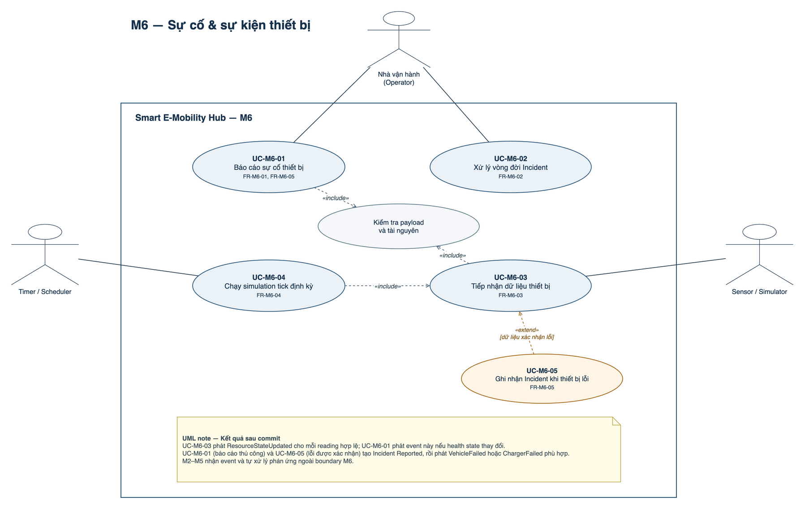
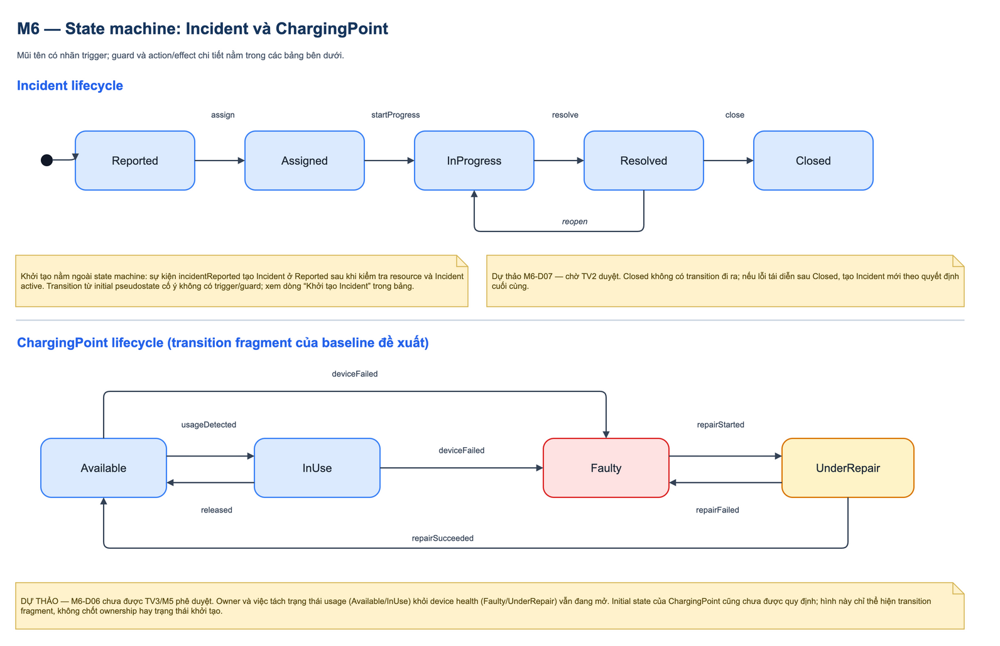
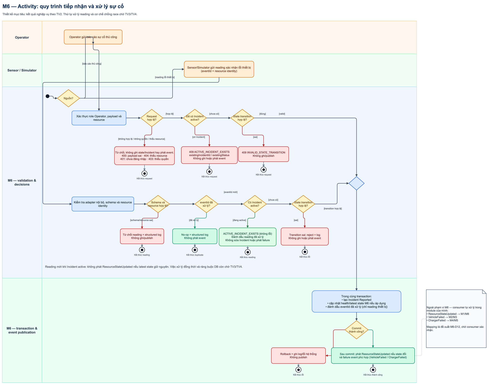
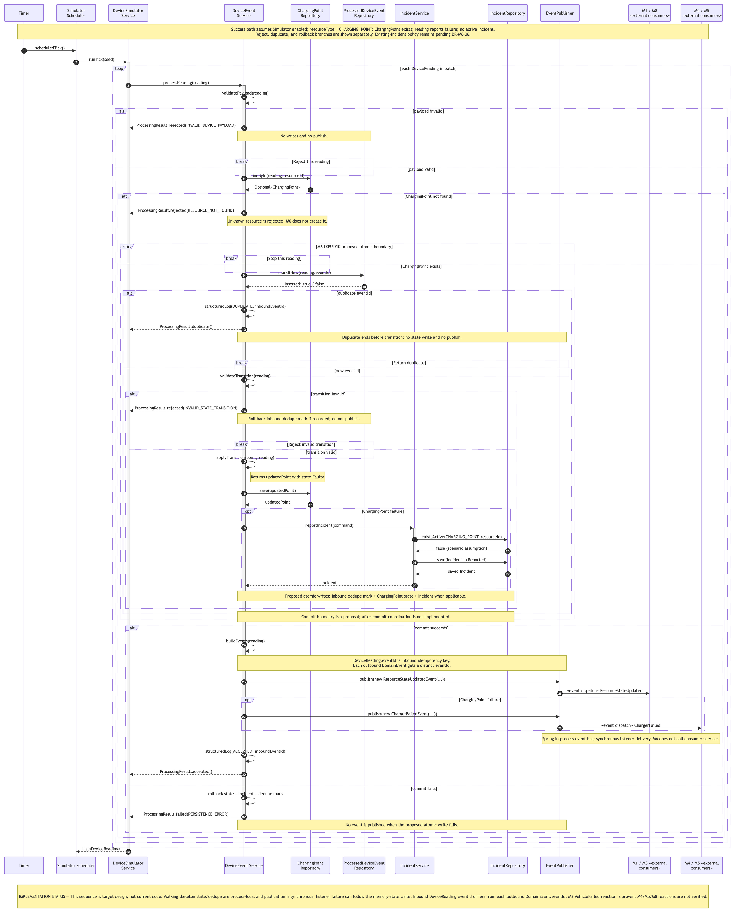
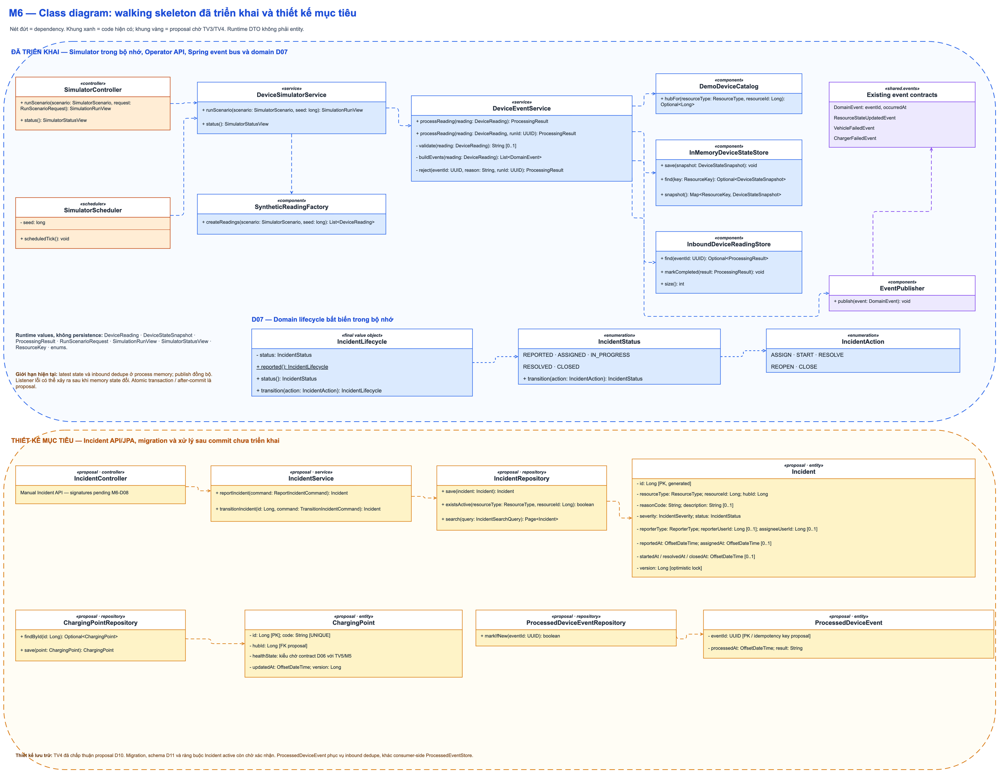
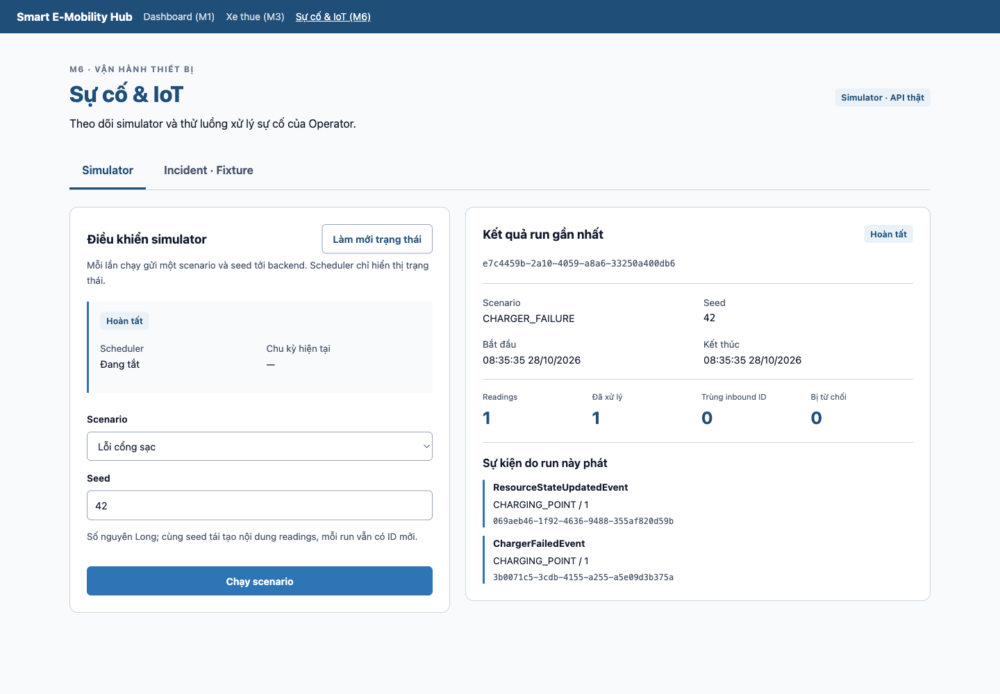
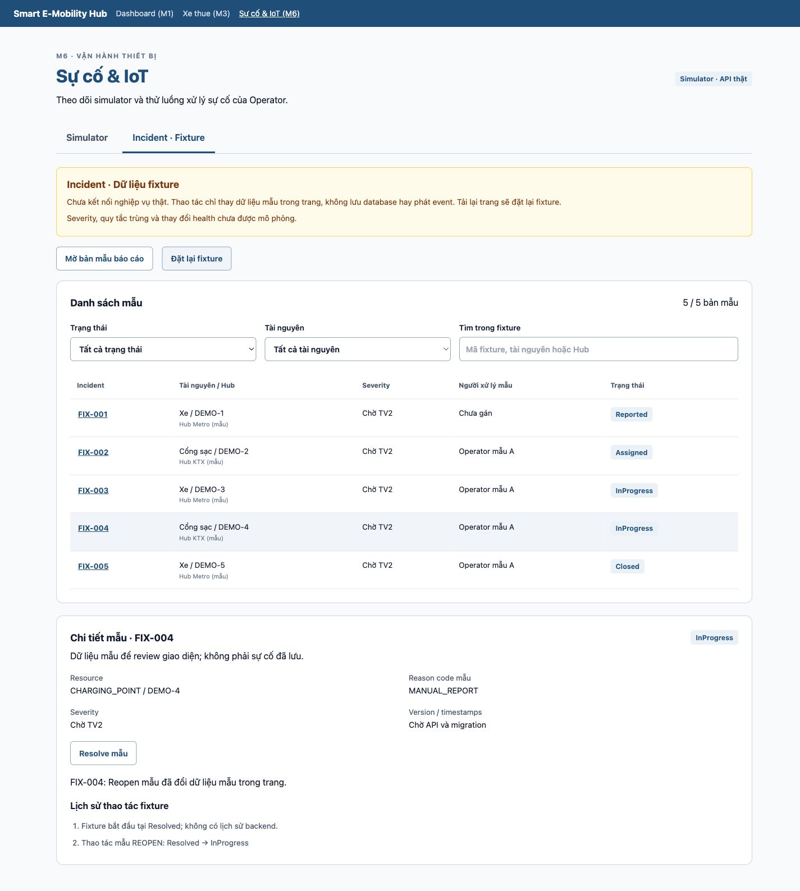

**TEMPLATE MODULE M6**

**Bộ giả lập IoT, sự kiện & xử lý sự cố**

*Smart E-Mobility Hub — Công nghệ Phần mềm HK261 — Người phụ trách: TV6*

| **Người phụ trách** | TV6 — DevOps, Tích hợp & Dựng video demo Họ tên: ................................. |
|----|----|
| **Phạm vi module** | Sinh dữ liệu cảm biến giả lập; cập nhật trạng thái tài nguyên; ghi nhận và theo dõi sự cố (xe hỏng, cổng sạc ngừng hoạt động); **phát sự kiện** cho các module liên quan. **Không** tự xử lý đặt chỗ hay phiên sạc của module khác. |
| **Cách dùng file này** | Điền lần lượt từ mục 1 đến mục 9, cập nhật sau mỗi vòng. Chữ nghiêng xám là gợi ý, điền xong thì xóa. Nội dung trong file này chính là nguyên liệu để viết file .tex của module trên Prism. |

> **Trạng thái tài liệu (cập nhật 29/10/2026):** TV2 đã chốt M6-D01, D02 (chu kỳ
> demo 5.000 ms), D07 và D08; TV3 đã chốt D03, D05, D06, D09; TV4 đã chấp thuận
> proposal schema D10. D08 yêu cầu toàn bộ `/api/m6/**` dùng role `OPERATOR`, chỉ
> ngoại lệ API chỉ-đọc khi có nhu cầu Student cụ thể; hiện chưa xác định ngoại lệ.
> TV6 đã chọn proposal D04/D11/D12 làm baseline implement phía M6; allowlist mã
> lỗi D04/D12 đang được kiểm tra theo loại resource. D04 vẫn cần TV5/M5 xác nhận
> ChargerFailed; TV3 đã chấp nhận D11 về kiến trúc và uppercase reason/payload
> đủ cho M3. D11 physical schema vẫn cần TV4, consumer M5/khác vẫn cần ack.
> Các ID khác vẫn theo dõi trong [`m6-open-decisions.md`](../../docs/proposals/m6-open-decisions.md).
> Mục §7.3/§7.4 và §8 ghi nhận walking skeleton simulator đã có code và focused
> test. Consumer-side dedupe D09 đã được triển khai ở nhánh local
> `codex/integrate-m6-m3-20261019` và được kiểm tra ở §8; thay đổi đó chưa có
> trên nhánh feature M6. D07 domain lifecycle đã có trên feature M6 (35 unit tests);
> Incident service/API/JPA chưa triển khai. Persistence và
> atomic after-commit cho M6 vẫn chưa implement. TV2 đã chốt severity/mapping/
> active-duplicate ngày 28/10; còn TV3 duyệt cơ chế/thứ tự xử lý mới, TV4 duyệt
> schema/migration và code áp dụng. §8.9 ghi source và các gap sau phản hồi.
> UI mới ngày 28/10 có simulator nối API thật và Incident fixture có nhãn rõ ràng;
> frontend 28 tests, backend 69 tests và smoke ba scenario đã chạy. §8.8 phân biệt
> proof live với component/route injection; TC-M6-25–63 tiếp tục Not run.
> Lượt code 29/10 đã sửa adapter MANUAL_REPORT và UI severity; backend 71 /
> frontend 32 tests pass, xem §8.10. Hai code commit là 7edb551 và b156344.

> **Đồng bộ liên module ngày 02/10/2026:** Bản mới của M2 xác nhận nhận
> `VehicleFailed`; M4 và M5 xác nhận nhận `ChargerFailed`. M8 vẫn là consumer
> `ResourceStateUpdated` theo Phụ lục A, nhưng chỉ dùng event làm tín hiệu dữ
> liệu đã đổi; mỗi simulation run phải lấy snapshot nhất quán qua API chỉ đọc.
> TV3 chọn phương án C cho M6-D06 (ghi nhận 20/10/2026): M6 sở hữu device
> health, M5 sở hữu charging allocation/session. Transition contract chi tiết
> vẫn cần phối hợp với TV5/M5.

# 1. Functional requirements (§2.2)

> Mỗi FR một câu "Hệ thống phải…". Mã FR-M6-01, 02… MoSCoW: Must/Should/Could/Won't. Module này bắt buộc có FR non-interactive — đã điền sẵn gợi ý ở dòng cuối.

| **Mã** | **Tên FR** | **Mô tả chi tiết** | **MoSCoW** | **Loại** | **Tác nhân kích hoạt** |
|----|----|----|----|----|----|
| FR-M6-01 | Báo cáo sự cố | Hệ thống phải cho phép Operator đã đăng nhập báo cáo xe hoặc cổng sạc bị hỏng bằng cách cung cấp Hub, loại tài nguyên, mã tài nguyên, mức độ, lý do và mô tả. | Must | Interactive | Operator |
| FR-M6-02 | Xử lý vòng đời sự cố | Hệ thống phải cho phép Operator xem, gán người xử lý và chuyển Incident qua các trạng thái hợp lệ `Reported`, `Assigned`, `InProgress`, `Resolved`, `Closed`, đồng thời từ chối chuyển trạng thái sai. | Must | Interactive | Operator |
| FR-M6-03 | Tiếp nhận dữ liệu thiết bị | Hệ thống phải tiếp nhận readings do adapter Sensor/Simulator sinh ra cho xe (bao gồm thông tin pin), chỗ đỗ và cổng sạc; kiểm tra payload/định danh, chống xử lý trùng theo inbound `DeviceReading.eventId`, rồi chỉ lưu latest state thuộc quyền sở hữu M6. | Must | **Non-interactive** | Sensor/Simulator |
| FR-M6-04 | Cập nhật trạng thái định kỳ | Hệ thống phải kích hoạt simulation tick theo chu kỳ cấu hình 5 giây đã được TV2 chốt cho demo, cho readings về xe/pin, chỗ đỗ và cổng sạc; phát `ResourceStateUpdated` với `hubId`, `resourceType`, `resourceId`, `newState` sau khi thay đổi được lưu theo ownership đã chốt. M6 không ghi state hay bảng thuộc module khác. *(D02 đã chốt; D05/D06 đã được TV3 chốt; D10 được TV4 chấp thuận, migration chưa triển khai)* | Must | **Non-interactive** | Timer/Scheduler |
| FR-M6-05 | Cô lập tài nguyên gặp sự cố | Khi xác nhận lỗi thiết bị, hệ thống phải tạo Incident ở trạng thái `Reported`, khóa health state do M6 sở hữu và phát đúng `VehicleFailed` hoặc `ChargerFailed`; M6 không sửa reservation, vehicle lifecycle, parking hoặc charging session của module khác. | Must | **Non-interactive** | Sự kiện thiết bị |

# 2. Business rules (§2.4)

> Luật phải có con số hoặc điều kiện cụ thể, và phải khớp với code thật. Ví dụ: "Thời gian giữ chỗ tối đa 15 phút".

| **Mã**   | **Luật nghiệp vụ** | **Áp dụng khi** | **Liên quan FR** |
|----------|--------------------|-----------------|------------------|
| BR-M6-01 | Chỉ người dùng role `OPERATOR` được gọi API Incident; Sensor/Simulator tạo Incident qua adapter nội bộ. Student không tạo hoặc xử lý Incident; hiện chưa có endpoint chỉ-đọc M6 được yêu cầu cho Student. TV2 chốt actor/policy và đồng ý không thêm kỹ thuật viên. *(M6-D01, D08; TV2/TV3, 2026-10-21)* | Mọi thao tác Incident | FR-M6-01, FR-M6-02 |
| BR-M6-02 | Scheduler dùng `app.simulator.interval-ms=5000` cho chu kỳ demo theo quyết định TV2. Mọi kịch bản ngẫu nhiên phải nhận seed; unit test gọi tick trực tiếp và không chờ đồng hồ thật. Interval đã cấu hình; scheduler vẫn tắt mặc định. *(M6-D02, D03; TV2, 2026-10-21)* | Chạy simulator | FR-M6-03, FR-M6-04 |
| BR-M6-03 | Pin thấp không phải VehicleFailed; M3 sở hữu VehicleLowBattery. TV2 chốt auto reasons: Vehicle MECHANICAL/SENSOR_OFFLINE, Charger OFFLINE/OVERHEAT/POWER_FAULT; severity mapping ở §8.9. MANUAL_REPORT chỉ cho Operator, adapter gửi mã này/unknown → INVALID_DEVICE_PAYLOAD, không ghi/publish. Ngày 29/10 code feature đã tách allowsDeviceReading/allowsOperatorReport và có regression proof ở §8.10; test cũ vẫn chỉ là lịch sử. | Phân loại dữ liệu lỗi | FR-M6-03, FR-M6-05 |
| BR-M6-04 | Incident chỉ chuyển `Reported → Assigned → InProgress → Resolved → Closed`; cho phép `Resolved → InProgress` để reopen. `Closed` là terminal. TV2 đã chốt lifecycle; graph D07 đã implement và unit-test trên feature M6, Incident API/JPA chưa có. *(M6-D07; TV2, 2026-10-21)* | Chuyển trạng thái Incident | FR-M6-02 |
| BR-M6-05 | TV3 chốt tách device health do M6 sở hữu khỏi charging allocation/session do M5 sở hữu (phương án C). Các transition và quy tắc cấp phát cụ thể trong bảng state vẫn là proposal, cần TV5/M5 xác nhận. *(M6-D06)* | Cập nhật trạng thái cổng sạc | FR-M6-03, FR-M6-05 |
| BR-M6-06 | TV2 chốt 28/10: tối đa một Incident active (REPORTED/ASSIGNED/IN_PROGRESS) trên (resourceType, resourceId), không theo reason. Operator trùng → 409 ACTIVE_INCIDENT_EXISTS; reading ID mới → kết quả non-error ACTIVE_INCIDENT_EXISTS và mark processed; không sửa Incident/phát failure lại. RESOLVED/CLOSED không active; báo mới tạo Incident mới. Reopen active-conflict → 409, giữ RESOLVED. Cơ chế race/DDL cần TV3/TV4 duyệt; chưa implement. | Tạo/reopen Incident | FR-M6-01, FR-M6-02, FR-M6-05 |
| BR-M6-07 | `DeviceReading.eventId` là inbound idempotency key. D11 baseline TV6 chỉ lưu latest state và Incident, không lưu raw telemetry theo từng tick; durable persistence chưa implement. Consumer-side dedupe dùng `(consumerKey, eventId)`; lỗi consumer được catch/log, không rethrow làm rollback publisher đã commit. Mỗi outbound `DomainEvent` có ID riêng. *(D09/D10 đã chốt; D11 baseline TV6, owner confirmation còn mở)* | Xử lý device update/event | FR-M6-03, FR-M6-04, FR-M6-05 |
| BR-M6-08 | M6 không gọi UPDATE hoặc ghi dữ liệu thuộc module khác; M6 phát event để consumer tự xử lý. TV3 chốt `VehicleFailed` để M3 chuyển xe sang `MAINTENANCE` và M2 hủy Reservation tương ứng. Phản ứng ChargerFailed của M4/M5 cần xác nhận riêng. *(M6-D05 đã chốt; D12 còn chờ)* | Tích hợp liên module | FR-M6-03, FR-M6-05 |
| BR-M6-09 | TV3 chốt quy ước HTTP 400/404/409 áp dụng toàn hệ thống. API service thực hiện validate → đổi state → save → publish trong transaction hoặc sau commit theo semantics của `EventPublisher`; consumer có transaction riêng, lỗi được catch/log và không rollback publisher đã commit. Atomic rollback của M6 reading/Incident chưa implement. *(M6-D09, D10)* | Lỗi API và transaction | FR-M6-01, FR-M6-02, FR-M6-03, FR-M6-04, FR-M6-05 |

# 3. Use-case (§2.5)

## 3.1 Use-case diagram: "Sự cố & sự kiện thiết bị"

File nguồn: [`m6_use_case.drawio`](../../docs/architecture/m6_use_case.drawio)

Sơ đồ đặt Operator, Sensor/Simulator và Timer/Scheduler ngoài system boundary
M6. Operator tham gia UC-M6-01 và UC-M6-02; Sensor/Simulator tham gia UC-M6-03;
Timer/Scheduler kích hoạt UC-M6-04. Association giữa actor và use case là đường
liền không có mũi tên. UC-M6-01 và UC-M6-03 «include» use case kiểm tra payload
và tài nguyên; UC-M6-04 «include» UC-M6-03 vì tick dùng cùng luồng xử lý dữ liệu
thiết bị. UC-M6-05 «extend» UC-M6-03 khi dữ liệu xác nhận lỗi; mũi tên «extend»
trỏ về use case gốc UC-M6-03. Ghi chú UML nêu các event được phát sau commit;
M2–M5 tự xử lý event ngoài boundary M6. Actor, cadence, Incident lifecycle và
permission đã được TV2 chốt; các phần chưa có quyết định tiếp tục được ghi rõ
trong bảng open decisions. Đây là thiết kế, không phải xác nhận đã implement.

## 3.2 Đặc tả use case (tối thiểu 3)

> Các use case cần đặc tả: Báo cáo sự cố; Xử lý sự cố; Nhận sự kiện thiết bị (actor IoT/Simulator). Ngoại lệ tập trung vào: Sự cố xảy ra khi tài nguyên đang được đặt hoặc đang sạc.

### UC-M6-01 — Báo cáo sự cố thiết bị

| **Trường** | **Đặc tả** |
|---|---|
| **Actor chính** | Operator |
| **Stakeholder & mối quan tâm** | Operator cần ghi nhận đúng thiết bị và theo dõi xử lý; M2–M5 cần nhận đúng failure fact nhưng không bị M6 sửa dữ liệu; TV7 cần kết quả kiểm chứng được. |
| **Tiền điều kiện** | Actor đã đăng nhập với role `OPERATOR`; resource catalog có tài nguyên đích. Incident active được kiểm tra trong luồng, không phải tiền điều kiện. |
| **Hậu điều kiện thành công** | Incident mới ở `Reported` được lưu; health state thuộc M6 được cập nhật khi áp dụng; event tương ứng chỉ phát sau khi lưu thành công; response chứa ID và trạng thái Incident. |
| **Hậu điều kiện thất bại** | Không tạo dữ liệu một phần và không phát event. Incident/state trước yêu cầu giữ nguyên. |
| **Trigger** | Operator chọn “Báo cáo sự cố”. |
| **Luồng chính** | 1. Operator chọn loại tài nguyên và Hub. 2. Hệ thống hiển thị tài nguyên phù hợp. 3. Operator nhập resource ID, severity, reason code và mô tả. 4. Hệ thống xác thực payload, resource và quyền. 5. Hệ thống kiểm tra Incident đang hoạt động. 6. `IncidentService.reportIncident(...)` tạo Incident `Reported`. 7. Hệ thống lưu Incident và health state thuộc M6 nếu áp dụng. 8. Chỉ sau commit thành công, hệ thống phát `VehicleFailed` hoặc `ChargerFailed` và `ResourceStateUpdated` nếu state thay đổi. 9. Hệ thống trả chi tiết Incident. |
| **Luồng thay thế** | 3a. Operator chọn `MANUAL_REPORT` và nhập mô tả bắt buộc. 6a. Nếu resource đang có reservation hoặc charging session, M6 vẫn tạo Incident và phát failure fact nhưng không tự hủy/đổi phiên; consumer M2–M5 quyết định phản ứng. 8a. Nếu resource là loại không có failure event chuyên biệt, hệ thống chỉ phát `ResourceStateUpdated` sau khi TV3 duyệt contract. |
| **Luồng ngoại lệ** | 4a. Payload sai → API trả 400. 4b. Resource không tồn tại → API trả 404. 5a. Đã có Incident hoạt động → API trả 409 `ACTIVE_INCIDENT_EXISTS`. 6b. State transition không hợp lệ → API trả 409. 7a. Write/commit thất bại → rollback, không phát event, trả lỗi hệ thống. |
| **FR/BR liên quan** | FR-M6-01, FR-M6-05; BR-M6-01, BR-M6-03, BR-M6-06–09. |

### UC-M6-02 — Xử lý vòng đời Incident

| **Trường** | **Đặc tả** |
|---|---|
| **Actor chính** | Operator |
| **Stakeholder & mối quan tâm** | Operator cần biết sự cố đang ở bước nào; module tài nguyên chỉ nhận fact cần thiết; nhóm cần lịch sử timestamp nhất quán. |
| **Tiền điều kiện** | Actor có role `OPERATOR`; Incident tồn tại và chưa ở `Closed`; request mang version hiện tại để chống ghi đè đồng thời. |
| **Hậu điều kiện thành công** | Incident chuyển đúng trạng thái; assignee và timestamp tương ứng được lưu; ChargingPoint health được cập nhật nếu sự cố cổng sạc bắt đầu/kết thúc sửa chữa. |
| **Hậu điều kiện thất bại** | Incident và ChargingPoint giữ nguyên; không phát state update mới. |
| **Trigger** | Operator mở chi tiết Incident và chọn hành động workflow. |
| **Luồng chính** | 1. Hệ thống tải Incident và các hành động hợp lệ. 2. Operator chọn Assign và assignee; hệ thống chuyển `Reported → Assigned`. 3. Operator chọn Start repair; hệ thống chuyển `Assigned → InProgress`, ChargingPoint `Faulty → UnderRepair` nếu áp dụng. 4. Operator chọn Resolve; hệ thống chuyển `InProgress → Resolved`, lưu `resolvedAt`; cổng sạc sửa thành công chuyển `UnderRepair → Available`. 5. Operator xác nhận Close; hệ thống chuyển `Resolved → Closed` và lưu `closedAt`. |
| **Luồng thay thế** | 4a. Lỗi tái diễn trước khi close: Operator chọn Reopen, hệ thống chuyển `Resolved → InProgress`. 3a. Sửa cổng thất bại: ChargingPoint chuyển `UnderRepair → Faulty`, Incident vẫn `InProgress` và ghi lý do. |
| **Luồng ngoại lệ** | 1a. Incident không tồn tại → 404. 2a–5a. Chuyển trạng thái không có trong BR-M6-04 → 409. 2b. Version đã thay đổi bởi Operator khác → 409 concurrency conflict và yêu cầu tải lại. 4b. Lưu state tài nguyên thất bại → rollback toàn transaction. |
| **FR/BR liên quan** | FR-M6-02, FR-M6-05; BR-M6-01, BR-M6-04, BR-M6-05, BR-M6-09. |

### UC-M6-03 — Nhận dữ liệu thiết bị và phát sự kiện

| **Trường** | **Đặc tả** |
|---|---|
| **Actor chính** | Sensor/Simulator; Timer/Scheduler kích hoạt định kỳ |
| **Stakeholder & mối quan tâm** | M1 cần cập nhật dashboard; M8 cần snapshot mới; M2–M5 cần failure fact; TV6 cần dữ liệu tái hiện được và không xử lý trùng. |
| **Tiền điều kiện** | Adapter nội bộ đang bật; payload có `eventId`, `hubId`, `resourceType`, `resourceId`, `newState`; `reason` có mặt khi reading báo lỗi. Resource có thể không tồn tại; trường hợp đó được xử lý trong luồng ngoại lệ. |
| **Hậu điều kiện thành công** | Latest state thuộc M6 được lưu một lần; `ResourceStateUpdated` được phát; nếu là failure thì Incident `Reported` và đúng failure event được phát. |
| **Hậu điều kiện thất bại** | Payload bị từ chối hoặc transaction rollback; không phát event dựa trên dữ liệu chưa lưu. |
| **Trigger** | Khi được cấu hình rõ, Timer/Scheduler gọi `scheduledTick()` và delegate sang `runScenario(NORMAL_TICK, seed)`; Operator gọi deterministic scenario qua `SimulatorController`. Scheduler hiện mặc định tắt. |
| **Luồng chính** | 1. `DeviceSimulatorService` tạo batch readings, mỗi reading có inbound `eventId`. 2. Với từng reading, `DeviceEventService.processReading(...)` gọi `validate(reading)`. 3. M6 tìm resource theo `resourceId`. 4. Walking skeleton gọi producer-side `markIfNew(eventId)` trong store process-memory riêng. 5. Nếu mới, M6 kiểm tra và cập nhật latest state trong memory. 6. M6 phát `ResourceStateUpdated`; các failure scenario phát thêm event hiện có. 7. Hệ thống ghi structured log với inbound eventId và kết quả; outbound `DomainEvent.eventId` được sinh riêng. |
| **Luồng thay thế** | 5a. Reading bình thường lưu state và phát `ResourceStateUpdated` sau commit; bỏ qua tạo Incident và failure event. 6a. Vehicle pin thấp không phải failure; M6 chỉ phát state update, còn `VehicleLowBattery` thuộc M3. 6b. Nếu lỗi xảy ra khi xe đang được đặt hoặc cổng đang phục vụ phiên sạc, M6 cô lập health state thuộc mình; M2/M3 hoặc M4/M5 tự xử lý reservation/session. 1a. Operator chạy deterministic scenario với seed cố định qua cùng pipeline. |
| **Luồng ngoại lệ** | 2a. Payload sai → trả `INVALID_DEVICE_PAYLOAD`, không ghi/publish. 3a. Resource không tồn tại → trả `RESOURCE_NOT_FOUND`, không tự tạo resource. 4a. `eventId` đã xử lý → `ProcessingResult.duplicate()` và structured log; kết thúc trước transition. 5b. Transition sai → rollback inbound dedupe mark nếu đã ghi, trả `INVALID_STATE_TRANSITION`, không publish. 6c. Incident active → kết quả theo BR-M6-06 còn chờ quyết định riêng; không tự chọn policy. 7a. Write/commit thất bại → rollback state, Incident và dedupe mark; trả `PERSISTENCE_ERROR`, không publish. |
| **FR/BR liên quan** | FR-M6-03–05; BR-M6-02–09. |

# 4. Thiết kế hành vi (§3.3)

## 4.1 State machine: ChargingPoint, Incident

File nguồn: [`m6_state_machines.drawio`](../../docs/architecture/m6_state_machines.drawio)

> **Trạng thái thiết kế:** Incident lifecycle đã được TV2 chốt theo M6-D07;
> Incident active trùng ở BR-M6-06 vẫn cần quyết định riêng. TV3 đã chốt owner
> split M6-D06 (M6 sở hữu health, M5 sở hữu usage/session); transition details
> của ChargingPoint vẫn cần TV5/M5.
> ChargingPoint diagram là transition
> fragment: nguồn chưa quy định initial state, nên không giả định cổng mới tạo
> luôn ở `Available`. Hình hiện tại chưa vẽ riêng usage state và health state;
> cần được cập nhật theo phương án C sau khi TV5/M5 xác nhận transition contract.

Nhãn trên mũi tên là trigger; guard và action/effect được ghi đầy đủ trong các
bảng. Initial pseudostate của Incident dùng chấm đen đặc. Theo UML, transition
từ initial pseudostate không có trigger hoặc guard; vì vậy sự kiện tạo Incident
được tách thành dòng khởi tạo bên dưới, không gắn lên mũi tên initial.

**Bảng trạng thái và chuyển trạng thái** (baseline dùng để review/test sau khi
được duyệt):

**Incident**

| **Trạng thái hiện tại** | **Sự kiện** | **Điều kiện** | **Trạng thái mới** | **Hành động** |
|----|----|----|----|----|
| Khởi tạo (không phải transition UML) | `incidentReported` | Resource hợp lệ; chưa có Incident active | Reported | Tạo và lưu Incident cùng reporter/reportedAt |
| Reported | `assign` | Đã có assignee | Assigned | Lưu assignee/assignedAt |
| Assigned | `startProgress` | Operator có quyền | InProgress | Lưu startedAt |
| InProgress | `resolve` | Có resolution note | Resolved | Lưu resolvedAt |
| Resolved | `close` | Operator xác nhận | Closed | Lưu closedAt |
| Resolved | `reopen` | Lỗi tái diễn trước khi close | InProgress | Xóa resolvedAt, ghi lý do reopen |

**ChargingPoint**

| **Trạng thái hiện tại** | **Sự kiện** | **Điều kiện** | **Trạng thái mới** | **Hành động** |
|----|----|----|----|----|
| Available | `usageDetected` | Sensor xác nhận đang dùng | InUse | Lưu state; phát ResourceStateUpdated sau commit |
| InUse | `released` | Sensor xác nhận kết thúc | Available | Lưu state; phát ResourceStateUpdated sau commit |
| Available | `deviceFailed` | Reason hợp lệ; không có Incident active | Faulty | Lưu state và tạo Incident Reported; sau commit phát ResourceStateUpdated và ChargerFailed |
| InUse | `deviceFailed` | Reason hợp lệ; không có Incident active | Faulty | Lưu state và tạo Incident Reported; sau commit phát ResourceStateUpdated và ChargerFailed |
| Faulty | `repairStarted` | Incident Assigned hoặc InProgress | UnderRepair | Lưu state; nếu Incident Assigned thì chuyển sang InProgress trong cùng thao tác; phát ResourceStateUpdated sau commit |
| UnderRepair | `repairSucceeded` | Sửa thành công; Incident được resolve | Available | Lưu state; phát ResourceStateUpdated sau commit |
| UnderRepair | `repairFailed` | Có failure reason mới | Faulty | Giữ Incident InProgress, ghi lý do; phát ResourceStateUpdated sau commit |

**Chuyển trạng thái không hợp lệ cần chặn:** mọi transition không có trong các
bảng; đặc biệt `Reported → Resolved`, `Assigned → Closed`, mọi transition đi ra
khỏi `Closed`, `Faulty → Available` trực tiếp. Theo baseline BR-M6-05 đang chờ
duyệt, ChargingPoint ở `Faulty` hoặc `UnderRepair` không được cấp phát; transition
sai trả 409 theo BR-M6-09. Bảng ghi riêng hai nhánh `Available → Faulty` và
`InUse → Faulty` để khớp với hai transition có cùng trigger trên diagram.

## 4.2 Activity diagram: Quy trình xử lý sự cố

File nguồn có thể chỉnh sửa trong draw.io: [`m6_incident_activity.drawio`](../../docs/architecture/m6_incident_activity.drawio)

Sơ đồ tách hai đầu vào. Nhánh Operator xác thực role, payload và resource; request
không hợp lệ bị từ chối, Incident active dẫn tới `409 ACTIVE_INCIDENT_EXISTS`
theo baseline BR-M6-06 đang chờ TV2 duyệt, còn state transition sai trả 409. Nhánh
Sensor/Simulator kiểm tra adapter, schema và resource; `eventId` trùng là no-op có
structured log. Với event mới, M6 kiểm tra transition riêng rồi mới xét Incident
active. Đặc tả chưa chốt kết quả cho một reading mới khi Incident đã active, nên
nhánh đó vẫn chờ quyết định riêng theo BR-M6-06.

Hai nhánh hợp lệ cùng ghi Incident `Reported`, cập nhật health/latest state M6 nếu
áp dụng, và chỉ ghi nhận `eventId` ở nhánh reading trong transaction. Chỉ sau
commit thành công M6 mới phát `ResourceStateUpdated` khi state đổi cùng failure
event phù hợp; commit lỗi rollback và không publish. Consumer tự xử lý ngoài
boundary M6. Mapping consumer trong ghi chú hình dùng baseline M6-D12 do TV6 chọn;
TV3 review và consumer xác nhận payload vẫn còn cần để coi đây là contract toàn
hệ thống. Theo D08, toàn bộ `/api/m6/**` yêu cầu `OPERATOR`; chỉ mở ngoại lệ
read-only nếu có nhu cầu Student cụ thể, hiện chưa xác định endpoint nào. Quy ước
401/403 theo D09. Đây là mô hình đặc tả, không phải xác nhận chức năng đã được
implement.

## 4.3 Sequence diagram: Sự kiện thiết bị → cập nhật trạng thái → phát sự kiện

> Lifeline phải trùng tên thành phần trong sơ đồ kiến trúc của TV3 và class ở mục 6.

File nguồn: [`m6_device_event_sequence.drawio`](../../docs/architecture/m6_device_event_sequence.drawio)

Sơ đồ mô tả một vertical slice: Timer kích hoạt simulator; với từng reading,
`DeviceEventService` kiểm tra payload rồi tra cứu resource trước khi kiểm tra
trùng `DeviceReading.eventId`. Duplicate kết thúc trước transition. Với reading
mới, service kiểm tra và áp dụng transition, lưu `ChargingPoint` thành `Faulty`,
rồi tạo Incident `Reported`. Nhánh thành công giả định Simulator bật,
`resourceType = CHARGING_POINT`, resource tồn tại, reading báo lỗi và chưa có
Incident active. Nhánh resource không tồn tại, payload sai, duplicate, transition
sai và write/commit thất bại vẫn được thể hiện như ngoại lệ.

Combined fragment đánh dấu vùng atomic được đề xuất cho M6-D09/D10: dedupe mark,
state write và Incident write. Khi commit thành công, `DeviceEventService` mới gọi
`buildEvents(reading)` và `EventPublisher` chuyển `ResourceStateUpdatedEvent` tới
M1/M8; với failure, chuyển thêm `ChargerFailedEvent` tới M4/M5. Khi commit thất
bại, state, Incident và dedupe mark được rollback, trả
`ProcessingResult.failed(PERSISTENCE_ERROR)` và không publish. Inbound
`DeviceReading.eventId` khác ID được sinh riêng cho từng outbound `DomainEvent`.
Publisher dùng Spring in-process event bus; M6 không gọi service của consumer.
`VehicleFailed` là biến thể tương tự, nằm ngoài scenario. Consumer mapping là đề
xuất M6-D12. Đây là target design, không phải mô tả implementation hiện tại.
Walking skeleton hiện dùng store trong bộ nhớ và publish đồng bộ; listener có
thể lỗi sau khi latest state trong memory đã đổi. Incident write, transaction
rollback và after-commit coordination chưa được implement.

# 5. Đặc tả màn hình gửi TV5 (§3.4)

**Bạn không vẽ mockup.** Bạn chỉ điền bảng dưới đây; TV5 dùng nó để viết prompt cho công cụ AI (Figma AI, Google Stitch…), tạo mockup rồi chỉnh theo design system, sau đó gửi lại cho bạn duyệt.

> Mô tả càng cụ thể thì càng ít phải sửa: nêu rõ trường dữ liệu nào hiện, thứ tự ưu tiên thông tin, thông báo lỗi cần hiện gì, có trạng thái đang xử lý và trạng thái rỗng (chưa có dữ liệu) hay không.

| **Màn hình** | **Actor** | **Thông tin hiển thị** | **Hành động người dùng** | **Phản hồi hệ thống (thành công / lỗi / đang xử lý)** |
|----|----|----|----|----|
| Danh sách Incident | Operator | ID, resource, Hub, severity, status, assignee, reportedAt; bộ lọc status/severity/resource | Lọc, mở chi tiết, tạo báo cáo | Loading skeleton; empty state; tải thành công; lỗi API kèm code/message |
| Chi tiết và workflow Incident | Operator | Timeline trạng thái, reason/description, resource, assignee, timestamps, version, hành động hợp lệ | Assign, Start, Resolve, Reopen, Close | Disable action đang gửi; toast thành công; 409 yêu cầu tải lại; transition sai hiển thị lý do |
| Điều khiển Simulator | Operator | Scheduler enabled/disabled và configured interval (read-only), seed, kịch bản, tick gần nhất, event gần nhất | Chạy deterministic tick/scenario; xem trạng thái | Xác nhận inbound eventId; validation error; trạng thái đang chạy; không cho chạy trùng. D02 chốt chu kỳ demo 5.000 ms; scheduler vẫn được cấu hình tắt mặc định. |

*\[Dán ảnh mockup TV5 gửi lại hoặc link Figma\]*

# 6. Class diagram và method (§3.2)

> Mọi method public ghi signature đầy đủ trên sơ đồ. Mô tả bằng lời chỉ cho 2–4 method nghiệp vụ. Không mô tả getter/setter, CRUD thuần, mapper.

File nguồn: [`m6_class_design.drawio`](../../docs/architecture/m6_class_design.drawio)

Trong sơ đồ, mỗi class có các ngăn tên / thuộc tính / operations; mũi tên nét
đứt là dependency (dùng/gọi), không phải quan hệ sở hữu dữ liệu. Vì Incident
tham chiếu tài nguyên qua cặp `resourceType` + `resourceId`, schema proposal D10
đã được TV4 chấp thuận dùng logical reference, không tạo polymorphic FK cho
resource. M6 sở hữu health state; usage/session thuộc M5.
Operations được ghi đủ kiểu tham số và kiểu trả về; DTO/enum được dùng làm type
nhưng không khai triển thành class riêng.

> Sơ đồ tách rõ walking skeleton đã triển khai khỏi vùng proposal. `SimulatorController`,
> `SimulatorScheduler`, `DeviceSimulatorService`, `SyntheticReadingFactory`,
> `DeviceEventService`, `DemoDeviceCatalog`, hai in-memory store và `EventPublisher`
> khớp code hiện tại. Incident workflow/repositories/entities và ChargingPoint
> persistence vẫn là target design theo D10 đã được TV4 chấp thuận; chưa có M6
> migration. Owner split
> ChargingPoint đã được TV3 chốt theo phương án C.

## 6.1 Entity gửi TV4 (để làm ERD)

| **Entity** | **Thuộc tính chính (kèm kiểu)** | **Khóa / quan hệ** |
|------------|---------------------------------|--------------------|
| Incident | `id: Long` (PK, generated); `resourceType: ResourceType` (NOT NULL); `resourceId: Long` (NOT NULL, logical reference); `hubId: Long` (NOT NULL); `reasonCode: String` (NOT NULL); `description: String?`; `severity: IncidentSeverity` (NOT NULL); `status: IncidentStatus` (NOT NULL); `reporterType: ReporterType` (NOT NULL); `reporterUserId: Long?`; `assigneeUserId: Long?`; `reportedAt: OffsetDateTime` (NOT NULL); `assignedAt/startedAt/resolvedAt/closedAt: OffsetDateTime?`; `version: Long` (NOT NULL, optimistic lock) | TV4 đã chấp thuận proposal D10 (2026-10-21): FK `hubId → hub.id`; `reporterUserId`/`assigneeUserId → app_user.id` nếu user entity hiện hữu hỗ trợ; không tạo polymorphic FK cho `resourceId`; các index `(resource_type, resource_id, status)`, `(hub_id, status)`, `(assignee_user_id, status)`. Migration chưa có. |
| ChargingPoint | `id: Long` (PK); `code: String` (NOT NULL, UNIQUE); `hubId: Long` (NOT NULL); `healthState` thuộc M6; usage/allocation state thuộc mô hình M5; `updatedAt: OffsetDateTime` (NOT NULL); `version: Long` (NOT NULL, optimistic lock) | TV3 đã chốt tách health khỏi usage/session theo M6-D06; TV4 đã chấp thuận proposal D10 (2026-10-21). Chưa có entity hay migration trong walking skeleton; transition contract vẫn cần TV5/M5. |
| DeviceLatestState (D11 addendum) | Một dòng hiện trạng: `resourceType`, `resourceId`, `hubId`, `state`, `batteryLevel: Integer?`, `failureReason: String?`, `observedAt: OffsetDateTime` | TV6 đề xuất unique `(resourceType, resourceId)` và logical resource reference, không polymorphic FK. Addendum chưa được TV4 duyệt; chưa có entity hoặc migration. Không lưu raw reading/tick history. |
| ProcessedDeviceEvent | `eventId: UUID` (đề xuất PK/inbound idempotency key); `processedAt: OffsetDateTime` (NOT NULL); `result: String` (NOT NULL) | Riêng producer-side inbound `DeviceReading` dedupe, khác consumer-side `shared.events.ProcessedEventStore`. Consumer namespaced dedupe đã được TV3 chốt theo D09; TV4 đã chấp thuận model proposal D10. Retention/coupling còn là quyết định triển khai; walking skeleton hiện dùng store trong bộ nhớ. |

> **D10 đã được TV4 chấp thuận (2026-10-21):** TV4 sở hữu Flyway migration theo
> schema proposal; migration chưa được tạo. Cần đồng bộ nếu khi triển khai phát
> sinh khác biệt vật lý đáng kể so với proposal đã chấp thuận.
> được tạo và schema chưa được TV4 duyệt.

`DeviceReading`, `DeviceStateSnapshot`, `ProcessingResult`, `RunScenarioRequest`,
`SimulationRunView`, `SimulatorStatusView`, `ResourceKey` và các enum là runtime
DTO/value objects; chúng không phải JPA entity và không tạo bảng persistence.

## 6.2 Mô tả 2–4 method nghiệp vụ

Hai method đầu bảng Incident là thiết kế proposal, chưa được cài đặt trong
walking skeleton. `processReading` và `runScenario` là các method đã có code.

| **Signature**      | `reportIncident(command: ReportIncidentCommand): Incident` |
|--------------------|---------------------------------------|
| **Class**          | `IncidentService` |
| **Mục đích**       | Xác thực báo cáo, ngăn Incident active trùng và tạo Incident `Reported`. Luồng publication tuân theo transaction order đã được TV3 chốt ở D09; Incident lifecycle D07 và schema D10 đã được chốt nhưng chưa implement. BR-M6-06 về Incident active trùng vẫn cần quyết định riêng. |
| **Tiền điều kiện** | Operator hợp lệ hoặc trusted internal adapter; resource tồn tại; reason code hợp lệ. |
| **Hậu điều kiện**  | Incident được lưu đúng một lần; trả Incident đã tạo cho caller. Device-reading flow không publish từ method này; publication theo thứ tự validate → state → save → publish đã được TV3 chốt, nhưng chưa có code Incident để xác minh. |
| **Ngoại lệ**       | `RESOURCE_NOT_FOUND`, `ACTIVE_INCIDENT_EXISTS`, `INVALID_FAILURE_REASON`. |

| **Signature**      | `transitionIncident(id: Long, command: TransitionIncidentCommand): Incident` |
|--------------------|---------------------------------------|
| **Class**          | `IncidentService` |
| **Mục đích**       | Áp dụng state machine Incident, cập nhật assignee/note/timestamps và health state M6 liên quan theo action. |
| **Tiền điều kiện** | Incident tồn tại; action hợp lệ; `expectedVersion` khớp; `assigneeUserId` có giá trị khi `action = ASSIGN`; `note` bắt buộc cho `RESOLVE` và `REOPEN` theo state table đề xuất. |
| **Hậu điều kiện**  | Incident và health state M6 liên quan được lưu cùng transaction; trả Incident mới. Event publication tuân theo transaction order D09; lifecycle D07/schema D10 đã được chốt nhưng chưa có code để xác minh. |
| **Ngoại lệ**       | `INCIDENT_NOT_FOUND`, `INVALID_STATE_TRANSITION`, `CONCURRENT_UPDATE`. |

| **Signature**      | `processReading(reading: DeviceReading): ProcessingResult` |
|--------------------|---------------------------------------|
| **Class**          | `DeviceEventService` |
| **Mục đích**       | Kiểm tra payload/resource trong catalog demo, loại inbound ID đã xử lý, cập nhật synthetic latest state trong bộ nhớ và phát event qua `EventPublisher` đồng bộ. Failure vehicle phát `VehicleFailed`; failure cổng sạc phát state `FAULTY` cùng `ChargerFailed`. |
| **Tiền điều kiện** | Reading có eventId, hub/resource identity, observed state và thời điểm quan sát hợp lệ; battery nếu có nằm trong `0..100`. |
| **Hậu điều kiện**  | Reading mới được xử lý qua store trong bộ nhớ; duplicate trả `DUPLICATE` và không publish lần nữa; outbound event IDs được trả riêng với inbound ID. Đây không phải DB transaction, rollback hoặc after-commit guarantee. |
| **Ngoại lệ**       | Payload/resource không hợp lệ được trả bằng `ProcessingResult.REJECTED` với reason code; lỗi listener đồng bộ có thể ném ra sau khi in-memory state đã đổi. |

| **Signature**      | `runScenario(scenario: SimulatorScenario, seed: long): SimulationRunView` |
|--------------------|---------------------------------------|
| **Class**          | `DeviceSimulatorService` |
| **Mục đích**       | Chặn hai run đồng thời, sinh readings cho scenario đã chọn, chuyển từng reading qua `DeviceEventService` và lưu summary của run gần nhất. |
| **Tiền điều kiện** | Scenario hợp lệ; seed được cung cấp. Scheduler chỉ gọi `NORMAL_TICK` khi được bật tường minh bằng cấu hình. |
| **Hậu điều kiện**  | Trả run ID, số lượng kết quả và outbound event IDs. Cùng seed cho cùng business payload; mỗi reading được cấp inbound UUID mới. `observedAt` được ghi tại lúc tạo nhưng không bảo đảm khác giữa các lần gọi sát nhau và không dùng làm duplicate key. |
| **Ngoại lệ**       | `SIMULATOR_ALREADY_RUNNING`; lỗi publisher làm run thành `FAILED`. |

> **Type note — proposal:** `TransitionIncidentCommand` gồm `action: IncidentAction`, `assigneeUserId: Long [0..1]`, `note: String [0..1]` và `expectedVersion: Long`. `assigneeUserId` bắt buộc với `ASSIGN`; `note` bắt buộc với `RESOLVE` và `REOPEN` theo state table đề xuất. DTO/query/view types còn lại được dùng trong signature nhưng không khai triển thành class riêng.

Các method đã implement có signature đúng code: `DeviceEventService` cung cấp
cả `processReading(reading: DeviceReading): ProcessingResult` và overload
`processReading(reading: DeviceReading, runId: UUID): ProcessingResult`;
`DeviceSimulatorService` cung cấp `runScenario(scenario: SimulatorScenario,
seed: long): SimulationRunView` và `status(): SimulatorStatusView`.

# 7. Cài đặt (§4.2, §4.3, §4.4)

## 7.1 Phạm vi cài đặt

> Bộ sinh dữ liệu giả lập cho xe/pin, chỗ đỗ và cổng sạc; Spring in-process event bus qua `EventPublisher`/`ApplicationEventPublisher`; service sự cố và màn hình quản lý sự cố. Không thêm message broker ngoài tiến trình.

Ghi chú của người phụ trách: ..............................................................

## 7.2 Sự kiện của module (theo Phụ lục A)

<table>
<colgroup>
<col style="width: 24%" />
<col style="width: 75%" />
</colgroup>
<thead>
<tr>
<th><strong>Chiều</strong></th>
<th><strong>Sự kiện và việc phải làm</strong></th>
</tr>
<tr>
<th><strong>Module này PHÁT</strong></th>
<th>
ResourceStateUpdated → M1 dashboard, M8 snapshot

VehicleFailed → M3 chuyển Maintenance, M2 xử lý đặt chỗ

ChargerFailed → M5 phân lại phiên sạc, M4 xử lý chỗ đỗ
</th>
</tr>
<tr>
<th><strong>Module này NHẬN và tự xử lý</strong></th>
<th>(không nhận sự kiện từ module khác — M6 là nguồn phát chính)</th>
</tr>
</thead>
<tbody>
</tbody>
</table>

> Chỉ phát và nhận đúng các sự kiện trên. **Không viết logic nằm trong module của người khác.** Cần thêm sự kiện mới thì báo TV3 cập nhật Phụ lục A.

**Đối chiếu với các template module mới nhất:**

| Event M6 phát | Payload hiện có | Phản ứng do consumer sở hữu | Trạng thái đồng bộ |
|---|---|---|---|
| `VehicleFailed` | `vehicleId`, `hubId`, `reason` cùng `eventId`, `occurredAt` kế thừa | M2 chuyển/hủy Reservation liên quan; M3 chuyển xe sang Maintenance | Khớp M2 và hợp đồng `shared/events`; M6 không sửa Reservation hoặc vehicle lifecycle |
| `ChargerFailed` | `chargingPointId`, `hubId`, `reason` cùng `eventId`, `occurredAt` kế thừa | M4/M5 tự xử lý trong module mình; M3 không xử lý event này | TV3 đã chốt owner split M6-D06 (health M6, usage/session M5); M4/M5 đã xác nhận nhận event ngày 02/10, nhưng reaction runtime chưa được chứng minh |
| `ResourceStateUpdated` | `hubId`, `resourceType`, `resourceId`, `newState` cùng metadata kế thừa | M1 cập nhật dashboard; M8 đánh dấu projection/snapshot source đã thay đổi rồi lấy snapshot nhất quán qua API chỉ đọc khi chạy mô phỏng | Khớp Phụ lục A và không biến chuỗi event thành snapshot nhất quán |

Các consumer phải tự dedupe theo outbound `DomainEvent.eventId`. Inbound
`DeviceReading.eventId` chỉ thuộc pipeline M6 và không được dùng thay ID event
liên module. Spring `ApplicationEventPublisher` là bus trong tiến trình; không
được mô tả như message broker bền vững, hàng đợi hoặc cơ chế retry tự động.

**Baseline reason code/payload do TV6 chọn ngày 2026-10-21 (D04/D12):** reason
codes là uppercase `String` để khớp event class hiện có; giữ nguyên payload
`VehicleFailed(vehicleId, hubId, reason)`,
`ChargerFailed(chargingPointId, hubId, reason)` và
`ResourceStateUpdated(hubId, resourceType, resourceId, newState)`, cùng metadata
`eventId`/`occurredAt`. Vehicle reasons: `MECHANICAL`, `SENSOR_OFFLINE`,
`MANUAL_REPORT`; charger reasons: `OFFLINE`, `OVERHEAT`, `POWER_FAULT`,
`MANUAL_REPORT`. TV3 review và consumer payload acknowledgements vẫn cần được
ghi nhận trước khi coi đây là contract tích hợp đã được mọi module duyệt.

## 7.3 Quyết định cài đặt quan trọng (§4.3)

> Viết 1–2 đoạn: vấn đề kỹ thuật là gì, mình chọn cách nào, vì sao, đánh đổi ra sao. Đây là phần thầy chấm trong mục Implementation.

M6 walking skeleton giữ producer logic trong `m6simulator`: `SyntheticReadingFactory`
tạo fixture theo seed; `DeviceEventService` xác thực payload, kiểm tra catalog,
dedupe inbound ID, cập nhật latest state trong bộ nhớ rồi phát event qua
`shared.events.EventPublisher`; `DeviceSimulatorService` quản lý run/scenario.
`NORMAL_TICK` sinh vehicle có battery, parking space và charging point;
`VEHICLE_FAILURE` phát `VehicleFailedEvent`; `CHARGER_FAILURE` phát
`ResourceStateUpdatedEvent(FAULTY)` và `ChargerFailedEvent`. Theo baseline D04/D12
TV6 chọn ngày 2026-10-21, vehicle reasons là `MECHANICAL`, `SENSOR_OFFLINE`,
`MANUAL_REPORT`; charger reasons là `OFFLINE`, `OVERHEAT`, `POWER_FAULT`,
`MANUAL_REPORT`. `FailureReasonCodes` kiểm tra exact uppercase allowlist theo
resource; các scenario hiện có vẫn dùng `MECHANICAL` và `OFFLINE`. TV5/M5 vẫn
cần xác nhận điều kiện/reaction ChargerFailed, còn TV3 và consumers cần xác nhận
contract liên module.

HTTP điều khiển scenario/status hiện yêu cầu role `OPERATOR`; catch-all
`/api/m6/**` cũng đã được thêm vào `shared/config/SecurityConfig` trên nhánh
tích hợp để khóa các route M6 khác. Thay đổi security này chưa có trên nhánh
feature. Scheduler có adapter nhưng mặc định tắt; D02 đã chốt và code cấu hình
interval demo 5.000 ms. State và inbound
dedupe mất khi process dừng; event publish đồng bộ, không có persistence,
transaction rollback, outbox, after-commit, retry hoặc durability. Ngày
02/10/2026, focused Maven tests đạt 21 test và `mvn -B verify` đạt 30 test,
không failure/error/skip; `ModuleBoundaryTest` cũng đạt. Frontend test command
không tìm thấy test file và thoát 0; frontend build thành công. Compose config
hợp lệ. Smoke trên Compose project riêng `m6-hardening-smoke` chạy PostgreSQL
16: unauthenticated 401, Student 403, Operator 200; ba scenario trả 200; M3
chuyển xe ID 1 sang `MAINTENANCE`; malformed/unknown/missing/null inputs trả
400 `VALIDATION_FAILED`; frontend trả 200. Project, volume và image riêng đã
được xóa sau smoke.

Cập nhật 28/10/2026 trên `feature/m6-iot-simulator-event-bus` (HEAD `5583c1c`,
working tree chưa commit): `IncidentAction` định nghĩa ASSIGN/START/RESOLVE/REOPEN/CLOSE;
`IncidentStatus.transition(action)` chỉ cho phép năm cạnh D07. Cặp sai ném
`BusinessException` với code `INVALID_STATE_TRANSITION` theo convention sẵn có.
`IncidentLifecycle.reported()` tạo value REPORTED; `transition(action)` trả value
mới, không sửa value cũ. Java enum không tự định nghĩa định dạng HTTP/DB.
Đây là domain value bất biến, chưa phải entity hay Incident đã lưu. Không tạo
Spring bean, không nối vào pipeline readings. Assignee, version, timestamp,
authorization, severity, active-duplicate, persistence và health coupling nằm
ngoài value này; không chọn default để thay quyết định còn mở.

Focused domain tests đạt 35; backend `mvn -B verify` đạt 69, không failure/error/skip
(xem §8.7). Review prototype TV5 đã hoàn tất, xem
[biên bản review](../../docs/reviews/m6-prototype-review-20261028.md); frontend chưa làm ở lượt D07; phần UI tiếp theo đã có kết quả ở §8.8.

Cập nhật UI ngày 28/10: route `/m6/operations` lazy-load `M6OperationsPage`,
thêm nav M6, dùng shared Axios/session client hiện hữu. `simulatorApi` gọi status
và ba scenario; seed được validate theo Long và gửi numeric literal chính xác,
response giữ seed dạng chuỗi để không bị JavaScript làm tròn. SimulatorPanel
hiển thị scheduler/interval/latestRun/counts/events và xử lý loading/empty,
400/401/403/409, network/5xx; POST pending được chặn double click, 409 chỉ GET
refresh chứ không retry POST. IncidentFixturePanel chỉ dùng local fixtures,
D07 transitions, bộ lọc và bản nháp chưa gửi; không gán severity/default hoặc
xử lý duplicate/health. Proof và giới hạn tại §8.8 và
[biên bản UI](../../docs/reviews/m6-ui-validation-20261028.md).

## 7.4 Sai lệch và giới hạn (§4.4) — gửi TV3

| **Chức năng** | **Thiết kế ban đầu** | **Thực tế đã làm** | **Lý do** |
|---------------|----------------------|--------------------|-----------|
| Event producer | Spring event bus và ba contract outbound M6 | Focused tests và Compose/PostgreSQL smoke ngày 02/10/2026 xác nhận ba scenario phát `ResourceStateUpdatedEvent`, `VehicleFailedEvent`, `ChargerFailedEvent` theo fixture | Bus synchronous, process-local, không durable |
| Bộ giả lập IoT | Scenario định trước cho vehicle/battery, parking space và charging point | `NORMAL_TICK`, `VEHICLE_FAILURE`, `CHARGER_FAILURE`; `NORMAL_TICK` phát Vehicle `AVAILABLE`, ParkingSpace `FREE`, ChargingPoint `AVAILABLE`; latest state và dedupe trong bộ nhớ; reason codes được kiểm tra theo resource; seed tái tạo business payload, inbound IDs mới | Walking skeleton, chưa persistence; timestamp không được bảo đảm khác nhau; D11 schema addendum đang chờ TV4 |
| Operator simulator API | POST scenario và GET status, role `OPERATOR` | `/api/m6/**` yêu cầu Operator trên nhánh tích hợp; 200 hợp lệ, 400 validation, 401 unauthenticated, 403 Student, 409 run đang chạy | D08 đã được triển khai trên nhánh tích hợp; chưa có ngoại lệ Student chỉ-đọc được yêu cầu; feature sync còn chờ |
| Scheduler | Một service dùng chung với Manual Adapter và Auto Adapter theo M6-D03 | `@ConditionalOnProperty`; chỉ chạy `NORMAL_TICK` khi bật với interval/seed cấu hình | TV2 chốt interval demo 5.000 ms theo D02; interval đã cấu hình, scheduler mặc định tắt |
| Incident / schema | TV2 chốt actor và lifecycle ở D01/D07; TV6 chọn model D10, TV4 chấp thuận 2026-10-21 | Feature M6 đã có domain graph/value D07, 35 unit tests pass; Incident service/API/JPA chưa triển khai; TV2 severity/mapping/BR-M6-06 đã chốt nhưng code chưa áp dụng; TV3 review cơ chế mới và TV4 migration còn là gate; latest-state schema addendum cũng chờ TV4 | Không tự đặt severity/duplicate policy hoặc tạo migration thuộc TV4 |
| Simulator UI | Operator xem status và chạy scenario trên backend | `/m6/operations` nối API thật; 3 scenario/seed/run receipt, 400/401/403/409; frontend 28 tests và production browser smoke với PostgreSQL ngày 28/10 | Chỉ output run và state memory hiện có; không thêm endpoint/tick count/scheduler toggle |
| Incident UI | Báo cáo, lọc và xử lý Incident thật | UI fixture có nhãn chưa nối nghiệp vụ, filter/detail/D07/reopen/reset; severity bốn mức + chọn bắt buộc không default; report chỉ preview, chưa tạo bản ghi | API/migration, cơ chế race/health và implementation Incident policy còn thiếu; UI fixture không phải FR-01/02 đã hoàn tất |
| Consumer dedupe | Dedupe theo cặp consumer key + outbound event ID | Nhánh tích hợp local đổi `ProcessedEventStore` sang `markIfNew(consumerKey, eventId)`, M3 dùng stable keys, processor chạy `REQUIRES_NEW`, listener bắt/log lỗi; §8 ghi focused proof. Thay đổi chưa có trên nhánh feature M6 | Shared store/M3 handler chỉ ở nhánh tích hợp; memory-only và mất khi restart |
| Runtime integration | M2/M3/M4/M5/M8 nhận event của M6 | H2 integration test và Compose/PostgreSQL smoke xác nhận M3 nhận `VehicleFailed` và xe ID 1 thành `MAINTENANCE`; M4/M5/M8 runtime reaction chưa được chứng minh | Các module tự triển khai reaction; không có gọi chéo service |

# 8. Test case (§5.3)

> Tối thiểu 8 test case, dùng ít nhất 2 kỹ thuật. Gợi ý cho module này: Hỏng thiết bị; state-transition Incident; kiểm tra sự kiện phát đúng bên nhận và đúng dữ liệu; chống xử lý trùng theo eventId.

## 8.1 Bộ 24 case hiện có — giữ kết quả lịch sử

**Rà soát ngày 27/10/2026:** Giữ nguyên TC-M6-01–24 và kết quả đã ghi bên
dưới. `P` là kết quả lịch sử trong phạm vi bằng chứng tại §8.2, không phải
kết quả chạy lại ngày 27/10 và không chứng minh Incident/persistence đã có.
TC-M6-25–63 tại §8.5 là thiết kế bổ sung; tất cả đều `Not run`.

| **Mã** | **Tên / mục tiêu** | **FR / UC** | **Kỹ thuật** | **Dữ liệu vào** | **Kết quả mong đợi** | **Kết quả thực tế** | **P/F** |
|----|----|----|----|----|----|----|----|
| TC-M6-01 | Cùng seed giữ nguyên business payload; UUID mới, timestamp không null | FR-M6-03/04 | So sánh theo trường nghiệp vụ | `NORMAL_TICK`, seed 42 hai lần | Business payload giống nhau; inbound IDs khác; cả hai `observedAt` không null, không yêu cầu khác nhau | Pass, focused Maven run 21 test; UUID khác nhau, observedAt không null | P |
| TC-M6-02 | `NORMAL_TICK` có vehicle+battery, parking space, charging point | FR-M6-03/04 | Equivalence / structural | seed 42 | Đúng ba resource type, chỉ vehicle có battery trong `0..100` | Pass, focused Maven run 21 test | P |
| TC-M6-03 | Reading thường phát `ResourceStateUpdatedEvent` đúng payload | FR-M6-03 | Event contract | parking space 1, state `OCCUPIED` | Hub/type/ID/state khớp reading | Pass, focused Maven run 21 test | P |
| TC-M6-04 | Vehicle failure đến M3 và chuyển fixture sang `MAINTENANCE` | FR-M6-05 | Spring event + H2 integration + Compose/PostgreSQL smoke | vehicle ID 1, `MECHANICAL` | M3 listener nhận event và state thành `MAINTENANCE` | Pass, `mvn -B verify` và isolated Compose/PostgreSQL smoke; M3 trả vehicle ID 1 `MAINTENANCE` | P |
| TC-M6-05 | Charger failure phát state `FAULTY` và `ChargerFailedEvent` | FR-M6-05 | Event contract | charging point 1, `OFFLINE` | Có đủ hai event với payload tương ứng | Pass, focused Maven run 21 test và smoke `CHARGER_FAILURE` có đủ hai event | P |
| TC-M6-06 | Gửi lại đúng cùng inbound `eventId` | FR-M6-03 | Idempotency / negative | Cùng một `DeviceReading` hai lần | Lần hai `DUPLICATE`, không phát event thêm | Pass, focused Maven run 21 test | P |
| TC-M6-07 | Battery sai hoặc resource vắng trong catalog | FR-M6-03 | Equivalence partitions | battery 101; parking ID 9 | `REJECTED`, không đổi state và không publish | Pass, focused Maven run 21 test | P |
| TC-M6-08 | Gọi status chưa đăng nhập | API simulator | Security boundary | GET `/api/m6/simulator/status` | HTTP 401 | Pass, `mvn -B verify` (MockMvc) và isolated HTTP smoke: 401 | P |
| TC-M6-09 | Student gọi status simulator | API simulator | Security boundary | role `STUDENT` | HTTP 403 | Pass, `mvn -B verify` (MockMvc) và isolated HTTP smoke: 403 | P |
| TC-M6-10 | Operator đọc status và chạy scenario | API simulator | Security boundary / happy path | role `OPERATOR`, seed 42 | HTTP 200 cho GET/POST | Pass, `mvn -B verify` (MockMvc) và isolated HTTP smoke: 200 | P |
| TC-M6-11 | Scheduler property tắt | FR-M6-04 | Configuration boundary | `scheduler-enabled=false` | Scheduler bean không được tạo | Pass, `mvn -B verify` (Spring context test) | P |
| TC-M6-12 | Scheduler bật với cấu hình tường minh | FR-M6-04 | Adapter delegation | interval/seed khai báo trong test | Scheduler gọi pipeline dùng chung với `NORMAL_TICK` | Pass, `mvn -B verify` (Spring context test) | P |
| TC-M6-13 | `NORMAL_TICK` phát đúng contract state của ba tài nguyên | FR-M6-03/04 | Pipeline integration + structural | seed 42 | Vehicle `AVAILABLE`, ParkingSpace `FREE`, ChargingPoint `AVAILABLE`; phát ba state event tương ứng | Pass, focused Maven run 21 test xác nhận đúng ba state/event, gồm ParkingSpace `FREE` | P |
| TC-M6-14 | Factory ném exception rồi simulator phục hồi | FR-M6-04 | Failure injection / recovery | Factory ném ở lần đầu, thành công lần sau | Lần đầu run `FAILED`, completedAt có, readingCount=0; lần sau chạy thành công | Pass, focused Maven run 21 test; factory exception ghi FAILED và run sau thành công | P |
| TC-M6-15 | Hai scenario không chạy chồng nhau | API simulator | Concurrency / negative | Run thứ nhất giữ bằng latch; request thứ hai trong lúc chạy | Service từ chối; API trả 409 `SIMULATOR_ALREADY_RUNNING`; sau run đầu guard được giải phóng | Pass, focused Maven run 21 test; latch concurrency và MockMvc 409 `SIMULATOR_ALREADY_RUNNING` | P |
| TC-M6-16 | Scenario/body sai hoặc thiếu seed | API simulator | API validation / negative | Unknown scenario, malformed/empty JSON, `{}`, seed `null` | HTTP 400 `VALIDATION_FAILED`; details chỉ rõ scenario hợp lệ hoặc request/seed | Pass, `mvn -B verify` (MockMvc) và isolated HTTP smoke: unknown/malformed/empty/missing/null đều 400 | P |
| TC-M6-17 | Lỗi ở giữa batch vẫn giữ counters của reading đã xử lý | FR-M6-04 | Failure injection | Reading đầu thành công, reading tiếp theo ném lỗi | Run `FAILED`, readingCount giữ batch size và processedCount giữ giá trị đã xong | Pass, focused Maven run 21 test; failure giữa batch giữ reading/processed counters | P |
| TC-M6-18 | Consumer dedupe theo stable key | M6-D09 | Dedupe pair / negative | Cùng outbound `eventId`, cùng consumer key rồi key khác | Cùng key no-op; key khác vẫn được xử lý | Pass, `ProcessedEventStoreTest` trong focused 14-test run và `mvn -B verify` integration | P |
| TC-M6-19 | Lặp lại `VehicleFailed` không đổi M3 lần hai | M6-D05/D09 | H2 event integration / idempotency | Cùng `VehicleFailedEvent` được publish hai lần | Xe vào `MAINTENANCE`; version không tăng ở lần nhận trùng | Pass, `DeviceEventM3IntegrationTest` trong focused 14-test run và `mvn -B verify` integration | P |
| TC-M6-20 | M3 consumer lỗi không thoát ra publisher | M6-D09 | Failure injection | Processor ném exception trong handler | Listener bắt/log lỗi và lời gọi handler không ném exception | Pass, `VehicleEventHandlerTest` trong focused 14-test run và `mvn -B verify` integration | P |
| TC-M6-21 | Threshold `VehicleLowBattery` do M3 sở hữu | M6-D04 | Boundary values | Trả xe ở 19% và đúng 20%; threshold cấu hình 20% | 19% phát `VehicleLowBattery`; 20% chỉ phát `VehicleReturned` | Pass, `VehicleServiceTest` trong focused 14-test run và `mvn -B verify` integration | P |
| TC-M6-22 | Reason code uppercase hợp lệ theo resource; code sai loại hoặc lowercase bị từ chối | M6-D04/D12 | Equivalence partitions / negative | Vehicle `MECHANICAL`, `SENSOR_OFFLINE`, `MANUAL_REPORT`; Charger `OFFLINE`, `OVERHEAT`, `POWER_FAULT`, `MANUAL_REPORT`; lowercase và code sai loại | Code hợp lệ được xử lý; code sai bị `REJECTED`, không lưu state/publish | Pass, `DeviceEventServiceTest`; `mvn -B verify` ngày 21/10/2026: 41 tests, 0 failures/errors | P |
| TC-M6-23 | Cập nhật latest snapshot cùng resource không giữ history trong walking skeleton | M6-D11 | State upsert | Hai reading cùng `VEHICLE/1`, state/pin khác nhau | Một snapshot trong memory store với state/pin của reading mới nhất | Pass, `DeviceEventServiceTest`; `mvn -B verify` ngày 21/10/2026: 41 tests, 0 failures/errors. Chưa chứng minh persistence DB | P |
| TC-M6-24 | Toàn namespace M6 áp dụng D08 OPERATOR matcher | M6-D08 | Security boundary / negative | Route chưa map `/api/m6/unmapped-access-check`; unauthenticated, STUDENT, OPERATOR | 401, 403; Operator đi qua authorization và nhận 404 do route chưa tồn tại | Pass, `SimulatorControllerSecurityTest`; `mvn -B verify` ngày 21/10/2026: 41 tests, 0 failures/errors | P |

TC-M6-18–21 là proof consumer/M3 D09 trên working tree
`codex/integrate-m6-m3-20261019`; shared/M3 changes chưa có trên feature branch.
TC-M6-22/23 (M6-owned D04/D11 in-memory behavior) đã chạy trên cả hai nhánh
local. TC-M6-24 kiểm tra matcher trong shared `SecurityConfig`, chỉ có trên
nhánh tích hợp. Không gộp các proof consumer với inbound `DeviceReading`
dedupe: đó là hai store và hai boundary khác nhau.

Verification evidence ngày 02/10/2026: focused command
`mvn -B -Dtest='*Simulator*,*DeviceEvent*,*EventStore*' test` đạt 21 test;
`mvn -B verify` đạt 30 test, không failure/error/skip, bao gồm
`ModuleBoundaryTest`. Frontend `npm ci` đạt; `npm run test -- --run
--passWithNoTests` thoát 0 và báo không có test file; `npm run build` thành
công. Compose config hợp lệ. Isolated Compose project `m6-hardening-smoke`
build và chạy backend, frontend cùng PostgreSQL 16; Operator login và status
trả 200, unauthenticated trả 401, Student trả 403. Ba scenario trả 200;
`NORMAL_TICK` có ba reading/state event, `VEHICLE_FAILURE` làm M3 chuyển xe
ID 1 sang `MAINTENANCE`, và `CHARGER_FAILURE` có hai event mong đợi. Unknown
scenario, JSON malformed/rỗng, thiếu seed và seed null đều trả 400
`VALIDATION_FAILED`. Frontend trả 200. Log đối chiếu được `runId`, inbound ID
và outbound ID. Chỉ project/network/volume/image smoke riêng được dừng và xóa.

Verification evidence ngày 20/10/2026 trên working tree local (không commit):
focused Maven command chạy 14 test, không failure/error/skip; `mvn -B verify`
đạt 37 test trên `codex/integrate-m6-m3-20261019` và 31 test trên
`feature/m6-iot-simulator-event-bus`. Trên cả hai branch, frontend `npm ci`,
`npm run test -- --run --passWithNoTests`, `npm run build` và Compose config đều
thoát 0 theo CI/demo runbook; frontend chưa có test file tại lần chạy lịch sử đó (UI mới ở §8.8). `npm ci` báo 16
vulnerabilities trong lockfile/dependency tree (7 moderate, 7 high, 2 critical);
dependency remediation chưa nằm trong phạm vi công việc này.

## 8.2 Rà lại phạm vi bằng chứng của TC-M6-01–24

Đã đọc source test ở checkout tích hợp và worktree feature. Các XML Surefire
hiện còn trong `backend/target/surefire-reports/` ghi 41 tests ở tích hợp và
34 tests ở feature, đều 0 failure/error/skip. Đây là artifact từ lượt chạy
trước, không gắn tự động với mọi thay đổi hiện tại và không phải một lượt chạy
mới. Số JUnit tests của backend khác số test case nghiệp vụ trong report.
Các HTTP/Compose smoke được giữ như bằng chứng lịch sử đã ghi ở §8.1; lượt rà
soát này không chạy lại hoặc tái dựng log/ảnh smoke.

Đường dẫn source bên dưới tính từ `backend/src/test/java/com/hcmut/emobility/`.

| Case | Source test đối chiếu | Bằng chứng thực sự phủ và giới hạn |
|---|---|---|
| TC-M6-01 | `m6simulator/service/SyntheticReadingFactoryTest#sameSeedProducesSameScenarioContentButFreshIds` | So sánh business payload; kiểm UUID và timestamp của reading đầu. Không chứng minh mọi UUID giữa mọi batch đều khác hoặc timestamp tăng. |
| TC-M6-02 | `SyntheticReadingFactoryTest#normalTickContainsAllThreeResourceTypesAndVehicleBattery` | Ba loại resource, vocabulary state, pin vehicle trong 0–100 và đúng một reading có pin. Fixture demo, không kiểm dữ liệu database. |
| TC-M6-03 | `m6simulator/service/DeviceEventServiceTest#normalReadingPublishesResourceStateUpdatedAndStoresLatestState` | Assert đầy đủ hub/type/id/state của một event qua mock publisher; latest state trong memory. Không có consumer runtime. |
| TC-M6-04 | `m3vehicle/DeviceEventM3IntegrationTest#m6VehicleFailedEventReachesM3AndMovesVehicleToMaintenance` | Spring bus + H2 chứng minh M3 vào MAINTENANCE; PostgreSQL smoke là bằng chứng lịch sử riêng. Không chứng minh Incident, M2 hoặc publication sau commit. |
| TC-M6-05 | `DeviceEventServiceTest#chargerFailurePublishesFaultyStateAndChargerFailed` | Assert loại/thứ tự hai event, state FAULTY và reason OFFLINE. Chưa assert toàn bộ chargingPointId/hubId của failure event; chưa có M4/M5 runtime. |
| TC-M6-06 | `DeviceEventServiceTest#duplicateInboundIdIsNoOpAndDoesNotPublishAgain` | Hai lần gọi tuần tự cùng object trong một process; không chứng minh concurrent delivery hoặc dedupe qua restart. |
| TC-M6-07 | `DeviceEventServiceTest#malformedBatteryAndUnknownResourceAreRejectedWithoutPublishing` | Pin 101, resource vắng trong demo catalog; state memory không đổi và không publish. Không phải HTTP 404 từ Incident API. |
| TC-M6-08 | `m6simulator/controller/SimulatorControllerSecurityTest#simulatorApiRequiresAuthentication` | MockMvc status route trả 401; HTTP smoke trước đây là bằng chứng riêng. |
| TC-M6-09 | `SimulatorControllerSecurityTest#studentCannotReadSimulatorStatus` | MockMvc status route trả 403. Không thay thế test từng endpoint Incident. |
| TC-M6-10 | `SimulatorControllerSecurityTest#operatorCanReadStatusAndRunScenario` | Controller/security với service mock cho GET/POST; không chứng minh persistence của service. |
| TC-M6-11 | `m6simulator/service/SimulatorSchedulerTest#schedulerBeanDoesNotExistWhenDisabled` | Spring context không có scheduler bean khi property false. |
| TC-M6-12 | `SimulatorSchedulerTest#enabledSchedulerUsesTheSharedNormalTickPipeline` | Context bật với interval/seed test; gọi trực tiếp scheduledTick và verify delegate. Không đo cadence thực tế 5 giây hoặc NFR realtime. |
| TC-M6-13 | `DeviceEventServiceTest#normalTickPipelinePublishesThreeContractStatesIncludingFreeParkingSpace` | Pipeline trong memory + mock publisher, đúng ba state/type. Không chứng minh state trong bảng của các module khác. |
| TC-M6-14 | `m6simulator/service/DeviceSimulatorServiceTest#factoryFailureRecordsFailedRunAndReleasesGuardForNextRun` | Inject factory exception, FAILED summary và run sau thành công. Không chứng minh DB rollback. |
| TC-M6-15 | `DeviceSimulatorServiceTest#concurrentRunIsRejectedAndGuardIsReleasedAfterFirstRunCompletes`; `SimulatorControllerSecurityTest#concurrentScenarioRequestReturnsConflictCode` | Latch ở service và HTTP 409 qua service mock. Chưa chứng minh hai HTTP request thật chạy đồng thời. |
| TC-M6-16 | Ba method `SimulatorControllerSecurityTest#unknownScenarioReturnsValidationErrorWithAllowedValues`, `#malformedAndEmptyRequestBodiesReturnValidationError`, `#missingOrNullSeedReturnsValidationError` | Validation của simulator API; không kiểm payload Incident. |
| TC-M6-17 | `DeviceSimulatorServiceTest#processingFailureKeepsCountsFromEarlierReadings` | Summary giữ counters khi processing mock ném lỗi; không chứng minh rollback toàn batch. |
| TC-M6-18 | `shared/events/ProcessedEventStoreTest#deduplicatesPerConsumerAndEventIdPair` | Cùng key no-op, key khác được nhận; store memory. Chỉ ở tích hợp, chưa chứng minh hai consumer thật cùng commit thành công. |
| TC-M6-19 | `DeviceEventM3IntegrationTest#repeatedVehicleFailedEventForSameConsumerDoesNotApplyTransitionTwice` | H2, cùng outbound event nhận tuần tự, M3 version không tăng lần hai. Chỉ ở tích hợp; khác inbound reading dedupe. |
| TC-M6-20 | `m3vehicle/events/VehicleEventHandlerTest#logsAndSwallowsVehicleFailedProcessorFailure`, `#eachM3ProcessorRunsInAnIndependentTransaction` | Assert listener không ném khi processor mock lỗi và kiểm annotation REQUIRES_NEW. Không capture/assert log, không chứng minh publisher transaction thật đã commit và không rollback. |
| TC-M6-21 | Hai method trong `m3vehicle/service/VehicleServiceTest`: `returnBelowConfiguredThresholdPublishesVehicleLowBattery`, `returnAtConfiguredThresholdDoesNotPublishVehicleLowBattery` | Unit test M3 ở 19/20, mock repository/publisher. Không chứng minh M6 phát VehicleLowBattery; M6 không sở hữu event đó. Chỉ ở tích hợp. |
| TC-M6-22 | `DeviceEventServiceTest#acceptsOnlyTheSelectedUppercaseReasonCodesForEachResourceType`, `#rejectsLowercaseAndWrongResourceReasonCodes` | Allowlist phía M6 gồm MANUAL_REPORT; code sai không đổi memory/publish. Không chứng minh manual Incident API hoặc consumer đã duyệt D12. |
| TC-M6-23 | `DeviceEventServiceTest#latestStateUpsertReplacesSnapshotWithoutKeepingHistory` | Một entry trong memory sau hai reading; không có DB upsert, Flyway hoặc restart proof. |
| TC-M6-24 | `SimulatorControllerSecurityTest#operatorRuleCoversTheEntireM6Namespace` | 401/403 trên route chưa map, Operator nhận 404. Chỉ ở tích hợp; 404 này không phải INCIDENT_NOT_FOUND hay bằng chứng Incident API tồn tại. |

TC-M6-01–17 và 22–23 có source tương ứng ở feature; TC-M6-18–21 và 24
phụ thuộc phần shared/M3/security chỉ có trên checkout tích hợp. Việc giữ P ở
bảng cũ không mở rộng phạm vi các assertion nêu trên. Khi thay implementation
memory bằng persistence phải chạy regression và ghi build/worktree mới.

## 8.3 Authority, dữ liệu và cách thực hiện bộ test bổ sung

**Phạm vi lượt 27/10:** chỉ thiết kế test và soạn câu hỏi cho owner; chưa thêm
JUnit test, API, entity, migration, UI hoặc ghép thêm branch. Các đường dẫn API
dưới đây là target đã ghi trong execution plan, chưa phải endpoint đang chạy:

- `POST /api/m6/incidents`; `GET /api/m6/incidents` với filter status/severity/resource;
- `GET /api/m6/incidents/{id}`;
- `PATCH /api/m6/incidents/{id}/transition`, command có action,
  `expectedVersion`, `assigneeUserId` khi ASSIGN; note hợp lệ được cung cấp
  khi RESOLVE/REOPEN để không tự chốt policy về note.

Nguồn authority: FR/BR và UC ở mục 1–3; D01/D07/D08 về actor, lifecycle và
quyền; D09 về HTTP 400/404/409 và consumer isolation; D10 là schema baseline
đã duyệt. User plan ngày 21/10 chọn publication sau commit, latest-state-only
và inbound dedupe memory; execution plan local ở
`docs/plans/active/m6-latest-state-incidents-events.md` ghi lại baseline đó
(plan local không được phân phối cùng feature branch).
D11 addendum vẫn chờ TV4, không được lấy việc viết test làm phê duyệt schema.

Các điều kiện còn mở dùng nhãn sau; nội dung gửi owner nằm ở
[§6 sổ quyết định](../../docs/proposals/m6-open-decisions.md):

| Nhãn | Điều kiện cần trước khi khóa expected result hoặc chạy |
|---|---|
| G-TV2 | **Đã chốt 28/10, ghi nhận 29/10**: severity/mapping và active outcomes. Không còn gate nghiệp vụ này; code vẫn thiếu. Timestamp khi reopen chưa được trả lời. |
| G-TV3-TECH | Chờ TV3 duyệt thứ tự active/transition và cơ chế chống race mới do TV2 đề xuất; shared changes cần review riêng. |
| G-TV4 | TV4 bàn giao migration D10; duyệt/bàn giao D11 latest-state addendum, keys/nullability và fixture resource. |
| G-TV3/M5 | D06 health/usage transition contract và semantics failure/repair/recovery, D12 payload/reason acknowledgements. |
| G-CODE | Incident/persistence/after-commit target chưa implement. Có thiết kế expected result không đồng nghĩa có test chạy được. |

**Fixture dùng chung:** F0 là PostgreSQL 16 trong Compose project/database riêng,
khởi tạo bằng migrations TV4 bàn giao; scheduler tắt. Có Hub H1/H2, resource
V1/V2 (VEHICLE), C1/C2 (CHARGING_POINT), P1 (PARKING_SPACE), hai Operator O1/O2,
Student S1; user/resource IDs lấy từ fixture chứ không giả định ID demo tồn tại.
Các resource test không có Incident trước khi case bắt đầu trừ khi ghi khác.
`S_VALID` được parameterize theo LOW/MEDIUM/HIGH/CRITICAL đã được TV2 chốt,
không có default. Auto mapping ở §8.9; reason fixture MECHANICAL cho vehicle,
OFFLINE cho charger. MANUAL_REPORT chỉ dùng cho Operator với mô tả không rỗng;
adapter mang mã này là negative fixture INVALID_DEVICE_PAYLOAD. Clock cố định T0 rồi tiến đến T1/T2 khi cần.

Các case producer/API dùng slice M6 với consumer nghiệp vụ khác thay bằng
event probe: assertion M6 không ghi bảng vehicle/reservation/session không bị
nhầm với write hợp lệ do consumer thực hiện. TC-54 bật hai test consumer riêng;
proof M3 thật vẫn là TC-04/19. Tích hợp thêm consumer thật thuộc bước 5, không
được tuyên bố đã chạy từ slice này.

`I_R`, `I_A`, `I_P`, `I_S`, `I_C` là Incident ở Reported, Assigned, InProgress,
Resolved, Closed; có version hiện tại v, created bằng fixture phù hợp với
schema đã duyệt. Mỗi case reset dữ liệu/store/listener của riêng nó. Các case
không kiểm severity chọn một giá trị hợp lệ sau khi G-TV2 được giải quyết.

**Oracle và kỹ thuật:** EP = equivalence partitioning; BVA = boundary value
analysis; ST = state transition; DT = decision table; IT = integration.
Kiểm cả response và DB đọc bằng connection/transaction mới; đối chiếu
state, assignee, timestamps, version, row count và outbound event count/payload.
Event probe trong test bắt đúng ba contract hiện có, không thêm event nghiệp vụ.
Memory snapshot hoặc verify một lệnh save không đủ chứng minh persistence.
Commit tests phải commit/rollback thật; không dựa vào rollback mặc định cuối
`@Transactional` test, không dùng sleep để tạo race. Dùng latch/barrier và hai
transaction độc lập. Spring bus vẫn synchronous/process-local; không đòi
outbox, retry tự động hay durable dedupe sau restart.

Không tự chọn HTTP 200 hay 201 cho create, tên field response chi tiết, exact
error code/note rules ngoài contract đã chốt. Case thành công yêu cầu 2xx cùng
ID/state đọc lại được; HTTP 400/404/409 dùng D09, còn exact code/schema cần
đồng bộ với TV3 trước khi khóa assertion triển khai.

## 8.4 Ma trận truy vết yêu cầu → test case

| Requirement / rule | Case hiện có và phạm vi | Thiết kế bổ sung | Còn phụ thuộc |
|---|---|---|---|
| FR-M6-01; UC-M6-01; BR-01/03/06/09 | TC-22 chỉ reason validation, chưa có báo cáo thủ công | TC-M6-25–31, 57, 59–60, 62 | G-TV2, G-TV4, G-CODE; charger semantics G-TV3/M5 |
| FR-M6-02; UC-M6-02; BR-01/04/09 | TC-24 chỉ authorization matcher | TC-M6-32–44, 63 | G-TV4/G-CODE; G-TV2 cho fixture và active-conflict; health coupling G-TV3/M5 |
| FR-M6-03; UC-M6-03; BR-03/07/09 | TC-01–03/06–07/13/22–23 trong memory | TC-M6-45–56, 58, 61 | G-TV4/G-CODE; G-TV2 cho Incident tự động |
| FR-M6-04; UC-M6-04; BR-02/07/08/09 | TC-01–02/11–17 là factory, scheduler adapter và run guard | TC-M6-45–50, 52–53, 55–56 áp dụng pipeline dùng chung | PostgreSQL + after-commit target; chưa đo realtime NFR |
| FR-M6-05; UC-M6-03/05; BR-03/05/06/08/09 | TC-04/05/19 chứng minh event/M3 một phần | TC-M6-25–26, 51–59, 61–63 | Incident, charger contract; M2/M4/M5 runtime không được suy từ producer test |
| D08 quyền toàn namespace | TC-08–10/24 | TC-M6-30–33 | Route Incident thật sau G-CODE |
| D09 concurrency và transaction; D11 persistence | TC-15 là run guard; TC-20 chỉ mock/annotation; TC-23 memory | TC-M6-43–56 | Không dùng ba case cũ làm DB/commit proof |

Các FR/UC viết rút gọn `FR-01`, `UC-01`, `BR-01` trong bảng case dưới đây
lần lượt là `FR-M6-01`, `UC-M6-01`, `BR-M6-01`. Ma trận này là đầu vào cho
TV7 ghép truy vết, chưa khẳng định đã vào ma trận chung của nhóm.

## 8.5 Thiết kế TC-M6-25–63 — toàn bộ Not run

### A. Báo cáo sự cố, validation, resource và quyền

| Mã / mục tiêu | FR / UC / BR | Kỹ thuật | Tiền điều kiện & dữ liệu | Các bước | Kết quả mong đợi / điều kiện chốt | Kết quả thực tế | P/F |
|---|---|---|---|---|---|---|---|
| TC-M6-25 — Operator báo xe hỏng | FR-01/05; UC-01; BR-01/03/08/09 | EP + API/DB IT | F0; O1; V1/H1; S_VALID; MECHANICAL; mô tả hợp lệ; không active Incident | 1. POST báo cáo. 2. GET theo ID. 3. Đọc DB và event probe sau commit. | 2xx, một Incident Reported gắn đúng resource/reporter/severity, reportedAt có; VehicleFailed đúng ID/hub/reason + metadata chỉ xuất hiện sau commit. M6 không ghi vehicle/reservation của consumer. G-TV2/G-TV4/G-CODE; không suy ra M3/M2 đã xử lý. | Not run | — |
| TC-M6-26 — Operator báo cổng sạc hỏng | FR-01/05; UC-01; BR-01/03/05/09 | EP + API/DB IT | F0; O1; C1/H1; S_VALID; OFFLINE; health ban đầu hợp lệ theo owner | 1. POST báo cáo. 2. Đọc Incident/health. 3. Bắt event sau commit. | Một Incident Reported; health và ChargerFailed/ResourceStateUpdated theo contract G-TV3/M5 xác nhận, đủ ID/hub/reason/state/metadata. Không tự đổi charging session/parking. Chưa khóa chi tiết health/event trigger khi owner chưa phản hồi; G-TV2/G-TV4/G-CODE. | Not run | — |
| TC-M6-27 — Payload thiếu hoặc sai cấu trúc | FR-01; UC-01; BR-09 | EP | F0; O1; resource tồn tại; lần lượt JSON hỏng/rỗng, thiếu hubId/resourceType/resourceId/reason | 1. Gửi từng biến thể riêng. 2. Kiểm HTTP, row count và events. | 400; không thêm Incident/đổi health/latest state/phát event. Field bắt buộc theo FR-01/target DTO; severity thiếu/sai tách sang TC-60 theo TV2 28/10, không default. G-CODE. | Not run | — |
| TC-M6-28 — Resource type/reason không hợp lệ | FR-01/03; UC-01/03; BR-03/09 | EP | F0; O1; VEHICLE với OFFLINE hoặc mechanical; CHARGING_POINT với MECHANICAL; resourceType không thuộc danh mục | 1. POST từng payload sai. 2. So DB/event baseline. | API 400; không ghi/publish. Reason allowlist là baseline phía M6 D04/D12, không tự gọi đó là consumer approval. Không mở rộng Incident sang ParkingSpace từ mockup. G-CODE. | Not run | — |
| TC-M6-29 — Resource không tồn tại | FR-01; UC-01; BR-09 | EP | F0; O1; Hub hợp lệ, severity/reason hợp lệ; ID absent được xác nhận bằng query | 1. POST báo cáo ID absent. 2. Đọc DB và probe. | 404 theo D09; không tự tạo resource, không Incident/state/event. Khác 404 route chưa map ở TC-24. G-TV2/G-TV4/G-CODE. | Not run | — |
| TC-M6-30 — Chưa đăng nhập vào Incident API | FR-01/02; UC-01/02; BR-01 | DT + API | F0; request hợp lệ nhưng không session | 1. POST create. 2. GET list/detail. 3. PATCH transition. 4. So DB/probe. | Mỗi route trả 401; không mutation/event. G-CODE; khi route chưa implement không coi response security hiện có là Incident feature pass. | Not run | — |
| TC-M6-31 — Student bị chặn Incident API | FR-01/02; UC-01/02; BR-01 | DT + API | F0; S1 đăng nhập; Incident tồn tại cho detail/transition | 1. POST/GET list/GET detail/PATCH như TC-30 với session S1. 2. So DB/probe. | Mỗi route trả 403; không mutation/event; không có Student read-only exception đã duyệt. G-CODE. | Not run | — |
| TC-M6-32 — List/detail/filter Incident | FR-02; UC-02; BR-01 | EP + API/DB IT | F0; O1; nhiều Incident khác status/resource; severity hợp lệ do TV2 chốt | 1. GET list không filter. 2. Filter từng status/severity/resource rồi tổ hợp. 3. GET một ID và query rỗng. | Chỉ trả bản ghi đúng bộ lọc, detail khớp DB; tập rỗng không giả thành lỗi; không thay state/version/publish. Phạm vi phân trang/sort không tự bổ sung. G-TV2/G-TV4/G-CODE. | Not run | — |
| TC-M6-33 — Incident ID absent | FR-02; UC-02; BR-09 | EP | F0; O1; ID được kiểm tra không tồn tại; PATCH body còn lại hợp lệ | 1. GET ID absent. 2. PATCH ID absent. 3. So state/event baseline. | 404 cho cả hai; không ghi/publish. G-CODE; không dùng route-404 ở TC-24 làm proof. | Not run | — |

### B. Lifecycle Incident và validation transition

Các case lifecycle chỉ assert phần Incident đã chốt D07; coupling repair/health
được ghi riêng là chờ G-TV3/M5, không coi phần đó Pass theo lifecycle alone.

| Mã / mục tiêu | FR / UC / BR | Kỹ thuật | Tiền điều kiện & dữ liệu | Các bước | Kết quả mong đợi / điều kiện chốt | Kết quả thực tế | P/F |
|---|---|---|---|---|---|---|---|
| TC-M6-34 — Assign | FR-02; UC-02; BR-04/09 | ST | F0; O1; I_R version v; assignee O2 tồn tại | 1. PATCH ASSIGN, expectedVersion=v, assigneeUserId=O2. 2. GET/đọc DB mới. | Assigned, assignee O2, assignedAt có; version mới khác v; không tự sửa state consumer. D07 đã chốt; G-CODE/G-TV4. | Not run | — |
| TC-M6-35 — Start | FR-02; UC-02; BR-04/05/09 | ST | F0; I_A version v; Operator hợp lệ | 1. PATCH START với v. 2. GET/DB. | InProgress, startedAt có, assignee giữ đúng, version đổi. Faulty→UnderRepair của charger chỉ kiểm sau G-TV3/M5; không suy từ Incident state. G-CODE/G-TV4. | Not run | — |
| TC-M6-36 — Resolve | FR-02; UC-02; BR-04/05/09 | ST | F0; I_P version v; note sửa xong hợp lệ | 1. PATCH RESOLVE với v và note. 2. GET/DB. | Resolved, resolvedAt có, version đổi; không tự quyết cổng có thể cấp phát lại. Coupling health/repair completion chờ G-TV3/M5; G-CODE/G-TV4. | Not run | — |
| TC-M6-37 — Close | FR-02; UC-02; BR-04/09 | ST | F0; I_S version v, không có Incident khác cần xử lý trên resource | 1. PATCH CLOSE với v. 2. Đọc lại. | Closed, closedAt có, version đổi; bản ghi không bị xóa. Closed là terminal theo D07. G-CODE/G-TV4. | Not run | — |
| TC-M6-38 — Reopen từ Resolved | FR-02; UC-02; BR-04/09 | ST | F0; I_S version v; note tái diễn; không có Incident active khác của resource | 1. PATCH REOPEN với v/note. 2. GET/DB. | InProgress, version đổi. Quyền reopen từ Resolved đã chốt; quy tắc reset/giữ từng timestamp cần đồng bộ DTO/state table trước khi khóa assertion. Health coupling chờ G-TV3/M5. G-CODE/G-TV4. | Not run | — |
| TC-M6-39 — Closed không reopen | FR-02; UC-02; BR-04/09 | ST negative | F0; I_C; đúng current version để không lẫn lỗi stale | 1. PATCH REOPEN. 2. Đọc lại và so event baseline. | 409 transition sai; status/version/assignee/timestamps giữ nguyên; không phát event từ thao tác bị từ chối. G-CODE/G-TV4. | Not run | — |
| TC-M6-40 — Phủ toàn bộ action/state sai | FR-02; UC-02; BR-04/09 | ST + DT | F0; mỗi source state là fixture độc lập; version hiện tại, assignee/note hợp lệ | 1. Chạy 25 tổ hợp state × action theo ma trận dưới. 2. Reset fixture từng tổ hợp. 3. Kiểm DB và probe. | 5 tổ hợp hợp lệ đúng state đích; 20 tổ hợp còn lại 409 và không đổi state/version/timestamps/events. Assignee lại/self-transition không được ngầm xem là workflow mới. G-CODE/G-TV4. | Not run | — |
| TC-M6-41 — Assign thiếu assignee | FR-02; UC-02; BR-09 | EP | F0; I_R, current version; thiếu/null assigneeUserId | 1. PATCH ASSIGN từng biến thể. 2. Đọc lại. | 400 theo target command ở §6.2/plan; không gán người/chuyển state/publish. Policy assignee không tồn tại hoặc sai role chưa được tự chọn trong case này. G-CODE. | Not run | — |
| TC-M6-42 — Action/version thiếu hoặc không hợp lệ | FR-02; UC-02; BR-09 | EP | F0; Incident tồn tại; JSON hỏng, action lạ/thiếu, expectedVersion thiếu/sai kiểu | 1. PATCH từng biến thể. 2. Đọc DB và probe. | 400 payload sai; không mutate/publish. Không tự áp thêm version range hoặc note length. G-CODE. | Not run | — |

**Decision table D07 (case TC-M6-40):** `409` là transition bị từ chối, không
phải lỗi concurrency. Các fixture hợp lệ đều không có active-conflict khác.

| Source state | ASSIGN | START | RESOLVE | REOPEN | CLOSE |
|---|---|---|---|---|---|
| Reported | Assigned | 409 | 409 | 409 | 409 |
| Assigned | 409 | InProgress | 409 | 409 | 409 |
| InProgress | 409 | 409 | Resolved | 409 | 409 |
| Resolved | 409 | 409 | 409 | InProgress | Closed |
| Closed | 409 | 409 | 409 | 409 | 409 |

### C. Hai yêu cầu cập nhật cùng version

| Mã / mục tiêu | FR / UC / BR | Kỹ thuật | Tiền điều kiện & dữ liệu | Các bước | Kết quả mong đợi / điều kiện chốt | Kết quả thực tế | P/F |
|---|---|---|---|---|---|---|---|
| TC-M6-43 — Hai Operator cùng version | FR-02; UC-02; BR-09; D10 version | Concurrency + DB IT | F0; I_R version v; O1/O2 cùng đọc v, hai assignee hợp lệ khác nhau | 1. Barrier giữ hai transaction sau khi đọc v. 2. Cả hai ASSIGN và commit. 3. GET bằng transaction mới. | Chính xác một mutation commit; request còn lại HTTP 409. DB chứa assignee của bên thắng, version mới; không lost update hoặc side effect từ transaction thua. Không chọn trước ai thắng. G-CODE/G-TV4. | Not run | — |
| TC-M6-44 — Client dùng version cũ | FR-02; UC-02; BR-09 | ST + API/DB IT | F0; I_A hiện version v1 sau ASSIGN; client còn v0 | 1. PATCH START với v0. 2. So DB/probe. 3. Tải lại rồi START với v1. | Lượt stale trả 409, không đổi Assigned hoặc phát event; lượt dùng version mới chuyển InProgress. G-CODE/G-TV4. | Not run | — |

### D. Latest-state trong PostgreSQL, không dùng memory làm oracle

| Mã / mục tiêu | FR / UC / BR | Kỹ thuật | Tiền điều kiện & dữ liệu | Các bước | Kết quả mong đợi / điều kiện chốt | Kết quả thực tế | P/F |
|---|---|---|---|---|---|---|---|
| TC-M6-45 — Insert snapshot đầu | FR-03/04; UC-03/04; BR-07; D11 | DB IT | F0; chưa có row V1; reading normal ID e1, H1, AVAILABLE, pin 75, T0 | 1. Gọi pipeline nội bộ và commit. 2. Đọc bảng bằng connection mới. | Một row key (VEHICLE,V1), hub/state/battery/time khớp; không raw tick history. G-TV4/G-CODE; không yêu cầu tạo Incident cho normal reading. | Not run | — |
| TC-M6-46 — Upsert cùng resource | FR-03/04; UC-03/04; BR-07; D11 | ST + DB IT | F0; row V1 tại T0; reading e2 mới, cùng key, AVAILABLE, pin 60, T1 lớn hơn T0 | 1. Commit e2. 2. Query key và row count bằng connection mới. | Vẫn đúng một row, pin/thời điểm cập nhật theo e2; không giữ hai snapshot/history. Không tự chốt policy out-of-order vì case chỉ dùng T1 mới hơn. G-TV4/G-CODE. | Not run | — |
| TC-M6-47 — Key có cả resourceType | FR-03; UC-03; BR-07; D11 | EP + DB IT | F0 có vehicle và charger cùng numeric ID N thuộc H1; normal reading hợp lệ riêng từng loại | 1. Commit reading VEHICLE/N. 2. Commit CHARGING_POINT/N. 3. Query cả hai key. | Hai row độc lập, không ghi đè nhau; UNIQUE theo cặp type/id. Logical resource reference theo schema TV4 chốt. G-TV4/G-CODE. | Not run | — |
| TC-M6-48 — Snapshot tồn tại sau restart | FR-03; UC-03; BR-07; D11 | Recovery + DB IT | F0; snapshot V1 đã commit, giữ nguyên DB test | 1. Ghi nhận row. 2. Đóng/mở application context hoặc backend riêng, không xóa volume. 3. Query lại. | Snapshot DB vẫn đọc được. Không yêu cầu inbound dedupe memory còn sau restart và không coi đó là event durability. G-TV4/G-CODE. | Not run | — |
| TC-M6-49 — Flyway trên database mới | FR-01/02/03; UC-01/02/03; D10/D11 | Schema/startup IT | PostgreSQL 16 rỗng riêng; đúng migration set TV4 bàn giao cho revision sẽ test | 1. Khởi động backend với Flyway và ddl-auto validate. 2. Kiểm schema/history/keys. 3. Khởi động lại. | Migration áp dụng một lần, Hibernate validate đạt, tables/unique/nullability khớp schema duyệt; restart không chạy lại migration đã áp dụng. Không thay H2 create-drop làm bằng chứng. G-TV4/G-CODE. | Not run | — |

### E. Transaction, publication và duplicate inbound

| Mã / mục tiêu | FR / UC / BR | Kỹ thuật | Tiền điều kiện & dữ liệu | Các bước | Kết quả mong đợi / điều kiện chốt | Kết quả thực tế | P/F |
|---|---|---|---|---|---|---|---|
| TC-M6-50 — Rollback latest-state | FR-03/04; UC-03/04; BR-07/09 | Failure injection + DB IT | F0; V1 snapshot cũ; reading normal e mới; probe rỗng | 1. Inject lỗi sau state write trước commit. 2. Kết thúc transaction lỗi. 3. Đọc DB bằng connection mới và probe. | Snapshot giữ nguyên, không row mới/history và không outbound event; inbound ID chưa được đánh dấu hoàn thành. G-TV4/G-CODE. | Not run | — |
| TC-M6-51 — Incident write lỗi rollback cả state | FR-01/03/05; UC-01/03/05; BR-07/09 | Failure injection + DB IT | F0; resource hợp lệ không active Incident; failure mới; S_VALID/mapping đã chốt | 1. Cho state write đi qua, inject lỗi khi lưu Incident. 2. Kết thúc transaction. 3. Đọc Incident/latest-state/health/probe. | Không Incident mới, state/health cũ giữ nguyên, không failure/state event. Oracle áp dụng cả manual và automatic bằng hai biến thể. G-TV2/G-TV4/G-CODE; health theo G-TV3/M5. | Not run | — |
| TC-M6-52 — Flush/commit thất bại không publish | FR-03/05; UC-03/05; BR-09 | Failure injection + real transaction | F0; reading e hợp lệ; cơ chế lỗi test có kiểm soát ở flush và commit thực | 1. Chạy riêng hai biến thể flush-error/commit-error. 2. Buộc transaction hoàn tất thay vì rollback ngầm cuối test. 3. Query DB/probe sau lỗi. | Không ghi một phần; probe không có event, không completed mark e. Verify save trước publish bằng mock không đủ để pass case này. G-TV4/G-CODE; Incident variant thêm G-TV2. | Not run | — |
| TC-M6-53 — Listener chỉ thấy dữ liệu đã commit | FR-03/04/05; UC-03/04/05; BR-07/09 | Transaction-order DB IT | F0; đọc normal và failure bằng hai biến thể; listener probe dùng transaction/connection mới | 1. Giữ transaction producer trước commit, assert probe rỗng. 2. Commit. 3. Trong listener query DB mới. | Sau commit listener đọc được snapshot; failure variant còn đọc Incident Reported cùng health phù hợp. Payload ba contract khớp ID/hub/state/reason/metadata; không thêm field/event. G-TV4/G-CODE, failure thêm G-TV2/G-TV3/M5. | Not run | — |
| TC-M6-54 — Consumer lỗi sau publisher commit | FR-05; UC-03/05; BR-07/08/09 | Failure injection + Spring/DB IT | F0; failure đã đủ gate; hai test consumer key khác nhau, một processor lỗi được listener catch/log | 1. Commit producer. 2. Gây lỗi consumer thứ nhất. 3. Cho consumer thứ hai nhận. 4. Query producer DB và captured log. | Incident/snapshot producer vẫn committed; lỗi consumer có log với eventId/key; consumer khỏe vẫn xử lý. Test consumer chỉ chứng minh cơ chế, không đại diện runtime M2/M4/M5. Chạy thật từng consumer khi tích hợp bước 5. G-TV2/G-TV4/G-CODE. | Not run | — |
| TC-M6-55 — Retry cùng inbound ID sau rollback | FR-03/05; UC-03/05; BR-07/09 | Recovery + DB IT | F0; reading e; lần đầu inject rollback, lần hai tắt injection, cùng process | 1. Xác nhận lần đầu rollback và không event. 2. Gửi lại đúng e. 3. Đọc DB/event/completed store. | Lần hai được xử lý, không bị DUPLICATE từ attempt thất bại; đúng một kết quả committed và một bộ event thành công. Không yêu cầu tự retry; caller test chủ động gửi lại. G-TV4/G-CODE, failure variant thêm G-TV2. | Not run | — |
| TC-M6-56 — Duplicate sau commit | FR-03/05; UC-03/05; BR-07 | Idempotency + DB IT | F0; e đã commit, store inbound memory chưa bị reset/evict | 1. Ghi row count/version/event count. 2. Gửi lại e. 3. So lại. | DUPLICATE/no-op; không Incident/state write, không tăng version hoặc event count; kiểm normal và failure variant. Không hứa chống trùng qua restart/eviction. G-TV4/G-CODE; failure thêm G-TV2. | Not run | — |

### F. Incident active trùng và severity — expected đã chốt TV2, chưa chạy

Expected bên dưới được cập nhật theo phản hồi TV2 28/10, ghi nhận 29/10.
G-TV2 nghiệp vụ đã đóng; G-CODE/G-TV4 và G-TV3-TECH tương ứng vẫn mở. Không
biến gợi ý unique column/thứ tự xử lý của TV2 thành TV3/TV4 approval. Cùng
inbound ID là TC-56; reading ID mới cùng resource là TC-58, không đồng nhất.

| Mã / mục tiêu | FR / UC / BR | Kỹ thuật | Tiền điều kiện & dữ liệu | Các bước | Kết quả mong đợi / điều kiện chốt | Kết quả thực tế | P/F |
|---|---|---|---|---|---|---|---|
| TC-M6-57 — Manual report trùng Incident active | FR-01/05; UC-01; BR-06 | DT + API/DB IT | F0; cùng resource có lần lượt I_R/I_A/I_P; request khác reason hoặc severity cũng được biến thể hóa | 1. O1 gửi báo cáo thứ hai. 2. Query Incident count/content và event count. | 409 ACTIVE_INCIDENT_EXISTS, details.existingIncidentId/existingStatus; active là REPORTED/ASSIGNED/IN_PROGRESS theo resourceType+resourceId bất kể reason. Không tạo/sửa Incident cũ, giữ severity/description, không event. TV2 đã chốt; G-TV4/G-CODE. | Not run | — |
| TC-M6-58 — Reading ID mới khi Incident đã active | FR-03/05; UC-03/05; BR-06/07 | DT + DB IT | F0; resource có Incident active; reading e2 khác e1, cùng resource, cùng/khác reason và mức độ theo mapping | 1. Gửi e2. 2. Query latest-state/Incident/events/dedupe result. | Result ACTIVE_INCIDENT_EXISTS, non-error/không rollback; mark eventId mới processed và structured log có eventId/existingIncidentId. Không tạo/sửa Incident hoặc phát VehicleFailed/ChargerFailed; latest-state không đổi thì không ResourceStateUpdated. Kể cả health Faulty không trả INVALID_STATE_TRANSITION; redelivery cùng ID sau đó là DUPLICATE (TC-56). TV2 đã chốt; G-TV3-TECH/G-TV4/G-CODE; chi tiết state/health theo owner. | Not run | — |
| TC-M6-59 — Hai báo cáo tạo đồng thời | FR-01/05; UC-01/05; BR-06/09 | Concurrency + DB IT | F0; cùng resource ban đầu không active Incident; O1/O2 hoặc hai failure reading ID khác nhau | 1. Barrier cho hai transaction cùng qua bước kiểm tra. 2. Commit cả hai. 3. Đếm Incident/events. | Đúng một Incident active theo resourceType+resourceId và một bộ failure events do bên thắng phát sau commit. Bên thua Operator: 409 ACTIVE_INCIDENT_EXISTS; reading: result như TC-58, không failure event. Không chỉ gọi tuần tự. Expected nghiệp vụ đã chốt; active_resource_key UNIQUE mới là gợi ý cần TV3/TV4 duyệt. G-TV3-TECH/G-TV4/G-CODE. | Not run | — |
| TC-M6-60 — Severity của báo cáo thủ công | FR-01; UC-01; BR-09 | EP/DT | F0; O1; resource mới riêng cho từng dữ liệu; toàn bộ severity được duyệt + giá trị lạ/null/thiếu | 1. POST từng giá trị riêng. 2. Query severity đã lưu và response. | LOW/MEDIUM/HIGH/CRITICAL uppercase được lưu đúng; Operator bắt buộc chọn, không default. Thiếu/null/rỗng/unknown/lowercase (high) → 400 VALIDATION_FAILED, details.severity, không ghi/event. Severity không đổi lifecycle/auto-assign; bản này không có API sửa severity. G-TV4/G-CODE. | Not run | — |
| TC-M6-61 — Mapping severity tự động | FR-03/05; UC-03/05; BR-03/06 | DT | F0; không active Incident; từng cặp resource/reason trong D04/D12; fixture riêng mỗi hàng | 1. Gửi MECHANICAL/SENSOR_OFFLINE/MANUAL_REPORT cho vehicle; OFFLINE/OVERHEAT/POWER_FAULT/MANUAL_REPORT cho charger. 2. Query severity/reporter/event. | Adapter không có severity field. VEHICLE MECHANICAL→HIGH, SENSOR_OFFLINE→MEDIUM; CHARGING_POINT OFFLINE→MEDIUM, POWER_FAULT→HIGH, OVERHEAT→CRITICAL. MANUAL_REPORT từ adapter hoặc unknown reason → INVALID_DEVICE_PAYLOAD, không ghi/publish; không fallback. Giữ DeviceReading/event payload. G-TV4/G-CODE; charger health theo G-TV3/M5. | Not run | — |
| TC-M6-62 — Tái báo sau Resolved/Closed | FR-01/05; UC-01/05; BR-04/06 | ST + DT | F0; resource có I_S hoặc I_C, thử hai source riêng, request manual/failure ID mới | 1. Tạo báo cáo mới cùng resource. 2. Query quan hệ giữa Incident cũ/mới, severity và events. | RESOLVED/CLOSED không active: tạo Incident mới bình thường từ manual hoặc reading mới; Incident cũ giữ nguyên, CLOSED không reopen. Không thêm field liên kết Incident cũ; tham chiếu nếu cần nằm description. Không tự suy health recovery/transition; phần đó theo G-TV3/M5. TV2 đã chốt; G-TV4/G-CODE. | Not run | — |
| TC-M6-63 — Reopen khi đã có Incident active khác | FR-02/05; UC-02/05; BR-04/06/09 | ST + DT + DB IT | F0; I_S cũ và Incident active mới trên cùng resource, version hợp lệ; thêm biến thể source không RESOLVED | 1. PATCH REOPEN Incident cũ. 2. Đọc hai Incident/events. | Kiểm source RESOLVED trước: source khác → 409 INVALID_STATE_TRANSITION. Nếu RESOLVED nhưng có active Incident khác → 409 ACTIVE_INCIDENT_EXISTS, details.existingIncidentId; Incident cũ giữ RESOLVED, không mutation/event. Hướng dẫn close bản cũ và xử lý bản mới. Timestamp reopen không conflict còn chưa chốt. G-TV3-TECH/G-TV4/G-CODE. | Not run | — |

## 8.6 Ghi kết quả, defect và tiêu chí hoàn thành phần kiểm thử

Hiện có **63 case thiết kế: 24 case giữ kết quả lịch sử + 39 case mới Not run**.
TC-40 chứa 25 tổ hợp con, TC-27/28/60/61 chứa các lớp dữ liệu con; không quy
đổi các hàng report thành một con số JUnit coverage hoặc pass rate toàn module.
Các gate chờ quyết định là khoảng trống đặc tả, chưa phải defect đã tái hiện.

Mỗi lần chạy cần ghi: mã case/subcase, ngày, branch + commit + trạng thái dirty
hoặc diff snapshot, migrations/revision, môi trường, fixture/seed/clock, command
hoặc HTTP request, expected theo authority phiên bản nào, actual, P/F, liên kết
Surefire/log/ảnh/SQL và mã defect nếu Fail. HTTP/log phải che session cookie.
Không dùng riêng screenshot Swagger Example Value làm actual result.

| Case/subcase | Ngày / branch / revision | Fixture / migration / môi trường | Command/request và evidence | Actual | P/F | Defect / ghi chú |
|---|---|---|---|---|---|---|
| TC-M6-25–63 | Chưa chạy | Chờ implementation/gate tương ứng | Chưa có execution evidence | Not run | — | Chưa có defect đã quan sát |

Một case chỉ chuyển Pass khi đủ oracle của case; phần Incident pass không tự
chứng minh charger recovery hoặc consumer runtime. Khi được triển khai ở lượt
sau: chạy focused tests rồi backend verify và các bước CI/demo runbook trên
đúng worktree; transaction/schema proof dùng PostgreSQL biệt lập. Lượt thiết kế
ngày 27/10 không chạy suite ứng dụng. Lượt tiếp theo đã được TV6
cho phép implement domain D07 và review prototype; kết quả ghi riêng ở §8.7.
Sau lượt D07, Incident API/persistence, frontend và bản ghép vẫn chưa xong.
Lượt UI tiếp theo đã có simulator thật/Incident fixture và smoke riêng ở §8.8;
Incident nghiệp vụ, bản ghép toàn nhóm và report cuối cùng vẫn chưa hoàn tất.

## 8.7 Execution evidence riêng cho domain D07

Authority: D07 / BR-M6-04 do TV2 chấp thuận ngày 21/10. Chạy tối 27/10/2026
(UTC+7), biên bản cập nhật 28/10. Branch `feature/m6-iot-simulator-event-bus`,
HEAD `5583c1c`, dirty với ba file domain và hai file test mới trong lượt này.
Môi trường: Java 21.0.10, Maven 3.9.9; không khởi động backend server hoặc DB.
[Manifest SHA-256 của năm file mới](Evidence/M6_IoT/records/domain-source-sha256.txt)
ghi nhận source của lượt domain này.

| Proof | Command từ `backend/` | Actual | Evidence |
|---|---|---|---|
| Toàn graph D07 + value object | `mvn -B -Dtest=IncidentStatusTest,IncidentLifecycleTest test` | 35 tests, 0 failure/error/skip, BUILD SUCCESS | [Focused log](Evidence/M6_IoT/records/d07-focused.log) |
| Regression/backend boundary | `mvn -B verify` | 69 tests, 0 failure/error/skip, BUILD SUCCESS; có ModuleBoundaryTest | [Verify log](Evidence/M6_IoT/records/backend-verify-20261027.log) |

`IncidentStatusTest` kiểm tra decision table độc lập đủ 25 cặp state/action:
5 hợp lệ, 20 bị từ chối với `INVALID_STATE_TRANSITION` và status CONFLICT theo
`BusinessException`; thêm 5 test null action. `IncidentLifecycleTest` có 5 test:
khởi tạo Reported, toàn chuỗi, reopen rồi resolve/close, reject không mutate và
null không mutate. `null` là misuse của Java API, chưa định nghĩa response HTTP.

Đây là phần graph oracle của TC-M6-34–40, **chưa đủ oracle của từng case API/DB**.
Do đó giữ nguyên 24 case lịch sử và cả 39 case mới **Not run**, P/F `—`.
Không có proof assignee/timestamp/version, transaction, migration, DB upsert,
event publication, UI thật hoặc consumer runtime từ 35 domain tests này.
Không gọi kết quả Maven là bản ghép đã pass toàn bộ CI/demo runbook.
[Review prototype](../../docs/reviews/m6-prototype-review-20261028.md) và ảnh
Playwright chỉ là proof prototype; không thay kết quả API/DB.

## 8.8 Execution evidence UI — 28/10/2026

Branch `feature/m6-iot-simulator-event-bus`, HEAD `5583c1c`, working tree chưa
commit. UI có ở feature worktree; không copy code sang nhánh tích hợp. Xem
[biên bản đầy đủ](../../docs/reviews/m6-ui-validation-20261028.md) và
[manifest source](Evidence/M6_IoT/records/ui-source-sha256.txt).

| Nhóm kiểm tra UI | Kết quả và phạm vi | Evidence |
|---|---|---|
| FE-M6-01 — seed/transport | Pass: 12 unit/API adapter tests; Long min/max, ngoài safe integer, malformed/overflow; JSON gửi số chính xác và đọc lại không mất chữ số | [Vitest](Evidence/M6_IoT/records/frontend-tests-20261028.log) |
| FE-M6-02 — simulator interactions/errors | Pass: 13 component tests; status/empty, cả ba scenario, local seed validation, 400/401/403, 409 refresh/no retry, pending double click, status retry, failed run/network | [Vitest](Evidence/M6_IoT/records/frontend-tests-20261028.log) |
| FE-M6-03 — Incident fixture | Pass: 3 component tests; filters/empty, chuỗi D07 gồm reopen/terminal/reset, preview không thêm row hoặc gọi API; không chọn severity/duplicate policy | [Vitest](Evidence/M6_IoT/records/frontend-tests-20261028.log) |
| FE-M6-04 — build/regression | Pass: npm ci, TypeScript/Vite production build; backend verify 69 tests, 0 failure/error/skip; Compose config/build pass | [Build](Evidence/M6_IoT/records/frontend-build-20261028.log), [Maven](Evidence/M6_IoT/records/backend-verify-20261028.log), [Compose](Evidence/M6_IoT/records/verification-excerpts-20261028.txt) |
| FE-M6-05 — live browser smoke | Pass trong phạm vi: nginx → API/session → ba scenario → run output. NORMAL_TICK 3 readings/3 events với Long max; VEHICLE_FAILURE 1 reading/VehicleFailed, M3 DB xe ID 1 thành MAINTENANCE/version 1; CHARGER_FAILURE 1 reading/2 events. 401 chuyển login, Student 403. API seed null trả 400 không đổi latestRun | [Biên bản + ảnh/network/SQL](../../docs/reviews/m6-ui-validation-20261028.md) |
| FE-M6-06 — injected errors/responsive | Pass trong phạm vi: browser inject 400/409 kiểm tra phản hồi UI, không đại diện contention backend. Desktop 1440×1000/mobile 390×844, body không tràn ngang; fixture table cuộn riêng | [Biên bản + ảnh](../../docs/reviews/m6-ui-validation-20261028.md) |
| Live backend 409 contention | Not run ở lượt UI; không chuyển proof injected/component thành backend concurrency proof | Chưa có live race evidence |
| Incident API/DB/transaction và consumer M2/M4/M5/M8 | Not run; chưa có implementation/migration/quyết định hoặc consumer runtime proof tương ứng | Giữ nguyên TC-M6-25–63 |

FE-M6-* là nhóm proof bổ sung cho UI, không thay hoặc đánh số lại 63 case đã
thiết kế. **24 case cũ giữ nguyên; cả 39 case mới vẫn Not run**, kể cả case có
một phần graph/fixture đã pass. M6 latest-state vẫn memory-only; M3 DB change
không chứng minh TC-M6-45–56. Flyway smoke chỉ dùng V1/V2 hiện hữu, không tạo
migration M6. Đã dọn browser/processes/project/volume/images riêng sau kiểm tra.
Khi TV4 giao migration và Incident service/API được implement, chạy từng case
với DB mới rồi thêm actual/P-F tại §8.6; chưa có ngày chạy hoặc kết quả cho phần
còn thiếu thì giữ Not run và gate expected đang chờ owner.

## 8.9 Phản hồi mới và evidence tuyển chọn — 29/10/2026

Nguồn: [TV2 28/10](Evidence/M6_IoT/decisions/tv2-20261028.md) và
[TV3 nhận 29/10, source không ghi ngày](Evidence/M6_IoT/decisions/tv3-received-20261029.md).
TV2 đã chốt severity bốn mức, auto mapping và BR-M6-06; expected TC-57–63 ở
§8.5.F đã cập nhật. TV3 chấp nhận D11 về kiến trúc, reason uppercase và payload
đủ cho M3; M5/consumer khác vẫn cần ack. TV3 chưa duyệt cơ chế/thứ tự mới trong
TV2 reply; D10/D11 migration/unique columns vẫn cần TV4. Reopen timestamps chưa
chốt. Java/API/DB state codes thống nhất REPORTED/ASSIGNED/IN_PROGRESS/RESOLVED/CLOSED.

| Resource / auto reason | Severity đã chốt |
|---|---|
| VEHICLE / MECHANICAL | HIGH |
| VEHICLE / SENSOR_OFFLINE | MEDIUM |
| CHARGING_POINT / OFFLINE | MEDIUM |
| CHARGING_POINT / POWER_FAULT | HIGH |
| CHARGING_POINT / OVERHEAT | CRITICAL |

Operator chọn bắt buộc LOW/MEDIUM/HIGH/CRITICAL, không default; sai/thiếu → 400
VALIDATION_FAILED với details.severity. MANUAL_REPORT chỉ Operator; adapter gửi
mã này → INVALID_DEVICE_PAYLOAD, không ghi/event, không có severity fallback.
Severity không đổi luồng/auto-assign và không có API sửa sau tạo trong bản này.

**Delta so với code/evidence cũ:** FailureReasonCodes/DeviceEventServiceTest vẫn
cho MANUAL_REPORT ở readings, UI fixture còn ghi Chờ TV2 và chưa có severity
input. Đây là gap sau đổi requirement, không phải đã implement. TC-22 cùng các
log 35/69/28 và ảnh ngày 27–28 được giữ như proof lịch sử theo baseline khi chạy;
không dùng để xác nhận policy mới. Lượt này không sửa code hoặc chạy lại tests.

Bộ evidence được gom vào [Evidence/M6_IoT](Evidence/M6_IoT/README.md): ảnh live UI,
fixture, injected 409, prototype, selected test logs, API/SQL receipts và source
hashes. Không đổi ảnh fixture thành proof nghiệp vụ. Chưa có ảnh terminal cho
mọi record; README hướng dẫn chụp thật. Chưa có Incident/latest-state DB image
vì chưa có migration/implementation; giữ Not run. **24 case cũ giữ nguyên;
39 case mới vẫn Not run**, chỉ expected được cập nhật theo authority mới.

## 8.10 Sửa gap và execution proof mới — 29/10/2026

Theo quyền user sửa hai gap, code trên feature đã được commit riêng:
`7edb551` (D07 + source-specific reason validation) và `b156344` (simulator UI +
severity-aware Incident fixture). Scope không gồm Incident API/JPA/migration,
automatic severity mapping, duplicate admission hoặc health/recovery.

- `allowsDeviceReading` chỉ nhận VEHICLE MECHANICAL/SENSOR_OFFLINE và
  CHARGING_POINT OFFLINE/OVERHEAT/POWER_FAULT. Adapter MANUAL_REPORT bị reject
  INVALID_DEVICE_PAYLOAD trước state write, inbound completion hoặc publish.
  `allowsOperatorReport` giữ MANUAL_REPORT cho xe/cổng sạc; helper không cấp
  quyền hoặc tạo Incident. DeviceReading/event payload không thêm field.
- Fixture hiển thị/lọc LOW/MEDIUM/HIGH/CRITICAL; form draft có placeholder rỗng,
  required, không default. Severity chỉ hiển thị/lọc và nằm trên bản nháp, không
  tự assign hoặc đổi D07. Không có thao tác sửa severity của Incident đã tạo.
  Không còn nhãn Chờ TV2 trong nội dung UI hiện tại; ảnh 28/10 giữ nguyên lịch sử.

| Proof mới | Actual | Evidence |
|---|---|---|
| Focused D07 + DeviceEventService | 47 tests, 0 failure/error/skip: 35 D07 và 12 service tests | [Focused log](Evidence/M6_IoT/records/policy-20261029/focused-backend.log) |
| Backend regression | mvn -B verify: 71 tests, 0 failure/error/skip, BUILD SUCCESS | [Verify log](Evidence/M6_IoT/records/policy-20261029/backend-verify.log) |
| Frontend regression | 32 tests pass: 12 transport, 13 simulator, 7 fixture; npm ci và TypeScript/Vite build pass | [Tests](Evidence/M6_IoT/records/policy-20261029/frontend-tests.log), [build](Evidence/M6_IoT/records/policy-20261029/frontend-build.log) |
| Manual adapter regression | Hai resource types: không đổi snapshot, không event/mark ID; corrected reading cùng ID vẫn xử lý; Operator reason helper chấp nhận MANUAL_REPORT | DeviceEventServiceTest#manualReportIsOperatorOnlyAndRejectedReadingDoesNotPoisonTheEventId trong focused/full log |
| Fixture browser | CRITICAL filter chỉ 1/5; severity trống required/valueMissing=true không preview; chọn CRITICAL preview đúng, không thêm row hoặc request Incident; desktop/mobile | [Receipts và giới hạn](Evidence/M6_IoT/records/policy-20261029/browser-checks.txt), [ảnh bắt buộc chọn](Evidence/M6_IoT/screenshots/ui/policy-20261029/02-severity-required.png), [ảnh preview](Evidence/M6_IoT/screenshots/ui/policy-20261029/03-severity-preview.png) |

Browser dùng production frontend qua Vite preview, **GET simulator/status được
stub** để cô lập fixture; đây không phải live backend/DB smoke mới. Compose config
--quiet pass; Docker runtime không được khởi động lại ở lượt này. React checklist:
state bất biến, severity không đổi transition, native required/labels, filter
không thêm effect hoặc network. [Source manifest](Evidence/M6_IoT/records/policy-20261029/source-sha256.txt)
khóa code đã chạy. Không ghi đè log/ảnh 27–28/10.

24 case cũ vẫn nguyên vẹn. 39 case mới vẫn **Not run** vì có oracle API/DB,
transaction, concurrency hoặc mapping chưa chạy; negative MANUAL_REPORT unit
proof không làm TC-61 hoặc Incident API TC-60 thành Pass. Các quyết định kỹ
thuật/DDL còn chờ owner vẫn giữ nguyên, không tự tạo migration để qua test.

# 9. Checklist hoàn thành module

Người review chéo tick vào các ô sau (tiêu chí ở mục 12 tài liệu Phân công):

- [ ] FR, BR, use case có mã đúng quy ước, đã vào ma trận truy vết của TV7.

- [ ] Có ít nhất một FR non-interactive với actor hệ thống trên use-case diagram.

- [ ] Đủ use-case diagram, activity, sequence, state machine như mục 10 tài liệu Phân công.

- [ ] Tên class, trạng thái, sự kiện khớp giữa sơ đồ, code và report.

- [ ] Class diagram có signature đầy đủ; đã mô tả 2–4 method nghiệp vụ.

- [ ] Entity đã gửi TV4; khớp ERD và code.

- [ ] Đã gửi bảng đặc tả màn hình cho TV5 và duyệt lại mockup TV5 tạo.

- [ ] Code đã merge qua pull request, chạy được trên bản tích hợp, CI xanh.

- [ ] Sự kiện phát/nhận đúng Phụ lục A; không viết logic trong module người khác.

- [ ] Có ≥ 8 test case dùng ≥ 2 kỹ thuật, đã chạy và ghi kết quả.

- [ ] Đã ghi sai lệch §4.4 và gửi TV3.

- [ ] Đã viết trang tóm tắt ôn tập (C-05).

# 10. Template report của module

Phần này là **bản nháp report** của module. Mọi thứ đã điền ở mục 1–8 chỉ là dữ liệu thô; ở đây viết thành văn để TV1 ghép vào report chung, nên bắt đầu viết càng sớm càng tốt.

> Quy tắc chung: mỗi hình đều phải có ít nhất một đoạn giải thích đi kèm, không dán hình trơ. Viết bằng câu hoàn chỉnh, không gạch đầu dòng cụt. Tên class, trạng thái, sự kiện phải trùng với code.

| **Mục report** | **Lấy dữ liệu từ** | **Viết bao nhiêu** |
|----|----|----|
| §2.2 Functional requirements | Mục 1 | Bảng FR + 1 đoạn dẫn |
| §2.4 Business rules | Mục 2 | Bảng BR + 1 đoạn dẫn |
| §2.5 Use-case modeling | Mục 3 | 1 hình + bảng đặc tả + 1–2 đoạn |
| §3.2 Structural design | Mục 6 | 1 hình class + bảng method + 1 đoạn |
| §3.3 Behavioral design | Mục 4 | 3 hình + mỗi hình 1 đoạn |
| §3.4 UI design | Mục 5 | Ảnh mockup + 1 đoạn (gửi TV5) |
| §4.3 Quyết định cài đặt | Mục 7.3 | 1–2 đoạn |
| §4.4 Sai lệch, giới hạn | Mục 7.4 | Bảng + 1 đoạn (gửi TV3) |
| §5.3 Test cases | Mục 8 | Bảng test + 1 đoạn về kỹ thuật đã dùng |

## 10.1 §2.2 — Yêu cầu chức năng của module

> Mở đầu 2–3 câu: module này phục vụ ai, giải quyết phần nào của bài toán. Sau đó dẫn vào bảng FR (chép từ mục 1). Nêu rõ FR nào là non-interactive và do tác nhân nào kích hoạt.

M6 phục vụ hai nhóm tác nhân. Operator dùng module để báo cáo, phân công và theo
dõi sự cố; Sensor/Simulator và Timer/Scheduler cung cấp luồng cập nhật thiết bị
không cần thao tác người dùng. Phạm vi của M6 kết thúc ở việc ghi nhận
Incident/health state do M6 sở hữu và phát fact liên module, không bao gồm logic
đặt chỗ, vòng đời xe, chỗ đỗ hoặc phiên sạc.

Bảng FR tại mục 1 xác định năm yêu cầu chức năng bắt buộc. FR-M6-01 và
FR-M6-02 là luồng tương tác của Operator. FR-M6-03 đến FR-M6-05 là các luồng
non-interactive, lần lượt nhận readings về xe/pin, chỗ đỗ, cổng sạc; được kích
hoạt theo chu kỳ; và cô lập lỗi thiết bị. TV3 đã chốt ranh giới event ở D05 và
health/usage ownership ở D06. TV6 đã chọn model proposal làm baseline D10; physical
schema đã được TV4 chấp thuận; Flyway migration vẫn chờ được triển khai.

## 10.2 §2.4 — Luật nghiệp vụ

> Dẫn bảng BR (mục 2). Với mỗi luật quan trọng, giải thích ngắn vì sao có luật đó — thường gắn với tài nguyên dùng chung hoặc tình huống tranh chấp.

Các luật tại mục 2 gồm quyết định đã được TV2/TV3 chốt và các proposal còn mở.
TV2 đã chấp thuận chu kỳ demo 5.000 ms ở BR-M6-02; interval đã đặt,
scheduler tắt mặc định và khi bật cần seed tường minh. Walking skeleton
chỉ kiểm tra adapter, chưa chứng minh đã đáp ứng NFR thời gian thực. BR-M6-04
(Incident) đã có domain graph D07 và 35 unit tests trên feature, chưa có service/API/JPA; BR-M6-05 còn cần TV5/M5 cho
transition ChargingPoint.

BR-M6-06 đã được TV2 chốt ngày 28/10; §8.9 ghi active set, duplicate outcomes
và mapping. Cơ chế kỹ thuật/DDL còn cần TV3/TV4, code policy chưa có. BR-M6-07 ghi rõ
inbound `DeviceReading.eventId`, thứ tự dedupe trước transition và atomic write
proposal; publish chỉ sau commit. D09 đã chốt quy ước lỗi, consumer dedupe và
transaction/error handling của consumer; atomic write cho state/Incident M6 vẫn
chưa được implement vì latest-state schema addendum chờ TV4 và Incident policy
đã có quyết định TV2 nhưng chưa được implement. D01, D02, D07 và D08
đã được TV2 chốt; D04/D11/D12 có baseline implement phía M6 do TV6 chọn, nhưng
xác nhận liên module tương ứng vẫn còn mở. BR-M6-06 (Incident active trùng) và
ChargingPoint transition details cũng cần quyết định/phối hợp riêng.

## 10.3 §2.5 — Mô hình use case

> Chèn use-case diagram của module, đánh số hình. Một đoạn giải thích: có những actor nào, vì sao có actor hệ thống, quan hệ «include»/«extend» dùng ở đâu. Sau đó là các bảng đặc tả use case (mục 3.2), tối thiểu 3 bảng. Nhấn mạnh luồng ngoại lệ về tranh chấp tài nguyên.

Hình use-case ở mục 3.1 đặt ba actor bên ngoài boundary M6. Association actor–use
case dùng đường liền không mũi tên. UC-M6-01 và UC-M6-03 «include» kiểm tra
payload/tài nguyên; UC-M6-04 «include» UC-M6-03 vì simulation tick đi qua cùng
luồng xử lý reading. UC-M6-05 «extend» UC-M6-03 với điều kiện reading xác nhận
lỗi; vì vậy mũi tên nét đứt hướng từ use case mở rộng về use case gốc. Event
publication được ghi theo transaction order D09 trong UML note, không vẽ tên
method hay chữ ký hàm thành use case. M2–M5 chỉ nhận event và tự thực hiện phản
ứng bên ngoài boundary M6. Các quyết định D01/D02/D07/D08 đã có phê duyệt; các
quyết định còn mở và phần proposal tương ứng được liệt kê trong decision log.

Ba bảng tại mục 3.2 mô tả đầy đủ tiền điều kiện, hậu điều kiện, trigger, luồng
chính, luồng thay thế và ngoại lệ. Tình huống tài nguyên đang được đặt hoặc đang
sạc không làm M6 sửa reservation/session: M6 chỉ cô lập health state, tạo
Incident và phát VehicleFailed hoặc ChargerFailed; M2–M5 quyết định phản ứng
trong transaction của module mình. Payload sai, resource không tồn tại, ghi
trùng hoặc transition sai đều kết thúc mà không publish event từ dữ liệu chưa
được lưu.

## 10.4 §3.2 — Thiết kế cấu trúc (class và method)

> Chèn class diagram của module. Một đoạn: các lớp chính đảm nhiệm gì, lớp nào chứa business logic, quan hệ với lớp của module khác. Sau đó là bảng mô tả 2–4 method nghiệp vụ (mục 6.2). Ghi rõ entity nào đã đưa vào ERD tổng của TV4.

Class diagram tại mục 6 có hai vùng riêng. Vùng xanh mô tả code đã triển khai:
`SimulatorController`, `SimulatorScheduler`, `DeviceSimulatorService`,
`SyntheticReadingFactory`, `DeviceEventService`, `DemoDeviceCatalog`, hai store
trong bộ nhớ và `EventPublisher` dạng concrete Spring component. Nét đứt thể hiện
dependency giữa các lớp này. Vùng vàng giữ Incident controller/service/repository,
Incident, ChargingPoint và ProcessedDeviceEvent dưới nhãn proposal; các dependency
ở vùng này không phải implementation hiện hữu.

Bổ sung code ngoài hình hiện tại: `IncidentAction`, `IncidentStatus` và
`IncidentLifecycle` là domain value D07 đã implement trên feature, không có
quan hệ JPA hoặc dependency sang module khác. Class diagram hiện chưa phản ánh
ba lớp mới; cần cập nhật khi hoàn thiện report, không xem vùng Incident proposal
trong hình là service/entity đã có.

M6 đã có producer code và event integration; Incident service/API/JPA, ChargingPoint
persistence và migration chưa được cài đặt. TV6 đã chọn Incident,
ChargingPoint health state và `ProcessedDeviceEvent` trong proposal làm baseline
M6-D10, TV4 đã chấp thuận schema proposal ngày 2026-10-21; `ProcessedDeviceEvent`
vẫn khác consumer-side `shared.events.ProcessedEventStore`. Không có JPA entity
hoặc migration M6; TV4 cần triển khai migration. Ranh giới event D05, owner split
D06 và consumer dedupe D09 đã được TV3 chốt.

## 10.5 §3.3 — Thiết kế hành vi

> Ba tiểu mục: state machine, activity, sequence. Mỗi hình kèm một đoạn giải thích. Với state machine, nêu các chuyển trạng thái không hợp lệ bị chặn và vì sao. Với sequence, chỉ rõ chỗ nào phát hoặc nhận sự kiện của module khác.

State machine tại mục 4.1 trình bày Incident và các transition fragment của
ChargingPoint. Mũi tên Incident bắt đầu bằng initial pseudostate không mang
trigger; `incidentReported` được mô tả là thao tác tạo Incident ở Reported bên
ngoài state machine. Incident đi theo whitelist transition, có nhánh
Resolved → InProgress để reopen và không có transition đi ra khỏi Closed.
ChargingPoint có đủ hai nhánh Available/InUse → Faulty; transition repair và
guard/action của từng cạnh khớp với bảng. Các chuyển không nằm trong bảng bị
từ chối theo baseline. TV3 đã chốt ownership/separation theo M6-D06, nhưng hình
hiện tại chưa tách riêng health và usage; transition details cần TV5/M5. TV2 đã
chốt Incident lifecycle theo D07; graph Incident đã được implement/unit-test
ở domain trên feature. Health graph và application/persistence flow chưa implement.

Activity diagram tại mục 4.2 tách luồng Operator khỏi readings của
Sensor/Simulator. Nhánh manual kiểm tra quyền, payload/resource, Incident active
rồi transition; nhánh device kiểm tra schema/resource, nhận diện duplicate
`eventId` trước transition, sau đó xét Incident active. Duplicate là no-op có
structured log; payload/resource/transition lỗi không ghi và không publish.
Write state/Incident và đánh dấu inbound event nằm trong atomic boundary đề xuất;
chỉ nhánh commit thành công mới publish. Kết quả khi Incident active còn chờ quyết
định riêng theo BR-M6-06. Quyền D08 đã được TV2/TV3 chốt; catch-all `/api/m6/**`
đã được thêm vào SecurityConfig trên nhánh tích hợp.

Sequence diagram tại mục 4.3 là target design cho một `ChargingPoint` failure,
không phải execution trace của walking skeleton. TV3 đã chốt consumer dedupe theo
`(consumerKey, eventId)` cùng nguyên tắc transaction/error handling cho consumer;
M3 implementation có trên nhánh tích hợp local, còn nhánh feature giữ trạng thái
trước đồng bộ. Atomic producer state/Incident write, commit/rollback và publication
boundary còn phụ thuộc việc implement persistence theo D10 đã được chấp thuận và
semantics thực tế của `EventPublisher`.
Code hiện tại xác thực reading, kiểm tra duplicate, ghi latest state vào process
memory rồi phát event đồng bộ; listener failure có thể xảy ra sau memory write.
Inbound `DeviceReading.eventId` khác outbound `DomainEvent.eventId`. Chỉ M3
`VehicleFailed` reaction đã có integration proof; M4/M5/M8 chưa được chứng minh.

## 10.6 §3.4 — Giao diện (gửi TV5 ghép)

> Với mỗi màn hình chính: ảnh mockup do TV5 tạo, thông tin hiển thị, hành động người dùng làm được, hệ thống phản hồi ra sao khi thành công và khi lỗi. Một câu giải thích lựa chọn thiết kế, ví dụ vì sao hiển thị mức pin bằng thanh màu thay vì số. TV5 ghép các phần này thành §3.4, nhưng bạn vẫn là người trả lời khi thầy hỏi về màn hình của module mình.

Prototype TV5 đã được review ở revision `5a05df1` của
`feature/m5-design-system`; [biên bản và bằng chứng](../../docs/reviews/m6-prototype-review-20261028.md).
Màn Incident dùng bảng resource/Hub, severity, assignee, status và hành động kế
tiếp; cần thêm Reopen từ Resolved, lọc danh sách thật, reasonCode riêng và
assignee/detail/version. Màn Simulator tách điều khiển manual khỏi scheduler
read-only; cần map đúng ba scenario API, seed số nguyên, status/result thật và
các phản hồi lỗi. Bố cục hai tab giúp Operator tách xử lý Incident khỏi công cụ QA.
Các ảnh trong biên bản review TV5 là mockup. Implementation tiếp theo ngày
28/10 có trang `/m6/operations`; ảnh mới và proof tại
[biên bản UI](../../docs/reviews/m6-ui-validation-20261028.md).

Tab Simulator dùng API status/scenario thật. Run receipt hiển thị số lượng
readings, kết quả xử lý và event IDs để Operator đối chiếu run; scheduler chỉ
read-only. Loading/empty/error hiển thị rõ; 400 yêu cầu sửa input, 401 qua shared
client về login, 403 yêu cầu Operator, 409 làm mới trạng thái trước khi chạy lại.
Không báo run thành công khi request thất bại.

Tab Incident chỉ là fixture: filter/detail và D07 transitions hoạt động trong
trang, có Reopen từ Resolved và không có action từ Closed. Bản mẫu report tách
reasonCode/mô tả, chỉ preview; không ghi DB hay phát event. Ảnh lịch sử 28/10 còn nhãn Chờ TV2; code 29/10 đã có bốn mức, bắt buộc chọn
không default, xem §8.10. Fixture chưa thực thi duplicate admission. Version/timestamp và health
recovery tiếp tục chờ API/migration và owner. Bố cục mobile xếp panel dọc và cho
bảng cuộn trong vùng riêng; xem ảnh mobile tại biên bản. FR-01/02 chưa được coi
là hoàn tất từ giao diện fixture; xem §7.4 về giới hạn.

## 10.7 §4.3 — Quyết định cài đặt quan trọng

> Đây là phần ăn điểm mục Implementation. Viết theo mạch: vấn đề kỹ thuật là gì → các cách giải quyết có thể → nhóm chọn cách nào → vì sao → đánh đổi gì. Nhắc tên method đã mô tả ở mục 6.2 để report nhất quán.

M6 chọn Spring event bus trong tiến trình thay vì thêm message broker. API dùng
chung `EventPublisher.publish(DomainEvent)` giữ các module phụ thuộc vào
`shared/events`, không gọi service nội bộ của nhau. Focused tests và Compose
smoke với PostgreSQL xác nhận pipeline scenario → `processReading(...)` → publish
chạy được; M3 nhận `VehicleFailed` và chuyển fixture vehicle ID 1 sang
`MAINTENANCE`. Đánh đổi là không có durability, dead-letter queue hay retry
tự động như broker ngoài tiến trình, và M4/M5/M8 runtime reaction chưa được
chứng minh. Khi phát event, inbound UUID được dùng riêng cho dedupe của producer;
mỗi outbound event có UUID riêng. Timestamp ghi thời điểm tạo, không phải unique key.

## 10.8 §4.4 — Sai lệch và giới hạn (gửi TV3)

> Chép bảng ở mục 7.4 và viết một đoạn ngắn thừa nhận thẳng thắn phần nào chưa làm được, vì sao. Guideline chấm điểm sự trung thực ở đây, giấu đi thì mất điểm.

Sai lệch hiện tại được ghi ở mục 7.4: walking skeleton M6 đã phát event trong
tiến trình, có focused tests, và đã qua isolated Compose/PostgreSQL smoke.
State/dedupe chỉ ở memory, publish không durable; domain D07 đã có trên feature
với 35 unit tests nhưng Incident service/API/JPA chưa có;
consumer namespaced dedupe mới có trên nhánh tích hợp local. Smoke chứng minh M3
handler xử lý `VehicleFailed`; M4/M5/M8 runtime reaction chưa được chứng minh.
D04/D11/D12 đã có baseline TV6 để implement phía M6, nhưng owner review/consumer
acknowledgements chưa hoàn tất; ChargingPoint transition details và BR-M6-06
cũng còn mở. D04 reason-code allowlist đã được thêm vào code tích hợp; D11
latest-state schema addendum vẫn cần TV4 duyệt, còn D10 Flyway migration chưa
tồn tại. D08 catch-all security matcher mới có trên nhánh tích hợp. UI simulator đã nối
API thật và có production smoke ngày 28/10; Incident UI mới là fixture có nhãn,
chưa phải workflow đã persist. Lỗi 400/409 trên browser injected và component
proof không thay thế live concurrency/transaction proof; §8.8 ghi rõ phạm vi.

## 10.9 §5.3 — Kiểm thử module

Mục 8 giữ 24 case lịch sử và thiết kế thêm 39 case bằng equivalence partition,
decision table, state transition, concurrency và transaction failure injection.
D07 đã có unit tests cho đủ 25 cặp state/action, null misuse và lifecycle value
bất biến; 35 domain tests và full backend verify 69 tests đạt trên feature M6.
Bằng chứng, command, revision và giới hạn nằm ở §8.7. Không có domain defect
còn mở trong các assertion đã chạy.

Các case API/DB mới vẫn Not run, kể cả TC-M6-34–40 vì còn assignee/timestamp,
version và persistence oracle. Review prototype phát hiện thiếu Reopen, filters
chưa hoạt động và simulator controls chưa khớp API; các phát hiện được ghi ở
biên bản UI, đã được xử lý ở trang M6 mới theo phạm vi §8.8 (Incident vẫn fixture), không sửa
file prototype gốc của TV5 và không làm thay đổi P/F của case backend.
Các khoảng trống quyết định severity/duplicate/health tiếp tục là gate đặc tả,
không được gộp thành lỗi sản phẩm hoặc bằng chứng module đã hoàn thiện.
